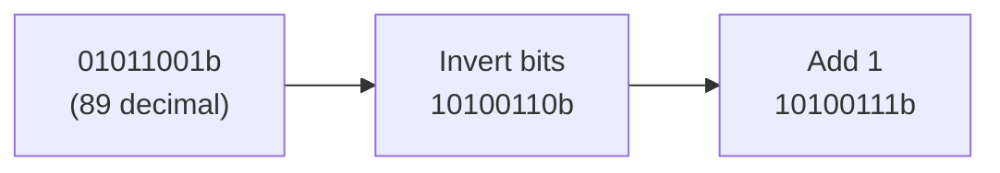
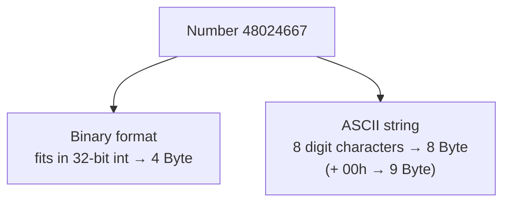
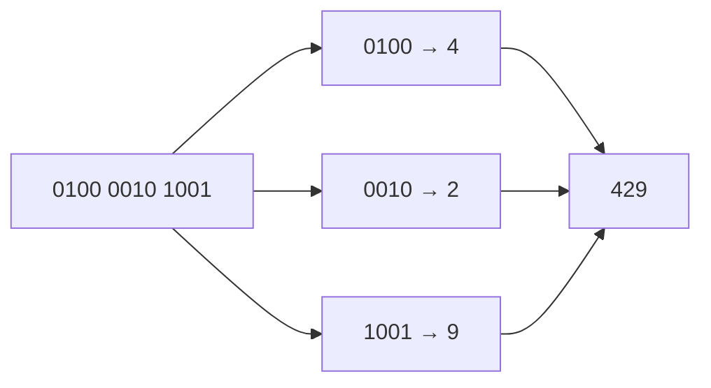
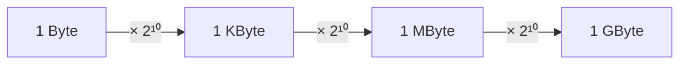

# Exercise 01 · Storage and interpretation of information

| | |
|---|---|
| Student | Becky |
| Subject | Informatik · Einführung in die Informatik (Hochschule Hannover) |
| Language | Written |
| Created | 2026-10-23 |

## The story in one sentence

A computer only stores **bits**. The same bits can mean a number, a letter, or a size label — like the same Lego brick used as a wheel, a window, or a door. Today you learn how to read and write those bits the way the course expects.

## Tasks

Do them in order. Every task has its own folder with the task, a desk for your written answers (`my-solution/`) and the sample solution (`solution/`).

<!-- index:start -->
| Task | Topic | Status |
|------|-------|--------|
| 01_1 | [Binary complement](task-01-1-binary-complement/README.md) | todo |
| 01_2 | [Bytes for a number](task-01-2-bytes-for-a-number/README.md) | todo |
| 01_3 | [BCD to decimal](task-01-3-bcd-to-decimal/README.md) | todo |
| 01_4 | [KB MB GB](task-01-4-kb-mb-gb/README.md) | todo |
| 01_5 | [Hex bytes as string](task-01-5-hex-bytes-as-string/README.md) | todo |
| 01_6 | [Hallo in ASCII](task-01-6-hallo-in-ascii/README.md) | todo |
| 01_7 | [Decode ASCII bytes](task-01-7-decode-ascii-bytes/README.md) | todo |
<!-- index:end -->

Status words: `todo` → `in progress` → `done`. Change them here when you finish a task (or let `/done` do it).

## How to work

1. Read this page to the end: it explains every new idea once, for all seven tasks.
2. Open the first task and read its `README.md`.
3. Write your answers in its `my-solution/` folder. That is your desk.
4. Check yourself against the check tables in the task.
5. Only when you are done (or really stuck for a long time): look at `solution/`.

In Cursor you can ask for help at any time, without getting the answer: `/next` (where am I?), `/stuck` (stuck or a new word), `/check` (is it right?), `/done` (finished).

These tasks are **written answers** (bit flips, counts, ASCII lookups), not programs. There are no automated `make test-task` checks — your tutor (or `/check`) is the check.

---

## What you will learn

Read this slowly. One picture at a time. Then do the matching task.

### 1. Binary complement — flip every bit, then add one

> [!PICTURE]
> A light board with eight lamps. Each lamp is either **on (1)** or **off (0)**. Binary complement means: flip every lamp, then add one bump on the right.

Tiny steps:

1. **Invert** every bit: 0 becomes 1, 1 becomes 0.
2. **Add** `00000001` (add one in binary).
3. Keep all 8 bits.



**In task 01_1** you do this for `01011001b`.

### 2. Binary number vs text — same digits, different boxes

> [!PICTURE]
> The number **42** on paper. As a **number**, the computer packs it into one bit-box. As **text**, each character (`'4'`, `'2'`) gets its **own** byte — like two separate letter tiles.

Tiny steps:

- As a **binary number**, use the type table (often 8, 16, or 32 bits).
- As an **ASCII string**, count one byte per character.
- A **null-terminated** string also needs one extra `00` byte at the end.



The sheet’s **data-type cheat sheet** (copied as text, not an image):

| Data type | Bits | Value range |
|-----------|------|-------------|
| `char` | 8 | −128 … 127 |
| `unsigned char` | 8 | 0 … 255 |
| `short` | 16 | −32768 … 32767 |
| `unsigned short` | 16 | 0 … 65535 |
| `int` | 32 | −2147483648 … 2147483647 |
| `unsigned int` | 32 | 0 … 4294967295 |
| `long` | 64 | about −9·10¹⁸ … 9·10¹⁸ |
| `unsigned long` | 64 | 0 … about 18·10¹⁸ |
| `float` | 32 | about 1.2·10⁻³⁸ … 3.4·10³⁸ |
| `double` | 64 | about 2.2·10⁻³⁰⁸ … 1.8·10³⁰⁸ |

**In task 01_2** you count bytes for `48024667` both ways (use the table for part (a)).

### 3. BCD — each digit keeps its own nibble

> [!PICTURE]
> Writing a phone number with **one stamp per digit**. **BCD** does that: every decimal digit becomes a **4-bit** group (a **nibble**). Do not glue all bits into one big binary number.

Tiny steps:

1. Split the bit string into groups of 4.
2. Read each group as a digit `0…9`.
3. Glue the digits left to right.



**In task 01_3** you decode one BCD value.

### 4. Kilo, Mega, Giga — powers of 1024

> [!PICTURE]
> Nesting boxes. Each bigger box holds **1024** of the smaller ones. That is `2¹⁰`.

Tiny steps:

1. 1 KByte = 2¹⁰ Byte.
2. 1 MByte = 2²⁰ Byte.
3. 1 GByte = 2³⁰ Byte.

The sheet’s **size-unit cheat sheet** (copied as text, not an image):

| Size unit | Power | Bytes | KBytes | MBytes |
|-----------|-------|-------|--------|--------|
| Byte | — | 1 (= 8 bits) | | |
| Kilobyte (KByte) | `2¹⁰` | 1024 | 1 | |
| Megabyte (MByte) | `2²⁰` | 1 048 576 | 1024 | 1 |
| Gigabyte (GByte) | `2³⁰` | 1 073 741 824 | 1 048 576 | 1024 |
| Terabyte (TByte) | `2⁴⁰` | … | 1 073 741 824 | 1 048 576 |
| Petabyte (PByte) | `2⁵⁰` | … | … | 1 073 741 824 |
| Exabyte (EByte) | `2⁶⁰` | … | … | … |



**In task 01_4** you write KByte / MByte / GByte as powers (and may also write the plain byte count).

### 5. ASCII — a table from byte to letter

> [!PICTURE]
> A dictionary: each byte value (often written in **hex** with an `h`, like `48h`) maps to one character — like a code book for letters.

Tiny steps:

1. Look up each byte in the ASCII table.
2. Write the matching character.
3. Stop at `00h` if the string is null-terminated (that byte is not a letter).

| Hex range | Characters |
|-----------|------------|
| `30h` … `39h` | digits `'0'` … `'9'` |
| `41h` … `5Ah` | uppercase letters |
| `61h` … `7Ah` | lowercase letters |
| `00h` | end of a **null-terminated** string (not printed) |

```mermaid
flowchart LR
  Hex["Hex bytes<br/>37h 30h 35h 39h"] --> Str["ASCII string<br/>\"7059\""]
  Word["\"Hallo\" + null"] --> Bytes["48 61 6C 6C 6F 00h"]
```

**In tasks 01_5–01_7** you go both ways: bytes → text and text → bytes.

---

## Words to know

| Word | Means |
|------|-------|
| **bit** | Smallest piece of information: 0 or 1 |
| **byte** | 8 bits |
| **binary complement** | Invert all bits, then add 1 (two’s complement step) |
| **BCD** | Binary-Coded Decimal: each decimal digit stored in 4 bits |
| **nibble** | 4 bits (half a byte) |
| **ASCII** | Table that maps byte values to characters |
| **hex / `h`** | Base-16 writing of a byte, e.g. `48h` |
| **null-terminated** | A string that ends with the byte `00h` |
| **KByte / MByte / GByte** | 2¹⁰ / 2²⁰ / 2³⁰ bytes (as used on this sheet) |

## Source

Prof. Dr. Jens Paßlick, Abteilung Wirtschaftsinformatik — *Einführung in die Informatik* (WiSe 2026/27), **1. Übung: Speicherung und Interpretation von Information**. Translated into English here; numbers and meanings match the sheet (including the official sample answers). Sheet tables and process arrows are rebuilt as Markdown / Mermaid — no images.

Back to [all exercises](../README.md).
