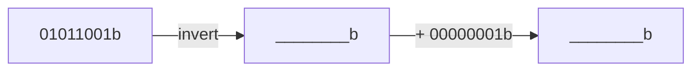

# Task 01_1 · Binary complement

Part of [Exercise 01 · Storage and interpretation of information](../README.md). New ideas you need: binary complement (invert, then add 1). They are explained in the exercise page.

| Folder | What it is |
|--------|-----------|
| [`my-solution/`](my-solution/README.md) | **Your desk.** Write the bit steps there |
| [`solution/`](solution/README.md) | The sample solution. Peek only when you are done |

## The task (from the sheet)

*(Translated into English from the course sheet.)*

Form the **binary complement** of the 8-bit binary number `01011001b`.

## The task, simply said

1. Start from `01011001`.
2. Invert every bit.
3. Add `00000001` in binary.
4. Write the 8-bit result (you may keep the `b` suffix).

## Check examples

| You look at | You should see |
|-------------|----------------|
| After invert | `10100110` |
| After +1 | `10100111` |
| Decimal hint on the sheet | `01011001b` = 89 decimal (optional check) |

## Little helpers

What does “invert” mean bit by bit?

Every `0` becomes `1`, every `1` becomes `0`. Do not shift or reorder the bits.

How do I add 1 in binary?

Add `1` to the rightmost bit. If that bit was `1`, it becomes `0` and you carry 1 to the left — same idea as decimal, but with only digits 0 and 1.

Must the answer stay 8 bits?

Yes. This task starts from an 8-bit pattern, so the result is also 8 bits.

## Done when

- [ ] You wrote the inverted pattern.
- [ ] You added one and got an 8-bit result.
- [ ] You can explain out loud: invert first, then +1.

Next: [Task 01_2](../task-01-2-bytes-for-a-number/README.md)
