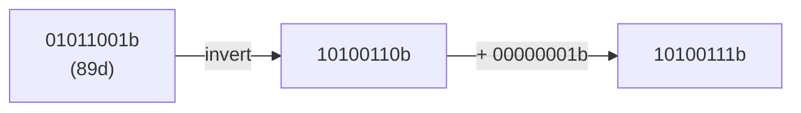

# Sample solution · Task 01_1 🏁

> Stop! Did you try it yourself first? Good. Then read on.

## How to check

Written answer — no compile step. Match the bits below.

## How it works, step by step

### 1. Aim

Find the **binary complement** (two’s complement of the bit pattern) of

```text
01011001b   (= 89 decimal)
```

Keep all **8 bits**.

### 2. Recall the two small steps

Binary (two’s) complement of an 8-bit pattern:

1. **Invert** every bit (`0↔1`).
2. **Add 1** to that result (binary add, keep 8 bits).



### 3. Step — invert in place

Write the bits under each other so you do not reverse the string:

| Position | 7 | 6 | 5 | 4 | 3 | 2 | 1 | 0 |
|----------|---|---|---|---|---|---|---|---|
| Given | 0 | 1 | 0 | 1 | 1 | 0 | 0 | 1 |
| Invert | 1 | 0 | 1 | 0 | 0 | 1 | 1 | 0 |

So after invert: `10100110b`.

*Why not reverse?* Complement flips each bit where it sits; it does not mirror the word.

### 4. Step — add 1

```text
  10100110
+ 00000001
----------
  10100111
```

No carry storm here: only the last bit flips from `0` to `1`.

### 5. Final answer

```text
10100111b
```

### 6. Mini-check

- Still 8 bits? Yes.
- Only inverted (forgot +1)? That would be `10100110` — wrong for two’s complement.
- Decimal sense check (optional): two’s complement of 89 in 8 bits is −89, whose 8-bit pattern is `10100111`.

## Common mistakes

| Mistake | What you see | Fix |
|---------|--------------|-----|
| Only invert, forget +1 | `10100110` | Binary complement needs the +1 step |
| Flip left↔right | Wrong pattern | Invert in place; do not reverse the string |
| Drop leading bits after +1 | Too few bits | Keep all 8 bits |

Back to [Task 01_1](../README.md).
