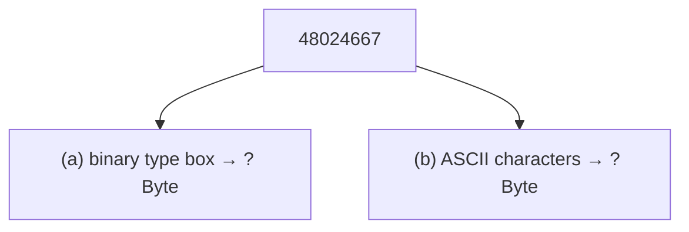

# Task 01_2 · Bytes for a number

Part of [Exercise 01 · Storage and interpretation of information](../README.md). New ideas you need: binary storage size vs ASCII string size. They are explained in the exercise page.

| Folder | What it is |
|--------|-----------|
| [`my-solution/`](my-solution/README.md) | **Your desk.** Write both answers there |
| [`solution/`](solution/README.md) | The sample solution. Peek only when you are done |

## The task (from the sheet)

*(Translated into English from the course sheet.)*

How many **bytes** does storing the number `48024667` need, if it is stored

- (a) in **binary** format, and
- (b) as a **character string** in **ASCII** format?

## The task, simply said

1. Part (a): choose the usual fixed-width binary box that can hold this integer (use the type table below).
2. Convert that bit width into **bytes**.
3. Part (b): count the digits in the decimal writing `48024667` — each digit is one ASCII byte. Say whether you also count a trailing null byte.

### Type table from the sheet (for part a)

| Data type | Bits | Value range |
|-----------|------|-------------|
| `char` | 8 | −128 … 127 |
| `unsigned char` | 8 | 0 … 255 |
| `short` | 16 | −32768 … 32767 |
| `unsigned short` | 16 | 0 … 65535 |
| `int` | 32 | −2147483648 … 2147483647 |
| `unsigned int` | 32 | 0 … 4294967295 |
| `long` | 64 | about −9·10¹⁸ … 9·10¹⁸ |
| `unsigned long` | 64 | 0 … about 18·10¹⁸ |
| `float` | 32 | about 1.2·10⁻³⁸ … 3.4·10³⁸ |
| `double` | 64 | about 2.2·10⁻³⁰⁸ … 1.8·10³⁰⁸ |

## Check examples

| Part | Idea | Expected answer (sheet) |
|------|------|-------------------------|
| (a) | Fits in 32-bit integer | 32 bit = **4 Byte** |
| (b) | Eight digit characters | **8 Bytes** by definition, or **9 Bytes** with null termination |

## Little helpers

Why 32 bits and not 16?

`48024667` is larger than 65535 (`unsigned short` max). It is smaller than about 2·10⁹, so a 32-bit `int` / `unsigned int` box is enough. 32 bits ÷ 8 = 4 bytes.

What is “null termination”?

Many C-style strings store an extra byte `00h` after the last character so the computer knows where the text ends. The sheet accepts both “8 without” and “9 with”.

Do spaces or commas count?

No. Use the digits only: `48024667` has eight characters.

## Done when

- [ ] Part (a) is 4 Byte (32 bit).
- [ ] Part (b) states 8 Bytes and/or 9 Bytes with null termination.
- [ ] You can say why binary and ASCII need different amounts of space.

Next: [Task 01_3](../task-01-3-bcd-to-decimal/README.md)
