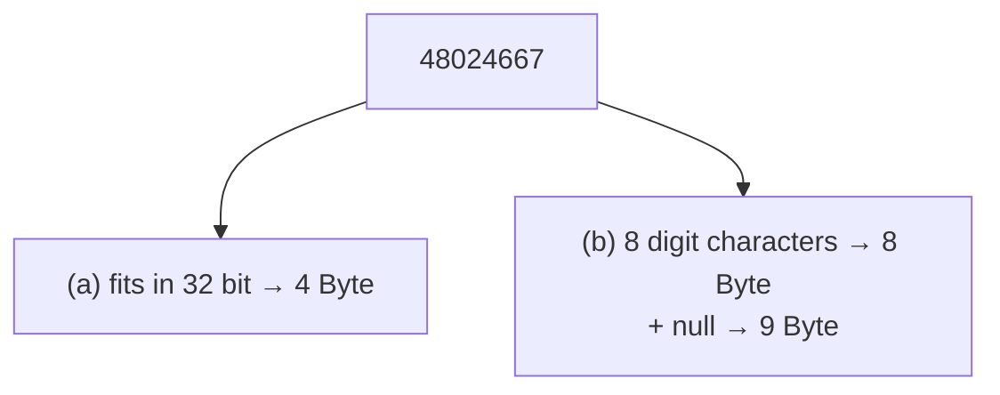

# Sample solution · Task 01_2 🏁

> Stop! Did you try it yourself first? Good. Then read on.

## How to check

Written answer — no compile step. Match the counts below.

## How it works, step by step

### 1. Aim

For the number `48024667`, say how many **bytes** you need

- (a) as a binary integer type, and  
- (b) as an ASCII digit string.

### 2. Picture first

> [!PICTURE]
> Same number, two packing styles.  
> (a) One **number box** sized from the type table.  
> (b) A row of **letter tiles** — one tile per digit character.

### 3. Part (a) — binary / integer storage

Tiny steps:

1. Ask: does it fit in 16 bits?  
   `unsigned short` max is `65535`.  
   `48024667 > 65535` → **no**, 2 bytes are not enough.
2. Ask: does it fit in 32 bits?  
   `unsigned int` / `int` (32-bit) goes up to about 4 billion.  
   `48024667` fits easily → **32 bits**.
3. Convert bits to bytes: `32 bit ÷ 8 = 4 Byte`.

**Answer (a): 4 Byte**

### 4. Part (b) — ASCII character string

Tiny steps:

1. Write the number as text: `48024667`.
2. Count characters: **8** digits.
3. In ASCII, one character = one byte → **8 Bytes** for the digits alone.
4. If the string is null-terminated (C-style), add one `00h` byte → **9 Bytes**.

**Answer (b): 8 Bytes** (digits only), or **9 Bytes** with a trailing null — say which you mean.

### 5. Mini-check

- (a) is about **numeric range**, not about how many digit characters you see.
- (b) is about **characters**, not about binary magnitude.

## Common mistakes

| Mistake | What you see | Fix |
|---------|--------------|-----|
| Using 16 bits for (a) | 2 Byte | Check the value against 65535 |
| Counting bits for (b) | Huge number | ASCII stores *characters*, one byte each |
| Forgetting the optional null | Only one of 8/9 | Sheet allows both; say which you mean |

Back to [Task 01_2](../README.md).
