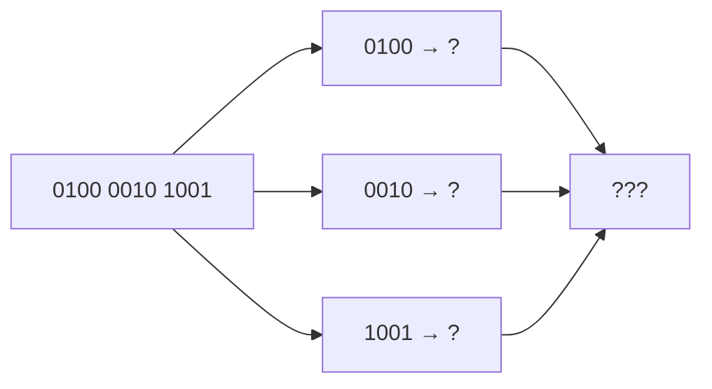

# Task 01_3 · BCD to decimal

Part of [Exercise 01 · Storage and interpretation of information](../README.md). New ideas you need: BCD (one decimal digit per 4 bits). They are explained in the exercise page.

| Folder | What it is |
|--------|-----------|
| [`my-solution/`](my-solution/README.md) | **Your desk.** Write the decimal number there |
| [`solution/`](solution/README.md) | The sample solution. Peek only when you are done |

## The task (from the sheet)

*(Translated into English from the course sheet.)*

The following number is **BCD-coded**: `0100 0010 1001`. Which **decimal** number is it?

## The task, simply said

1. Split the bits into groups of four (already spaced for you).
2. Read each group as a binary digit from 0 to 9.
3. Write those digits next to each other as one decimal number.

## Check examples

| Nibble | Binary | Decimal digit |
|--------|--------|---------------|
| first | `0100` | 4 |
| second | `0010` | 2 |
| third | `1001` | 9 |
| whole | | **429** |

## Little helpers

What is a valid BCD nibble?

Only `0000` … `1001` (0 … 9). Values like `1010` (10) are not used as a single BCD digit.

Do I convert the whole bit string as one binary integer?

No. That would treat it as a normal binary number. BCD keeps **each digit separate**.

## Done when

- [ ] Each nibble is mapped to a digit 0–9.
- [ ] The decimal answer is written as one number.
- [ ] You can explain why BCD is not the same as “all bits as one binary value”.

Next: [Task 01_4](../task-01-4-kb-mb-gb/README.md)
