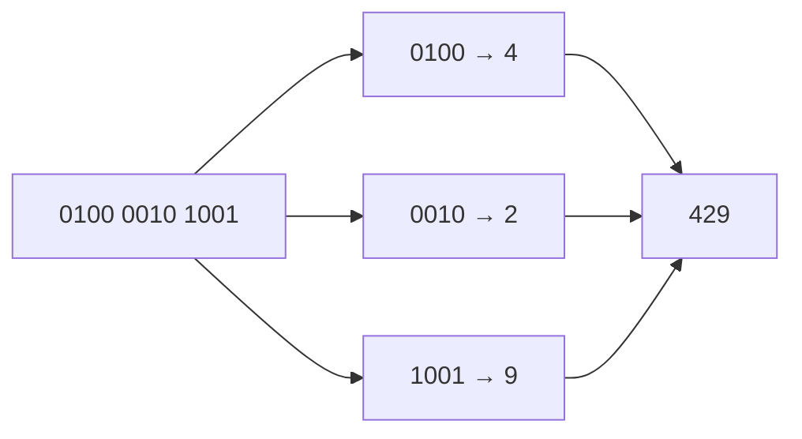

# Sample solution · Task 01_3 🏁

> Stop! Did you try it yourself first? Good. Then read on.

## How to check

Written answer — no compile step. Match the number below.

## How it works, step by step

### 1. Aim

Read the BCD bit string `0100 0010 1001` as a decimal number.

### 2. What BCD means here

BCD = **Binary-Coded Decimal**: every **nibble** (4 bits) stands for **one decimal digit** `0…9`.  
You do **not** treat the whole 12-bit string as one binary integer.

### 3. Split into nibbles (left = highest digit)

```text
0100   0010   1001
```

### 4. Translate each nibble

| Nibble | Binary value | Decimal digit |
|--------|--------------|---------------|
| `0100` | 4 | **4** |
| `0010` | 2 | **2** |
| `1001` | 9 | **9** |

*How:* `0100` = 4, `0010` = 2, `1001` = 8+1 = 9.

### 5. Glue the digits in order

Left to right: `4`, then `2`, then `9` → **429**.



### 6. Final answer

**429**

### 7. Mini-check (what not to do)

If you read all 12 bits as one binary number:  
`010000101001`₂ = 1065₁₀ — that is a different encoding, **not** BCD.

## Common mistakes

| Mistake | What you see | Fix |
|---------|--------------|-----|
| Read all 12 bits as one binary number | 1065 | Split into nibbles first |
| Mix up nibble order | 924 or similar | Left nibble is the highest digit |
| Treat `1001` as hex only | Confusion | In BCD it is simply decimal 9 |

Back to [Task 01_3](../README.md).
