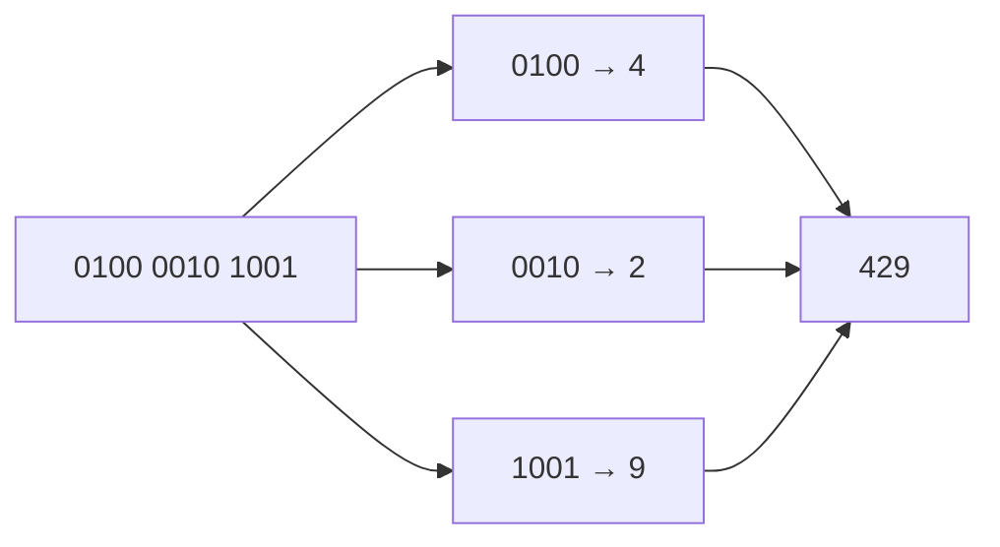

# Sample solution · Task 01_3 🏁

> Stop! Did you try it yourself first? Good. Then read on.

## How to check

Written answer — no compile step. Match the number below.

## How it works, step by step

### 1. Aim

Read the BCD bit string `0100 0010 1001` as a decimal number.

### 2. Picture first

> [!PICTURE]
> A phone number stamped **one digit at a time**.  
> Each stamp is 4 bits (a **nibble**).  
> BCD means: read each stamp as its own decimal digit. Do **not** glue all bits into one big binary number.

### 3. Recipes on the table

| Recipe | What you do | When |
|--------|-------------|------|
| **BCD decode** | Split into 4-bit stamps → digit each → glue | Sheet says BCD — **this task** |
| One big binary number | Read all 12 bits as a single integer | Different encoding — wrong here |

| Thinking | |
|----------|--|
| What does the sheet say? | BCD |
| Choose | Split into nibbles |
| Why not one big binary? | That would give 1065 — not BCD |

### 4. Split into stamps (nibbles)

Left stamp = highest digit.

```text
0100   0010   1001
```

Three stamps. Three digits.

### 5. Translate each stamp

Count the place values inside one nibble: `8 4 2 1`.

**Stamp `0100`**

- Only the “4” lamp is on.
- Digit = **4**

**Stamp `0010`**

- Only the “2” lamp is on.
- Digit = **2**

**Stamp `1001`**

- The “8” lamp and the “1” lamp are on.
- Digit = 8 + 1 = **9**

| Nibble | Decimal digit |
|--------|---------------|
| `0100` | **4** |
| `0010` | **2** |
| `1001` | **9** |

### 6. Glue the digits in order

Left to right: `4`, then `2`, then `9`.

```text
429
```



### 7. Final answer

**429**

### 8. Mini-check (what not to do)

If you read all 12 bits as one binary number:

```text
010000101001₂ = 1065₁₀
```

That is a different encoding. **Not** BCD.

## Common mistakes

| Mistake | What you see | Fix |
|---------|--------------|-----|
| Read all 12 bits as one binary number | 1065 | Split into nibbles first |
| Mix up nibble order | 924 or similar | Left nibble is the highest digit |
| Treat `1001` as hex only | Confusion | In BCD it is simply decimal 9 |

Back to [Task 01_3](../README.md).
