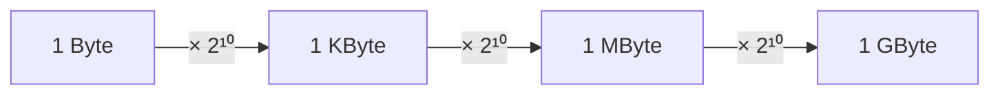

# Task 01_4 · KB MB GB

Part of [Exercise 01 · Storage and interpretation of information](../README.md). New ideas you need: binary kilo / mega / giga (powers of 1024). They are explained in the exercise page.

| Folder | What it is |
|--------|-----------|
| [`my-solution/`](my-solution/README.md) | **Your desk.** Write the three sizes there |
| [`solution/`](solution/README.md) | The sample solution. Peek only when you are done |

## The task (from the sheet)

*(Translated into English from the course sheet.)*

How many **bytes** are **1 Kilobyte**, **1 Megabyte** and **1 Gigabyte**? Giving the answer as a **power of two** is enough.

## The task, simply said

1. Remember: on this sheet, 1 KByte = 1024 Byte = `2¹⁰` Byte.
2. 1 MByte stacks another 1024: `2²⁰` Byte.
3. 1 GByte stacks once more: `2³⁰` Byte.
4. You may also write the plain decimal byte counts if you like.

### Size table from the sheet

| Size unit | Power | Bytes | KBytes | MBytes |
|-----------|-------|-------|--------|--------|
| Byte | — | 1 (= 8 bits) | | |
| Kilobyte (KByte) | `2¹⁰` | 1024 | 1 | |
| Megabyte (MByte) | `2²⁰` | 1 048 576 | 1024 | 1 |
| Gigabyte (GByte) | `2³⁰` | 1 073 741 824 | 1 048 576 | 1024 |
| Terabyte (TByte) | `2⁴⁰` | … | 1 073 741 824 | 1 048 576 |
| Petabyte (PByte) | `2⁵⁰` | … | … | 1 073 741 824 |
| Exabyte (EByte) | `2⁶⁰` | … | … | … |

## Check examples

| Unit | Power form | Decimal bytes (optional) |
|------|------------|--------------------------|
| 1 KByte | `2¹⁰` Byte | 1024 |
| 1 MByte | `2²⁰` Byte | 1 048 576 |
| 1 GByte | `2³⁰` Byte | 1 073 741 824 |

## Little helpers

Why 1024 and not 1000?

This course uses the **binary** sizes (powers of 2). Marketing “GB” sometimes means 1000³ — not on this sheet.

How do the exponents add?

`1024 · 1024 = 2¹⁰ · 2¹⁰ = 2²⁰`. Same idea for Giga: three factors of `2¹⁰` → `2³⁰`.

## Done when

- [ ] All three units are written as powers of two (or matching decimals).
- [ ] You used 1024-based (binary) sizes, not 1000-based SI sizes.
- [ ] You can say out loud: Kilo → Mega → Giga multiplies by 1024 each step.

Next: [Task 01_5](../task-01-5-hex-bytes-as-string/README.md)
