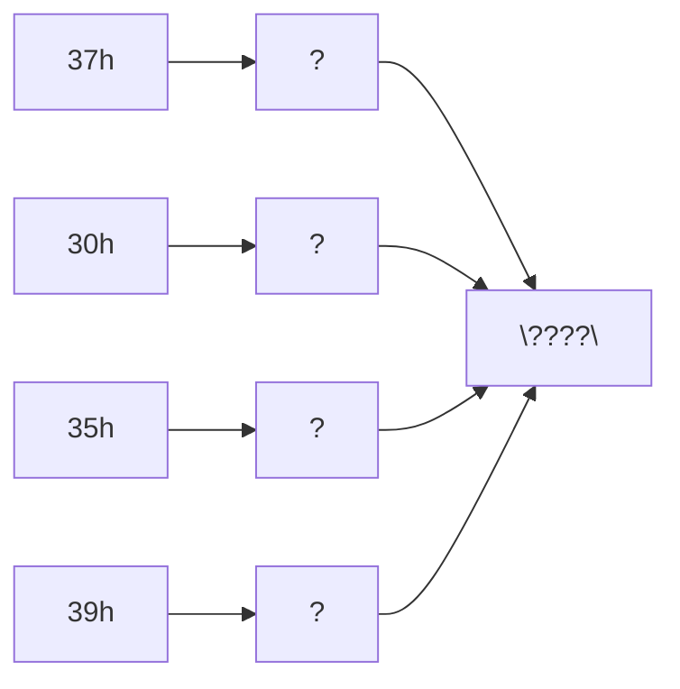

# Task 01_5 · Hex bytes as string

Part of [Exercise 01 · Storage and interpretation of information](../README.md). New ideas you need: ASCII lookup from hex bytes. They are explained in the exercise page.

| Folder | What it is |
|--------|-----------|
| [`my-solution/`](my-solution/README.md) | **Your desk.** Write the decoded string there |
| [`solution/`](solution/README.md) | The sample solution. Peek only when you are done |

## The task (from the sheet)

*(Translated into English from the course sheet.)*

Given the byte sequence `37h`, `30h`, `35h`, `39h`. Which numbers (characters) do you get when the computer interprets this sequence as a **character string**?

## The task, simply said

1. Take each hex byte in order.
2. Look up its ASCII character (digits live at `30h` … `39h`).
3. Write the four characters as one string.

## Check examples

| Byte | ASCII character |
|------|-----------------|
| `37h` | `'7'` |
| `30h` | `'0'` |
| `35h` | `'5'` |
| `39h` | `'9'` |
| whole | **`"7059"`** |

## Little helpers

Quick rule for digit bytes

`3Xh` is digit character `'X'` when X is 0–9. Example: `35h` → `'5'`.

Is the answer a number or a string?

It is the **string** of digit characters `"7059"`. The computer is not adding them as a binary integer here — it is reading text.

## Done when

- [ ] Each of the four bytes has a character.
- [ ] The string is written in the same order as the bytes.
- [ ] You can explain why `30h` is `'0'`, not the number 30.

Next: [Task 01_6](../task-01-6-hallo-in-ascii/README.md)
