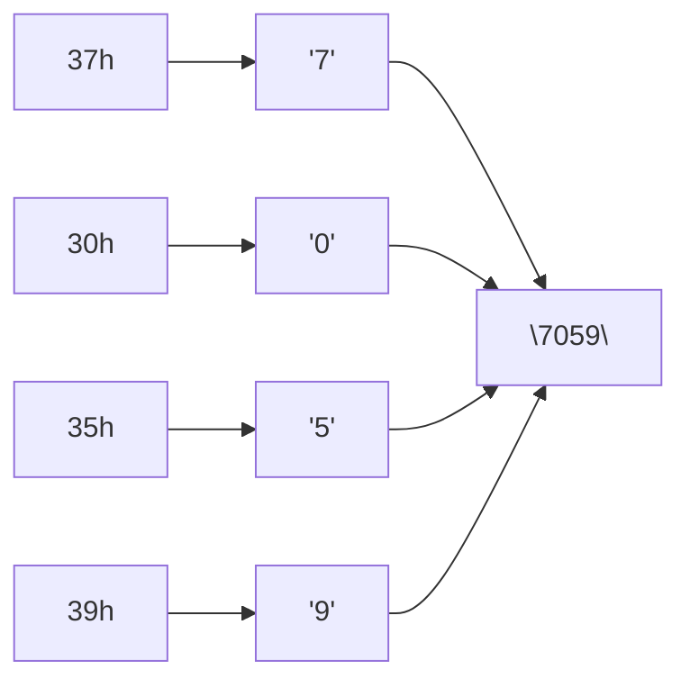

# Sample solution · Task 01_5 🏁

> Stop! Did you try it yourself first? Good. Then read on.

## How to check

Written answer — no compile step. Decode one byte at a time, then join the characters.

## How it works, step by step

**Given bytes:** `37h`, `30h`, `35h`, `39h`

**What the task asks:** treat each byte as an **ASCII character**, not as one big binary number.

### Step 0 — Picture first

> [!PICTURE]
> A code book. Each hex byte is one page. You look up the page and write the letter (or digit) you find. Then you join the letters left to right.

### Step 1 — Remember the digit shortcut

In ASCII, digit characters live here:

```text
'0' = 30h
'1' = 31h
'2' = 32h
…
'9' = 39h
```

Rule of thumb: hex `3Xh` (with X from 0…9) is the character digit `'X'`.

### Step 2 — Decode each byte in order

| Byte | Shortcut | Character |
|------|----------|-----------|
| `37h` | `3` + digit 7 | `'7'` |
| `30h` | `3` + digit 0 | `'0'` |
| `35h` | `3` + digit 5 | `'5'` |
| `39h` | `3` + digit 9 | `'9'` |

### Step 3 — Keep the same left-to-right order

The computer reads the bytes in the order given. So the string is built as:

```text
'7' then '0' then '5' then '9'
```



**Answer:** `"7059"`

### What this is *not*

- Not the decimal number built from hex digits `37303539`.
- Not the integer value of those four bytes stuck together.
- It is the **text** the ASCII table prints for those four codes.

## Common mistakes

| Mistake | What you see | Fix |
|---------|--------------|-----|
| Writing the hex digits as text | `"37303539"` | One *byte* → one *character* |
| Reversing the order | `"9507"` | Keep left-to-right |
| Treating as one integer | A large number | The task asks for a string |

Back to [Task 01_5](../README.md).
