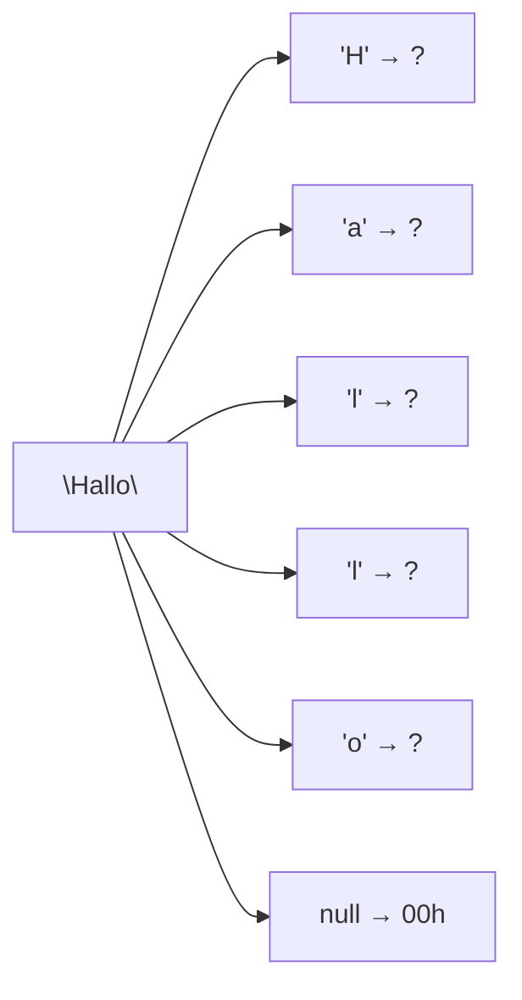

# Task 01_6 · Hallo in ASCII

Part of [Exercise 01 · Storage and interpretation of information](../README.md). New ideas you need: ASCII encoding and null termination. They are explained in the exercise page.

| Folder | What it is |
|--------|-----------|
| [`my-solution/`](my-solution/README.md) | **Your desk.** Write the byte sequence there |
| [`solution/`](solution/README.md) | The sample solution. Peek only when you are done |

## The task (from the sheet)

*(Translated into English from the course sheet.)*

Give the resulting **byte sequence** for storing the string `"Hallo"` (**null-terminated**) in **ASCII** format.

## The task, simply said

1. Encode each letter of `Hallo` as one ASCII hex byte.
2. Append the null byte `00h` at the end.
3. Write the full sequence (spaces between bytes are fine; keep the `h` if you like).

## Check examples

| Character | ASCII hex |
|-----------|-----------|
| `'H'` | `48h` |
| `'a'` | `61h` |
| `'l'` | `6Ch` |
| `'l'` | `6Ch` |
| `'o'` | `6Fh` |
| end | `00h` |
| whole | **`48 61 6C 6C 6F 00h`** |

## Little helpers

Uppercase vs lowercase

`'H'` is uppercase → `48h`. `'a'` is lowercase → `61h`. Case matters.

Why two times `6Ch`?

The word has two `'l'` letters in a row. Same character → same byte, twice.

Must I write the trailing `h`?

The sheet shows `… 00h`. Writing `48 61 6C 6C 6F 00` with a note that values are hex is also clear — match the sheet style when you can.

## Done when

- [ ] Five letter bytes are correct and in order.
- [ ] The sequence ends with `00h`.
- [ ] You did not add spaces or quotes as extra bytes.

Next: [Task 01_7](../task-01-7-decode-ascii-bytes/README.md)
