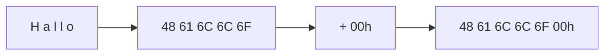

# Sample solution · Task 01_6 🏁

> Stop! Did you try it yourself first? Good. Then read on.

## How to check

Written answer — no compile step. Encode letter by letter, then add the null byte.

## How it works, step by step

**String:** `"Hallo"`  
**Extra rule:** **null-terminated** → append `00h` at the end.

### Step 1 — Split the word into characters

```text
H   a   l   l   o
```

Note: first letter is **uppercase** `H`; the others are **lowercase**. Case changes the ASCII code.

### Step 2 — Look up each character in ASCII (hex)

Useful anchors:

```text
'A' = 41h … 'H' = 48h … 'Z' = 5Ah   (uppercase)
'a' = 61h … 'l' = 6Ch … 'o' = 6Fh … 'z' = 7Ah   (lowercase)
```

Now letter by letter:

| Character | How to find it | Hex |
|-----------|----------------|-----|
| `'H'` | uppercase, 8th letter after `'A'` → `41h + 7` | `48h` |
| `'a'` | start of lowercase block | `61h` |
| `'l'` | `'a'` + 11 → `61h + 0Bh` | `6Ch` |
| `'l'` | same as previous `'l'` | `6Ch` |
| `'o'` | `'a'` + 14 → `61h + 0Eh` | `6Fh` |

### Step 3 — Add the null terminator

Null-terminated means: “after the last letter, store one more byte that is all zeros.”

```text
00h
```

That byte is **not** a printable character. It only marks the end.

### Step 4 — Write the full sequence



```text
48  61  6C  6C  6F  00 h
 H   a   l   l   o  end
```

**Answer:** `48 61 6C 6C 6F 00h`

## Common mistakes

| Mistake | What you see | Fix |
|---------|--------------|-----|
| Forgetting `00h` | Only five bytes | Null-terminated = extra zero byte |
| Encoding `'H'` as lowercase | `68h …` | First letter is uppercase `48h` |
| Using decimal codes | `72 97 108 …` | Sheet wants hex |

Back to [Task 01_6](../README.md).
