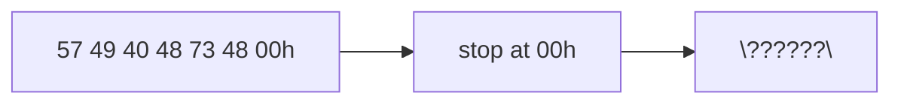

# Task 01_7 · Decode ASCII bytes

Part of [Exercise 01 · Storage and interpretation of information](../README.md). New ideas you need: ASCII decode and the null terminator. They are explained in the exercise page.

| Folder | What it is |
|--------|-----------|
| [`my-solution/`](my-solution/README.md) | **Your desk.** Write the decoded string there |
| [`solution/`](solution/README.md) | The sample solution. Peek only when you are done |

## The task (from the sheet)

*(Translated into English from the course sheet.)*

Which **character string** is encoded by the byte sequence `57 49 40 48 73 48 00h` in **ASCII** format?

## The task, simply said

1. Decode each hex byte to an ASCII character until you hit `00h`.
2. Do **not** print the null as a letter — it only marks the end.
3. Write the resulting string in quotes.

## Check examples

| Byte | Character |
|------|-----------|
| `57h` | `'W'` |
| `49h` | `'I'` |
| `40h` | `'@'` |
| `48h` | `'H'` |
| `73h` | `'s'` |
| `48h` | `'H'` |
| `00h` | end (not printed) |
| whole | **`"WI@HsH"`** |

## Little helpers

What is `40h`?

In ASCII, `40h` is the `'@'` sign.

Why does the string stop at `00h`?

Null-terminated strings end there. The `00` byte is storage, not a visible character in the answer.

Case of letters

`57h` is uppercase `'W'`; `73h` is lowercase `'s'`. Keep the case from the table.

## Done when

- [ ] Every byte before `00h` is decoded.
- [ ] The answer string is `"WI@HsH"`.
- [ ] You did not add a visible character for `00h`.

Back to [Exercise 01](../README.md) when you finish — or run `/done`.
