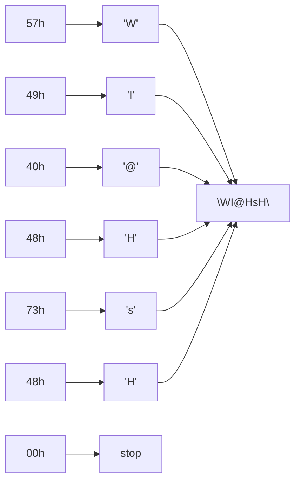

# Sample solution · Task 01_7 🏁

> Stop! Did you try it yourself first? Good. Then read on.

## How to check

Written answer — no compile step. Decode until `00h`, then stop.

## How it works, step by step

**Given:** `57 49 40 48 73 48 00h`

This is the reverse of task 01_6: bytes → characters.

### Step 1 — Plan: stop at the null

The last byte is `00h`. That means “string ends here.”  
Decode everything **before** it. Do **not** invent a printable character for `00h`.

### Step 2 — Useful ASCII landmarks

```text
uppercase: 'A'=41h … 'H'=48h … 'I'=49h … 'W'=57h … 'Z'=5Ah
lowercase: 'a'=61h … 's'=73h … 'z'=7Ah
symbol:    '@' = 40h
```

### Step 3 — Decode one byte at a time

| Byte | Landmark | Character |
|------|----------|-----------|
| `57h` | uppercase `'W'` (`'A'` + 22) | `'W'` |
| `49h` | uppercase `'I'` (`'A'` + 8) | `'I'` |
| `40h` | the `@` sign | `'@'` |
| `48h` | uppercase `'H'` | `'H'` |
| `73h` | lowercase `'s'` (`'a'` + 18) | `'s'` |
| `48h` | uppercase `'H'` again | `'H'` |
| `00h` | terminator | *(stop)* |

### Step 4 — Join the characters in order

```text
W  I  @  H  s  H
```



**Answer:** `"WI@HsH"`

### Tiny self-check

- Third character really is `@` (because of `40h`), not skipped.
- Fifth character is lowercase `s` (`73h`), not uppercase `S` (`53h`).
- No seventh letter from the null byte.

## Common mistakes

| Mistake | What you see | Fix |
|---------|--------------|-----|
| Skipping `'@'` | `"WIHsH"` | `40h` is a real character |
| Printing something for `00h` | Extra junk | Stop before the null |
| Wrong case on `'s'` | `"WI@HSH"` | `73h` is lowercase |

Back to [Task 01_7](../README.md).
