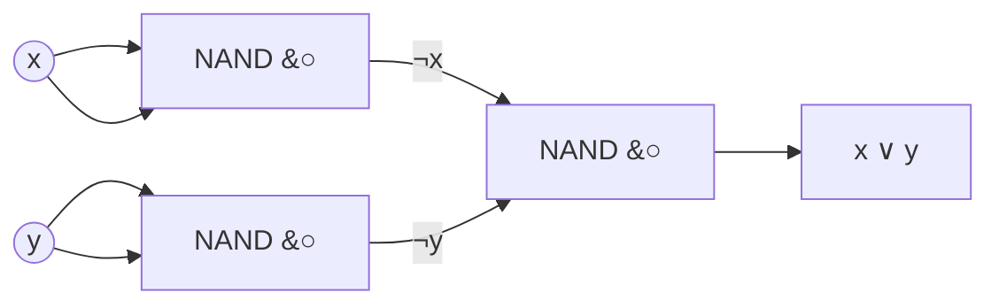
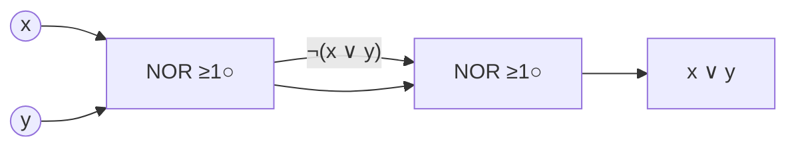

# Sample solution · Task 02_1 🏁

> Stop! Did you try it yourself first? Good. Then read on.

## How to check

Written formulas and sketches — no compile step. Read the tiny steps, then compare your drawing to the final sketch.

---

## Goal

Build a circuit whose output is **`x ∨ y`** (OR: at least one input is 1).

- Part **a**: you may use **only NAND** gates.
- Part **b**: you may use **only NOR** gates.

---

## a) OR from NAND only — small steps

### Step 1 — Remember what NAND does

NAND means “AND, then flip”:

```text
NAND(u, v) = ¬(u ∧ v)
```

If you feed the **same** wire into both inputs, you get a **NOT**:

```text
NAND(x, x) = ¬(x ∧ x) = ¬x
```

Picture: one NAND brick with both legs tied to `x` is an inverter.

### Step 2 — Find a Boolean identity that uses AND and NOT only

De Morgan’s law says OR is the same as “NAND of the inverted inputs”:

```text
x ∨ y  =  ¬(¬x ∧ ¬y)
```

Why? `¬x ∧ ¬y` is 1 only when **both** are 0. Flip that → 1 whenever **at least one** of `x`, `y` is 1. That is OR.

So the formula on the solution sheet is:

```text
NAND:  (x ∨ y) = ¬(¬x ∧ ¬y)
```

### Step 3 — Turn each piece into a NAND

| Piece in the formula | Build it with NAND |
|----------------------|--------------------|
| `¬x` | NAND with both inputs = `x` |
| `¬y` | NAND with both inputs = `y` |
| `¬(¬x ∧ ¬y)` | one more NAND whose inputs are those two outputs |

You need **three** NAND gates in total.

### Step 4 — Draw it (IEC boxes)

`&` inside the box + bubble `o` on the **output** = NAND.

```text
          ┌───┐
    x ────┤   │
          │ & │o──── ¬x ────┐
    x ────┤   │             │     ┌───┐
          └───┘             ├─────┤   │
                            │     │ & │o──── x ∨ y
          ┌───┐             ├─────┤   │
    y ────┤   │             │     └───┘
          │ & │o──── ¬y ────┘
    y ────┤   │
          └───┘
```



### Step 5 — Walk one example through the wires

Take `x = 1`, `y = 0` (OR should be **1**):

1. Left NAND: `NAND(1,1) = ¬1 = 0` → wire `¬x = 0`.
2. Right NAND: `NAND(0,0) = ¬0 = 1` → wire `¬y = 1`.
3. Final NAND: `NAND(0, 1) = ¬(0 ∧ 1) = ¬0 = 1` → **OR = 1**. ✓

Try `x = 0`, `y = 0` yourself: both NOTs become 1, final NAND of `(1,1)` is 0.

---

## b) OR from NOR only — small steps

### Step 1 — Remember what NOR does

```text
NOR(u, v) = ¬(u ∨ v)
```

Tied inputs → NOT again: `NOR(z, z) = ¬z`.

### Step 2 — Start from a single NOR

One NOR of `x` and `y` already gives:

```text
NOR(x, y) = ¬(x ∨ y)
```

That is the **opposite** of what we want. So flip it once more.

### Step 3 — Flip with a second NOR

```text
¬( ¬(x ∨ y) )  =  x ∨ y
```

Second NOR: both inputs tied to the first NOR’s output → acts as NOT.

Formula on the sheet:

```text
NOR:  (x ∨ y) = ¬(¬(x ∨ y))
```

Only **two** NOR gates.

### Step 4 — Draw it

`≥1` inside the box + bubble `o` on the **output** = NOR.

```text
          ┌────┐
    x ────┤    │
          │ ≥1 │o──── ¬(x ∨ y) ────┐
    y ────┤    │                   │     ┌────┐
          └────┘                   ├─────┤    │
                                   │     │ ≥1 │o──── x ∨ y
                                   └─────┤    │
                                         └────┘
```



### Step 5 — Walk the same example

`x = 1`, `y = 0`:

1. First NOR: `¬(1 ∨ 0) = ¬1 = 0`.
2. Second NOR as NOT: `¬0 = 1` → **OR = 1**. ✓

---

## Spot checks (both circuits)

| x | y | Wanted OR | After NAND circuit | After NOR circuit |
|---|---|-----------|--------------------|-------------------|
| 0 | 0 | 0         | 0                  | 0                 |
| 0 | 1 | 1         | 1                  | 1                 |
| 1 | 0 | 1         | 1                  | 1                 |
| 1 | 1 | 1         | 1                  | 1                 |

## Common mistakes

| Mistake | What you see | Fix |
|---------|--------------|-----|
| Using a plain OR or AND box in part a | Not “NAND only” | Only NAND symbols |
| Forgetting to invert `x` and `y` before the final NAND | Output is NAND, not OR | Two NOT-NANDs first (Step 3) |
| Part b with only one NOR | Output is `¬(x∨y)` | Add the second NOR as NOT |
| Drawing bubbles on the wrong pin | Wrong polarity | Output bubble = NAND/NOR; input bubble = inverted input |

Back to [Task 02_1](../README.md).
