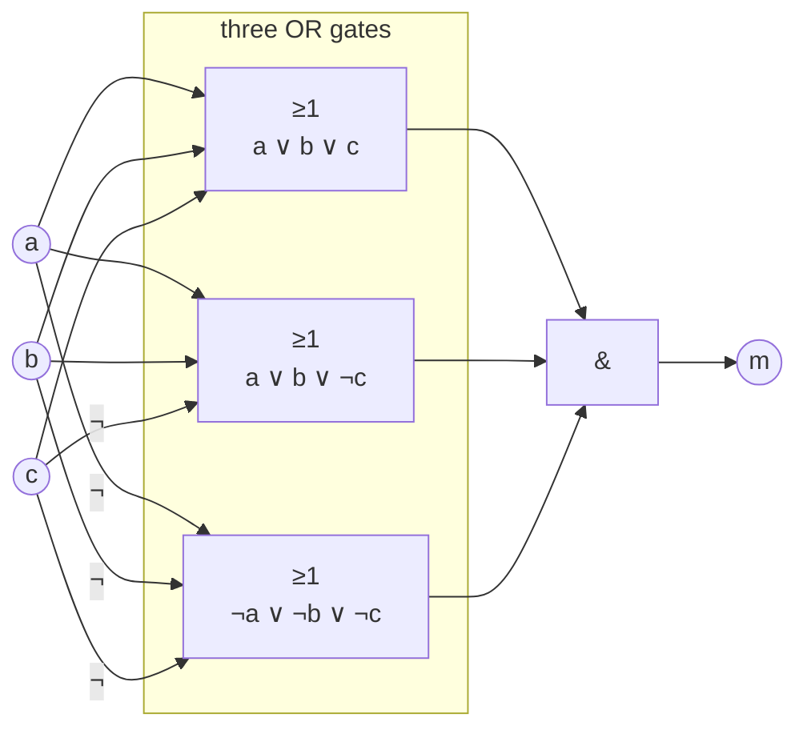
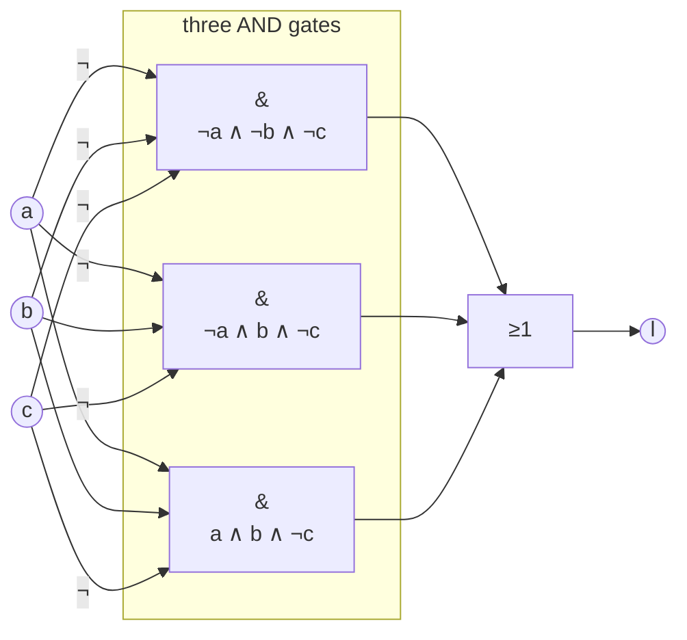

# Sample solution · Task 02_2 🏁

> Stop! Did you try it yourself first? Good. Then read on.

## How to check

Written formulas and sketches — no compile step. Follow the tiny steps; each one builds the next.

---

## Goal

From the truth table for segments **`m`** and **`l`**, write the **smallest** normal form (DNF or CNF) for each, then draw the matching gates. No further algebra shortcuts — stop at the normal form.

Truth table (from the lecture slide):

| a | b | c | m | l |
|---|---|---|---|---|
| 0 | 0 | 0 | 0 | 1 |
| 0 | 0 | 1 | 0 | 0 |
| 0 | 1 | 0 | 1 | 1 |
| 0 | 1 | 1 | 1 | 0 |
| 1 | 0 | 0 | 1 | 0 |
| 1 | 0 | 1 | 1 | 0 |
| 1 | 1 | 0 | 1 | 1 |
| 1 | 1 | 1 | 0 | 0 |

---

## Reminder: how DNF and CNF are built

**DNF** (from the **1**-rows):

1. Keep only rows where the output is **1**.
2. For each such row, write an **AND** of literals that is true **only** in that row (`0` → `¬var`, `1` → `var`).
3. **OR** all those AND-terms together.

**CNF / KNF** (from the **0**-rows):

1. Keep only rows where the output is **0**.
2. For each such row, write an **OR** of literals that is false **only** in that row (`0` → positive `var`, `1` → `¬var`).
3. **AND** all those OR-terms together.

Picture: DNF is “list every winning ticket and OR them”. CNF is “list every losing ticket as a ban, and AND the bans”.

---

## Segment `m` — small steps

### Step 1 — Count 0-rows and 1-rows

Look only at column `m`:

| Kind | Rows `a b c` | How many |
|------|--------------|----------|
| `m = 0` | `000`, `001`, `111` | **3** |
| `m = 1` | `010`, `011`, `100`, `101`, `110` | **5** |

Fewer zeros → **CNF is smaller** (3 clauses beats 5 minterms). Choose **CNF**.

### Step 2 — Build one CNF clause per 0-row

Rule for a 0-row: bit **0** → put the variable **as is**; bit **1** → put **¬variable**. OR them.

| 0-row `a b c` | Clause |
|---------------|--------|
| `0 0 0` | `(a ∨ b ∨ c)` |
| `0 0 1` | `(a ∨ b ∨ ¬c)` |
| `1 1 1` | `(¬a ∨ ¬b ∨ ¬c)` |

Check the middle one: `(a ∨ b ∨ ¬c)` is **0** only when `a=0`, `b=0`, `c=1` — exactly row `001`. Good.

### Step 3 — AND the clauses

```text
KNF / CNF:
m = (a ∨ b ∨ c) ∧ (a ∨ b ∨ ¬c) ∧ (¬a ∨ ¬b ∨ ¬c)
```

### Step 4 — Why this is “small enough”

The sheet says: pick DNF or CNF so the expression is as small as possible, **no further rewriting**. Three OR-terms ANDed is the answer — stop here.

### Step 5 — Spot-check two rows

- Row `000`: first clause `(0∨0∨0)=0` → whole AND is **0**. Matches table.
- Row `010`: `(0∨1∨0)=1`, `(0∨1∨1)=1`, `(1∨0∨1)=1` → **1**. Matches table.

### Step 6 — Draw the circuit

Three vertical rails `a`, `b`, `c`. One **OR** (`≥1`) per clause. Bubbles `o` on inputs that are negated. Feed the three OR outputs into one **AND** (`&`).

```text
 a ─────┬──────────────────┬──────────────────┬────────
        │                  │                  │
 b ─────┼────────┬─────────┼────────┬─────────┼────────
        │        │         │        │         │
 c ─────┼────────┼────┬────┼────────┼────┬────┼────────
        │        │    │    │        │    │    │
      ┌─┴────────┴────┴──┐ │        │    │    │
      │       ≥1         │ │        │    │    │
      └────────┬─────────┘ │        │    │    │
               │         ┌─┴────────┴──o─┴──┐ │
               │         │       ≥1         │ │
               │         └────────┬─────────┘ │
               │                  │      ┌────┴─o──o──o─┐
               │                  │      │      ≥1      │
               │                  │      └──────┬───────┘
               │                  │             │
               └────────────┬─────┴──────┬──────┘
                            │            │
                         ┌──┴────────────┴──┐
                         │        &         │
                         └────────┬─────────┘
                                  │
                                  m

 top OR:    a ∨ b ∨ c
 mid OR:    a ∨ b ∨ ¬c     (bubble on c)
 bottom OR: ¬a ∨ ¬b ∨ ¬c   (bubbles on a, b, c)
```



---

## Segment `l` — small steps

### Step 1 — Count 0-rows and 1-rows

| Kind | Rows `a b c` | How many |
|------|--------------|----------|
| `l = 1` | `000`, `010`, `110` | **3** |
| `l = 0` | the other five | **5** |

Fewer ones → **DNF is smaller**. Choose **DNF**.

### Step 2 — Build one DNF minterm per 1-row

Rule for a 1-row: bit **0** → `¬var`; bit **1** → `var`. AND them.

| 1-row `a b c` | Minterm |
|---------------|---------|
| `0 0 0` | `(¬a ∧ ¬b ∧ ¬c)` |
| `0 1 0` | `(¬a ∧ b ∧ ¬c)` |
| `1 1 0` | `(a ∧ b ∧ ¬c)` |

Check the middle: `(¬a ∧ b ∧ ¬c)` is 1 only for `a=0`, `b=1`, `c=0`. Good.

### Step 3 — OR the minterms

```text
DNF:
l = (¬a ∧ ¬b ∧ ¬c) ∨ (¬a ∧ b ∧ ¬c) ∨ (a ∧ b ∧ ¬c)
```

### Step 4 — Spot-check two rows

- Row `000`: first minterm is 1 → **l = 1**. Matches table.
- Row `111`: every minterm needs `¬c` or other mismatches → all 0 → **l = 0**. Matches table.

### Step 5 — Draw the circuit

Same three rails. One **AND** (`&`) per minterm (bubbles where the formula has `¬`). Feed the three AND outputs into one **OR** (`≥1`).

```text
 a ─────┬──────────────────┬──────────────────┬────────
        │                  │                  │
 b ─────┼────────┬─────────┼────────┬─────────┼────────
        │        │         │        │         │
 c ─────┼────────┼────┬────┼────────┼────┬────┼────────
        │        │    │    │        │    │    │
      ┌─┴─o──────┴─o──┴─o┐ │        │    │    │
      │        &         │ │        │    │    │
      └────────┬─────────┘ │        │    │    │
               │         ┌─┴─o──────┴────┴─o┐ │
               │         │        &         │ │
               │         └────────┬─────────┘ │
               │                  │      ┌────┴──────┴─o─┐
               │                  │      │       &       │
               │                  │      └───────┬───────┘
               │                  │              │
               └────────────┬─────┴───────┬──────┘
                            │             │
                         ┌──┴─────────────┴──┐
                         │        ≥1         │
                         └─────────┬─────────┘
                                   │
                                   l

 top AND:    ¬a ∧ ¬b ∧ ¬c   (bubbles on a, b, c)
 mid AND:    ¬a ∧  b ∧ ¬c   (bubbles on a, c)
 bottom AND:  a ∧  b ∧ ¬c   (bubble on c only)
```



---

## Summary

| Output | Chosen form | Why | Formula |
|--------|-------------|-----|---------|
| `m` | CNF | 3 zeros &lt; 5 ones | `(a∨b∨c) ∧ (a∨b∨¬c) ∧ (¬a∨¬b∨¬c)` |
| `l` | DNF | 3 ones &lt; 5 zeros | `(¬a∧¬b∧¬c) ∨ (¬a∧b∧¬c) ∨ (a∧b∧¬c)` |

## Common mistakes

| Mistake | What you see | Fix |
|---------|--------------|-----|
| DNF for `m` (five minterms) | Long formula | Count first; prefer CNF here |
| CNF for `l` (five clauses) | Long formula | Prefer DNF here |
| Swapping positive / negated literals in a CNF clause | Clause zeros on the wrong row | 0-row: bit 0 → positive; bit 1 → negated |
| Swapping literals in a DNF minterm | Minterm ones on the wrong row | 1-row: bit 0 → `¬`; bit 1 → positive |
| Drawing AND where the formula says OR | Circuit ≠ formula | CNF: OR then AND; DNF: AND then OR |
| Further “simplifying” with algebra | Extra work the sheet forbids | Stop at the normal form |

Back to [Task 02_2](../README.md).
