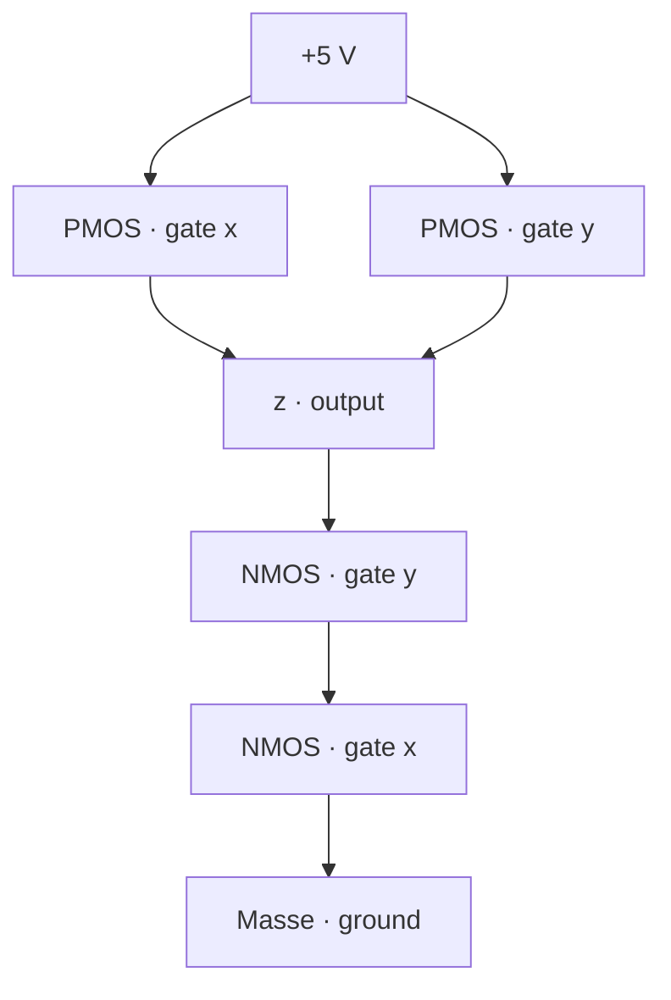

# Task 03_1 · CMOS NAND gate

Part of [Exercise 03 · CMOS and building blocks](../README.md). New ideas you need: CMOS pull-up / pull-down, L / NL, NAND. They are explained in the exercise page.

| Folder | What it is |
|--------|-----------|
| [`my-solution/`](my-solution/README.md) | **Your desk.** Truth table, gate name, L / NL boxes |
| [`solution/`](solution/README.md) | The sample solution. Peek only when you are done |

## The task (from the sheet)

*(Translated into English from the course sheet.)*

Look at the following graphic.

**a)** Which truth table results from the circuit?

**b)** Which gate is it?

**c)** Write into the boxes an **L** if that transistor conducts, or **NL** if it does not.

*(On the paper, part (c) shows the same circuit with gate voltages `x = 1` and `y = 0`, and one empty box under each transistor.)*

### Circuit from the sheet (text redraw)

PMOS = circle on the gate. NMOS = no circle. Blue regions on the paper = pull-up (top) and pull-down (bottom).

```text
                         +5 V
                           |
              .------------+------------.
              |  pull-up network        |
              |                         |
              |   o         o           |     o = PMOS (circle on gate)
              |   |         |           |
          x ──|───┤         ├───────────|── y
              |   |         |           |
              |   +----+----+           |
              |        |                |
              '--------+----------------'
                       |
                       +-------------------- z   (output)
                       |
              .--------+----------------.
              |  pull-down network      |
              |        |                |
          y ──|────────┤                |     (NMOS, no circle)
              |        |                |
          x ──|────────┤                |
              |        |                |
              '--------+----------------'
                       |
                     Masse
                    (ground)
```

Same idea as a connection graph:



### Part (c) — same circuit, given inputs

```text
                         +5 V
                           |
              .------------+------------.
              |  pull-up network        |
              |                         |
              |  [ ? ]       [ ? ]      |   ← fill L or NL
              |   o           o         |
              |   |           |         |
         1 ───|───┤           ├─────────|─── 0
          (x) |   |           |         |  (y)
              |   +-----+-----+         |
              |         |               |
              '---------+---------------'
                        |
                        +------------------ z
                        |
              .---------+---------------.
              |  pull-down network      |
              |         |               |
              |       [ ? ]             |   ← fill L or NL
         0 ───|─────────┤               |  (gate y)
          (y) |         |               |
              |       [ ? ]             |   ← fill L or NL
         1 ───|─────────┤               |  (gate x)
          (x) |         |               |
              '---------+---------------'
                        |
                      Masse
```

*(On the paper: left vertical = `x` (= 1), right = `y` (= 0). Series NMOS: upper gate = `y`, lower gate = `x`. Fill each box from that transistor’s own gate voltage.)*

## The task, simply said

1. For every pair `(x, y)`, decide: path to +5 V open, or path to ground?
2. Output `z` is **1** when pulled up, **0** when pulled down.
3. Name the gate whose truth table matches.
4. For `x = 1`, `y = 0`, mark each of the four transistors L or NL.

## Check examples

| You look at | You should see |
|-------------|----------------|
| `x y = 1 1` | only then both NMOS conduct → `z = 0` |
| any other `x y` | at least one PMOS conducts and the series NMOS path is broken → `z = 1` |
| gate name | NAND |
| `x = 1`, `y = 0`: PMOS on `x` | NL (PMOS off when gate is 1) |
| `x = 1`, `y = 0`: PMOS on `y` | L (PMOS on when gate is 0) |

## Little helpers

<details>
<summary>When does a PMOS conduct?</summary>

When its gate is **0**. Gate **1** → NL.

</details>

<details>
<summary>When does an NMOS conduct?</summary>

When its gate is **1**. Gate **0** → NL.

</details>

<details>
<summary>Why is parallel PMOS + series NMOS a NAND?</summary>

The lamp goes dark (`z = 0`) only if **both** NMOS are on → both inputs 1. That is exactly NAND.

</details>

## Done when

- [ ] Part (a): full truth table for `x`, `y`, `z`.
- [ ] Part (b): gate named.
- [ ] Part (c): four L / NL answers for `x = 1`, `y = 0`.
- [ ] You can say out loud why `z` is 1 in that case.

Next: [Task 03_2](../task-03-2-4-to-2-encoder/README.md)
