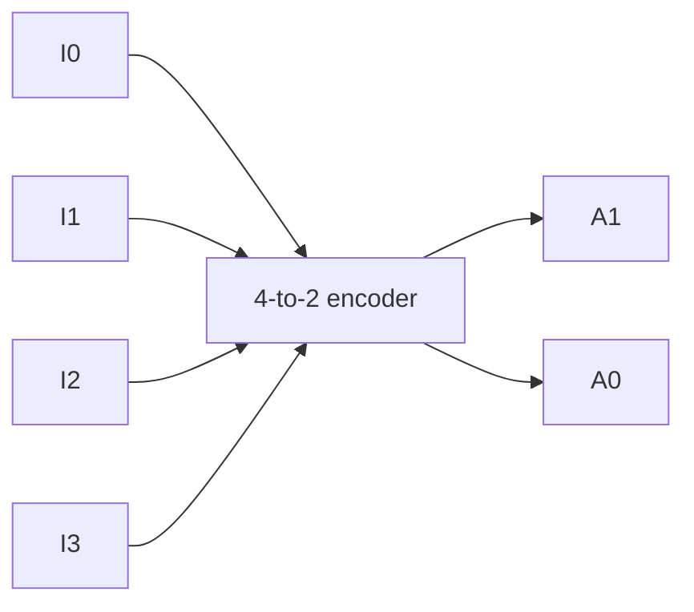

# Task 03_2 · 4-to-2 encoder

Part of [Exercise 03 · CMOS and building blocks](../README.md). New ideas you need: encoder, one-hot inputs. Explained in the exercise page.

| Folder | What it is |
|--------|-----------|
| [`my-solution/`](my-solution/README.md) | **Your desk.** Write the truth matrix there |
| [`solution/`](solution/README.md) | The sample solution. Peek only when you are done |

## The task (from the sheet)

*(Translated into English from the course sheet.)*

What does the truth matrix of a **4-to-2 encoder** look like?

*(The paper has no drawing here — only the question. The block below is the usual teaching picture.)*

```text
  I0 ──┐
  I1 ──┤
  I2 ──┼──► [ 4-to-2 encoder ] ──► A1
  I3 ──┘                      └──► A0

  Rule: exactly one Ii is 1 (one-hot).
  A1 A0 = binary number of that i.
```



## The task, simply said

1. Four inputs: `I0`, `I1`, `I2`, `I3` (exactly one is 1 at a time — one-hot).
2. Two outputs: `A1`, `A0` (the binary number of which input is active).
3. Write one row per valid input combination.

## Check examples

| Active input | A1 A0 |
|--------------|-------|
| `I0 = 1`     | 0 0   |
| `I1 = 1`     | 0 1   |
| `I2 = 1`     | 1 0   |
| `I3 = 1`     | 1 1   |

## Little helpers

<details>
<summary>How many valid rows?</summary>

Four — one for each input line being the single 1. (Rows where several inputs are 1, or none, are usually left out of the basic matrix.)

</details>

<details>
<summary>Which bit is which?</summary>

`A1` is the high bit (worth 2), `A0` is the low bit (worth 1). So `I2` → binary 2 → `A1 A0 = 1 0`.

</details>

## Done when

- [ ] The matrix has the four one-hot rows.
- [ ] Each row’s `A1 A0` matches the index of the active input.
- [ ] You can explain why four wires become two bits.

Next: [Task 03_3](../task-03-3-multiplexer-select/README.md)
