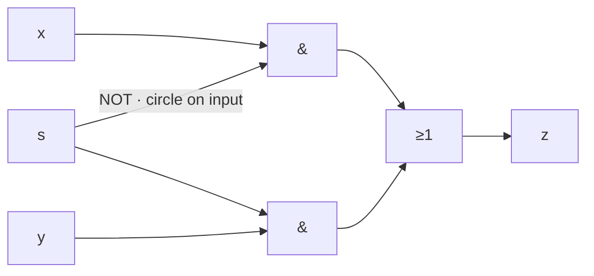

# Task 03_3 · Multiplexer select

Part of [Exercise 03 · CMOS and building blocks](../README.md). New ideas you need: multiplexer, select line. Explained in the exercise page.

| Folder | What it is |
|--------|-----------|
| [`my-solution/`](my-solution/README.md) | **Your desk.** Short written answer |
| [`solution/`](solution/README.md) | The sample solution. Peek only when you are done |

## The task (from the sheet)

*(Translated into English from the course sheet.)*

What does the **`s`** in the following circuit indicate, or what is it for?

### Circuit from the sheet (IEC symbols, text redraw)

Three vertical wires on the left: `y`, `x`, `s`. Two AND boxes (`&`), one OR box (`≥1`). A small circle on an AND input means **NOT**.

```text
  y          x          s
  │          │          │
  │          │          │
  │       ┌──┴──┐       │
  │       │  &  │○──────┘     top AND: x AND (NOT s)
  │       └──┬──┘             (○ = invert that input)
  │          │
  │       ┌──┴──┐
  │       │ ≥1  ├──────────► z
  │       └──┬──┘
  │          │
  │       ┌──┴──┐
  └───────┤  &  │◄───────── s     bottom AND: y AND s
          └─────┘
```

Same wiring as a formula and a graph:

```text
z = (x AND NOT s)  OR  (y AND s)
```



| s | which AND is open | z |
|---|-------------------|---|
| 0 | top (`x` and not `s`) | `x` |
| 1 | bottom (`y` and `s`) | `y` |

## The task, simply said

1. Look at when each AND can pass its data bit.
2. Name the role of wire `s` in one or two short sentences.
3. Optional: say what the whole circuit is called.

## Check examples

| Situation | What happens |
|-----------|----------------|
| `s = 0` | top AND can pass `x`; bottom AND blocked → `z = x` |
| `s = 1` | bottom AND can pass `y`; top AND blocked → `z = y` |
| Role of `s` | **select** (choose `x` or `y`) |

## Little helpers

<details>
<summary>Why is there a circle on one s input?</summary>

The circle means **NOT**. So that AND is active when `s` is 0. The other AND is active when `s` is 1. Together they never both pass data at once.

</details>

<details>
<summary>What is the whole box called?</summary>

A **2-to-1 multiplexer** (MUX): two data inputs, one select, one output.

</details>

## Done when

- [ ] You named `s` as the select / choice signal.
- [ ] You can say which data input wins for `s = 0` and for `s = 1`.

Next: [Task 03_4](../task-03-4-half-adder-sum-and-carry/README.md)
