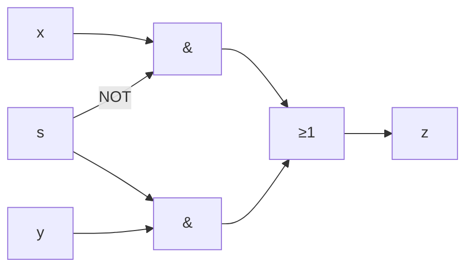

# Sample solution · Task 03_3 🏁

> Stop! Did you try it yourself first? Good. Then read on.

## How to check

Written answer — no compile step. Follow the tiny steps, then say the role of `s` in one sentence.

## How it works, step by step

### Step 0 — Picture first

> [!PICTURE]
> Two train tracks (`x` and `y`) and one exit (`z`). The lever `s` chooses which track is connected. That lever is the **select**.

### Step 1 — Name the parts on the paper

| Symbol | Means |
|--------|-------|
| `&` | AND |
| `≥1` | OR |
| small circle on an input | NOT that input |

Three wires come in from the left: `y`, `x`, `s`. One wire goes out: `z`.

### Step 2 — Read each AND carefully

**Top AND**

- Inputs: `x` and **not** `s` (the circle sits on the `s` side).
- An AND is 1 only when **both** of its inputs are 1.
- So this AND can pass `x` only when `NOT s = 1` → only when **`s = 0`**.

**Bottom AND**

- Inputs: `y` and `s` (no circle).
- This AND can pass `y` only when **`s = 1`**.

### Step 3 — What the OR does

Both AND outputs go into the `≥1` (OR). The OR output is `z`.

At most one AND is “open” at a time (because one needs `s=0` and the other needs `s=1`). So `z` simply follows whichever AND is open.

### Step 4 — Write the formula (optional but clear)

```text
z = (x AND NOT s)  OR  (y AND s)
```



### Step 5 — Try both values of `s`

| s | Top AND | Bottom AND | z |
|---|---------|------------|---|
| 0 | open → passes `x` | blocked | **`x`** |
| 1 | blocked | open → passes `y` | **`y`** |

### Step 6 — Answer in words

**`s` is the select signal** (Auswahl / Steuersignal).

It does **not** carry the data. It only chooses: “send `x` to `z`, or send `y` to `z`?”

The whole box is a **2-to-1 multiplexer** (MUX): two data inputs, one select, one output.

Picture: a railway switch. `x` and `y` are two tracks. `s` is the lever. `z` is the single exit.

### Final answer

**`s` is the select / choice signal** — it chooses whether `z` follows `x` (`s=0`) or `y` (`s=1`). The circuit is a 2-to-1 multiplexer.

## Common mistakes

| Mistake | What you see | Fix |
|---------|--------------|-----|
| Calling `s` a data input like `x`/`y` | Misses the switch idea | `s` only chooses; it is not the payload |
| Swapping which input wins | `s = 0` → `y` | The circle (NOT) sits on the **`x`** path |
| Forgetting the circle | Both ANDs look the same | Circle = invert that one input |

Back to [Task 03_3](../README.md).
