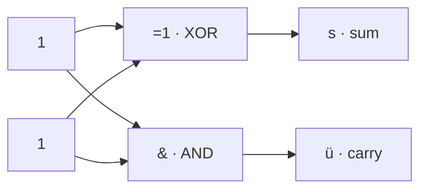

# Task 03_4 · Half adder sum and carry

Part of [Exercise 03 · CMOS and building blocks](../README.md). New ideas you need: half adder, sum, carry, XOR, AND. Explained in the exercise page.

| Folder | What it is |
|--------|-----------|
| [`my-solution/`](my-solution/README.md) | **Your desk.** Values for `s` and `ü` |
| [`solution/`](solution/README.md) | The sample solution. Peek only when you are done |

## The task (from the sheet)

*(Translated into English from the course sheet.)*

What are the results for **`s`** and **`ü`**?

### Circuit from the sheet (IEC symbols, text redraw)

Two vertical input wires, both given as **1** in little boxes. Top gate XOR (`=1`) → `s`. Bottom gate AND (`&`) → `ü`. Dots are junctions (same wire fans out).

```text
      ┌───┐
      │ 1 │                    ┌─────┐
      └─┬─┘                 ┌──┤ =1  ├──► s     (Summe / sum)
        │                   │  └─────┘
        │     ●─────────────┤
        │     │             │
        │     │             │  ┌─────┐
        │     │          ┌──┤  │  &  ├──► ü     (Übertrag / carry)
        │     │          │  │  └─────┘
        │     ●──────────┘  │
        │                   │
      ┌─┴─┐                 │
      │ 1 │─────────────────┘
      └───┘
```



## The task, simply said

1. Compute the XOR of the two 1s → that is `s` (sum).
2. Compute the AND of the two 1s → that is `ü` (carry / Übertrag).
3. Write both results.

## Check examples

| Gate | Inputs | Output |
|------|--------|--------|
| XOR (`=1`) | 1, 1 | `s = 0` |
| AND (`&`)  | 1, 1 | `ü = 1` |

(Thinking in decimal: 1 + 1 = 2 → write **0** in the ones place and carry **1**.)

## Little helpers

<details>
<summary>What does XOR do?</summary>

Output is 1 when the inputs are **different**. Same inputs → 0. So `1 XOR 1 = 0`.

</details>

<details>
<summary>What do s and ü mean?</summary>

On the sheet: **`s`** = Summe (sum), **`ü`** = Übertrag (carry). Together this circuit is a **half adder**.

</details>

## Done when

- [ ] You wrote a value for `s`.
- [ ] You wrote a value for `ü`.
- [ ] You can explain why 1 + 1 needs a carry.

Back to [Exercise 03](../README.md).
