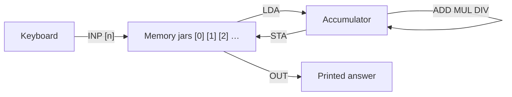

# Exercise 05 · Machine language and assembler

| | |
|---|---|
| Student | Becky |
| Subject | Informatik · Einführung in die Informatik (Hochschule Hannover) |
| Language | Written |
| Created | 2026-11-01 |

## The story in one sentence

A real CPU only understands **tiny numbered steps**; **assembler** is those steps written as short words — like a recipe where each line changes one counter (the **accumulator**) or one box in **memory**.

## Tasks

Do them in order. Every task has its own folder with the task, a desk for your written answers (`my-solution/`) and the sample solution (`solution/`).

<!-- index:start -->
| Task | Topic | Status |
|------|-------|--------|
| 05_1 | [Trace the program table](task-05-1-trace-the-program-table/README.md) | todo |
| 05_2 | [Formula x squared plus 2y plus c](task-05-2-formula-x-squared-plus-2y-plus-c/README.md) | todo |
| 05_3 | [Describe the loop program](task-05-3-describe-the-loop-program/README.md) | todo |
<!-- index:end -->

Status words: `todo` → `in progress` → `done`. Change them here when you finish a task (or let `/done` do it).

## How to work

1. Read this page to the end: it explains every new idea once, for all three tasks.
2. Open the first task and read its `README.md`.
3. Write your answers in its `my-solution/` folder. That is your desk.
4. Check yourself against the check rows in the task (or use Check on the website desk).
5. Only when you are done (or really stuck for a long time): look at `solution/`.

In Cursor you can ask for help at any time, without getting the answer: `/next` (where am I?), `/stuck` (stuck or a new word), `/check` (is it right?), `/done` (finished).

These tasks are **written answers** (trace tables, assembler listings, line-by-line explanations), not Java programs. There are no automated `make test-task` checks — your tutor (or `/check`) is the check.

---

## What you will learn

Read this slowly. One picture at a time. Then do the matching task.

### 1. Memory cells and the accumulator

> [!PICTURE]
> Imagine a row of numbered **jars** on a shelf: jar `[0]`, jar `[1]`, jar `[2]`. You also hold one **hand counter** called the **accumulator**. Most steps either change the hand counter or read/write a jar.

Tiny example:

| Step | What happens |
|------|----------------|
| `INP [2]` | You type `5` at the keyboard. Jar `[2]` becomes `5`. The hand counter is not used (shown as `-` on the sheet). |
| `LDA 2` | Copy jar `[2]` into the hand counter → counter shows `5`. |
| `ADD [1]` | Add jar `[1]` to the counter. If `[1]` is `18`, the counter becomes `23`. |

**In task 05_1** you fill a table after **every** line of a given program.

### 2. The instruction set on this sheet

The course uses one small machine. Brackets `[n]` mean **memory cell n**.

| Instruction | What it does |
|-------------|--------------|
| `INP [n]` | Read a number from the keyboard into memory `[n]`. Accumulator unchanged. |
| `LDA n` or `LDA [n]` | Load memory `[n]` into the accumulator. |
| `ADD [n]` or `ADD n` | Add memory `[n]` or the constant `n` to the accumulator. |
| `MUL n` | Multiply the accumulator by the constant `n` (whole numbers only). |
| `DIV n` | Divide the accumulator by `n` (integer division — drop the remainder). |
| `STA [n]` | Store the accumulator into memory `[n]`. |
| `OUT [n]` | Print the number in memory `[n]`. |
| `JEZ nn` | If the accumulator is **zero**, jump to instruction line `nn`. |
| `JMP nn` | Jump to instruction line `nn` (always). |
| `HLT` | Stop the program. |



**In task 05_2** you write a **new** program with these words to compute \(z = x^2 + 2y + c\).

### 3. Loops with jumps

> [!PICTURE]
> A **jump** is like a sign: “Go back to step 3.” **`JEZ`** only jumps when the counter shows **zero** — like stopping a “keep halving” game when there is nothing left to halve.

Tiny idea:

```text
03  LDA [0]     ← loop starts here
04  DIV 2
05  JEZ 11      ← leave when the counter hit 0
…   … change jars …
10  JMP 03      ← run the loop again
11  OUT [1]
```

**In task 05_3** you explain **each line** of a program that uses `DIV`, `JEZ`, and `JMP`.

---

## Words to know

| Word | Means |
|------|-------|
| Machine language | Instructions as numbers the hardware runs. |
| Assembler | The same instructions written as short mnemonics (`LDA`, `ADD`, …). |
| Accumulator | One working register; many steps read or update this value first. |
| Memory cell `[n]` | Jar number `n` in the machine’s small store. |
| Immediate | A constant written in the instruction itself (e.g. `MUL 3`). |
| Integer division | Divide and drop the remainder (`7 DIV 2` → `3`, not `3.5`). |
| Jump | Continue at another line number instead of the next line. |

## Source

Hochschule Hannover · Prof. Dr. Jens Paßlick · *Einführung in die Informatik* (WiSe 2026/27) · Sheet 5 · *Maschinensprache und Assembler*.

Back to [all exercises](../README.md).
