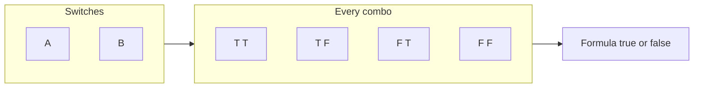
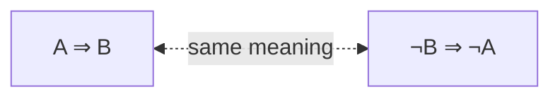
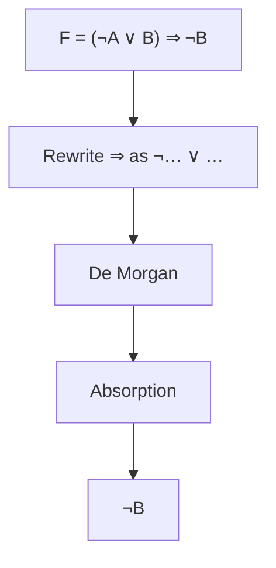
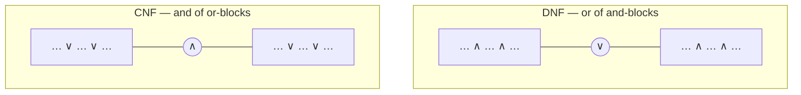
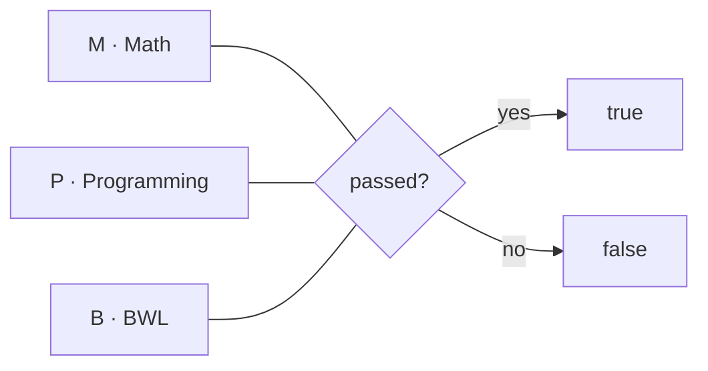

# Exercise 04 · Logic II

| | |
|---|---|
| Student | Becky |
| Subject | Mathematical Foundations · Mathematische Grundlagen der Informatik (Hochschule Hannover) |
| Language | Written |
| Created | 2026-10-23 |

## The story in one sentence

Logic is a **tiny language for exact claims**. Today you prove a famous rule with a truth table, shrink a formula, build DNF and CNF from a table, and decode what a truthful student really passed.

## Tasks

Do them in order: each one is a bit harder than the one before. Every task has its own folder with the task, a desk for your written answers (`my-solution/`) and the sample solution (`solution/`).

<!-- index:start -->
| Task | Topic | Status |
|------|-------|--------|
| 04_1 | [Validity of contraposition](task-04-1-validity-of-contraposition/README.md) | todo |
| 04_2 | [Simplify the formula](task-04-2-simplify-the-formula/README.md) | todo |
| 04_3 | [DNF and CNF via truth table](task-04-3-dnf-and-cnf-via-truth-table/README.md) | todo |
| 04_4 | [Zweistein's exams](task-04-4-zweisteins-exams/README.md) | todo |
<!-- index:end -->

Status words: `todo` → `in progress` → `done`. Change them here when you finish a task (or let `/done` do it).

## How to work

1. Read this page to the end: it explains every new idea once, for all four tasks.
2. Open the first task and read its `README.md`.
3. Write your answers in its `my-solution/` folder. That is your desk.
4. Check yourself against the “check” examples in the task.
5. Only when you are done (or really stuck for a long time): look at `solution/`.

In Cursor you can ask for help at any time, without getting the answer: `/next` (where am I?), `/stuck` (stuck or a new word), `/check` (is it right?), `/done` (finished).

These tasks are **written answers**, not programs. There are no automated `make test-task` checks — your tutor (or `/check`) is the check.

---

## What you will learn

### 1. Truth tables — try every switch setting

> [!PICTURE]
> A room of light switches. Each letter (`A`, `B`, `C`, …) is one switch: **on** = true (`T` / `1`), **off** = false (`F` / `0`). A truth table is the list of every switch combo and what the formula does.



Tiny example for `A ∧ B` (both must be on):

| A | B | A ∧ B |
|---|---|-------|
| T | T | T |
| T | F | F |
| F | T | F |
| F | F | F |

**In task 04_1** you use this to prove a rule is always true. **In task 04_3** you use a bigger table to build DNF and CNF.

### 2. Contraposition — flip both sides and swap

> [!PICTURE]
> A rule on a door: “If it rains, then the ground is wet.” The contraposition says the same idea with both sides flipped and swapped: “If the ground is **not** wet, then it did **not** rain.”



In symbols:

```text
(A ⇒ B)   is equivalent to   (¬B ⇒ ¬A)
```

“Valid” here means: the biconditional `(A ⇒ B) ⇔ (¬B ⇒ ¬A)` is **true in every row** of the truth table (a tautology).

**In task 04_1** you show that with a full truth table.

### 3. Simplifying a formula — same meaning, fewer pieces

> [!PICTURE]
> Tidying a messy drawer. You throw nothing important away; you only rearrange until the drawer looks smaller but still holds the same things. That is simplifying a formula.



Useful rewrite rules (same meaning):

| Pattern | Same as |
|---------|---------|
| `X ⇒ Y` | `¬X ∨ Y` |
| `¬(X ∨ Y)` | `¬X ∧ ¬Y` |
| `¬(X ∧ Y)` | `¬X ∨ ¬Y` |
| `X ∨ (X ∧ Y)` | `X` (absorption) |
| `¬Y ∨ (X ∧ ¬Y)` | `¬Y` (absorption) |

A formula is **simpler** when it uses fewer connectives / letters but is true in exactly the same rows.

**In task 04_2** you simplify `F = (¬A ∨ B) ⇒ ¬B`.

### 4. DNF and CNF — two tidy shapes

> [!PICTURE]
> LEGO in two tidy shapes. **DNF** is a big **or** of small **and**-blocks. **CNF** is a big **and** of small **or**-blocks. You build both from the truth table’s true and false rows.



From a truth table:

1. Rows where the formula is **true** → each row becomes one **and**-block (a minterm). Join those blocks with **or** → **DNF**.
2. Rows where the formula is **false** → each row becomes one **or**-block (a maxterm). Join those blocks with **and** → **CNF**.

Operator tip for this sheet: `⇒` is weaker than `∨` and `∧`, so

```text
A ∨ ¬(B ∨ C) ⇒ B    means    (A ∨ ¬(B ∨ C)) ⇒ B
```

**In task 04_3** you build both forms for that formula.

### 5. Translating stories into letters

> [!PICTURE]
> Three exam stamps on a desk: Math, Programming, BWL. Each stamp is either **passed** or **not**. You invent letters, turn each sentence into a formula, then ask which stamp combo makes every sentence true.



Someone who **never lies** means every sentence they say is a true formula.

**In task 04_4** you use this on Zweistein’s report.

---

## Words to know

| Word | Means |
|------|-------|
| **truth table** | Every true/false combination of the letters, plus the formula’s value |
| **contraposition** | `(A ⇒ B)` means the same as `(¬B ⇒ ¬A)` |
| **tautology / valid** | True in every row of the truth table |
| **equivalent** | True in exactly the same rows (`⇔` holds as a tautology) |
| **simplify** | Rewrite to a shorter equivalent formula |
| **DNF** | Or of and-clauses (often one minterm per true row) |
| **CNF** | And of or-clauses (often one maxterm per false row) |
| **minterm** | And of every letter or its negation for one row |
| **maxterm** | Or of every letter or its negation for one row |

German on the paper sheet (if you match notes): *Wahrheitstafel* → truth table, *Kontraposition* → contraposition, *Gültigkeit* → validity, *vereinfachen* → simplify, *DNF* / *KNF* → DNF / CNF, *äquivalent* → equivalent.

## Source

Prof. Dr.-Ing. Dennis Chong, Hochschule Hannover, Fakultät IV — Wirtschaft und Informatik | Abteilung WI.  
Course: Mathematical Foundations of Computer Science (*Mathematische Grundlagen der Informatik*).  
Sheet: Exercise 04 — Logic II (*Übung 04 Logik II*), tasks 04_1–04_4.

Back to [all exercises](../README.md).
