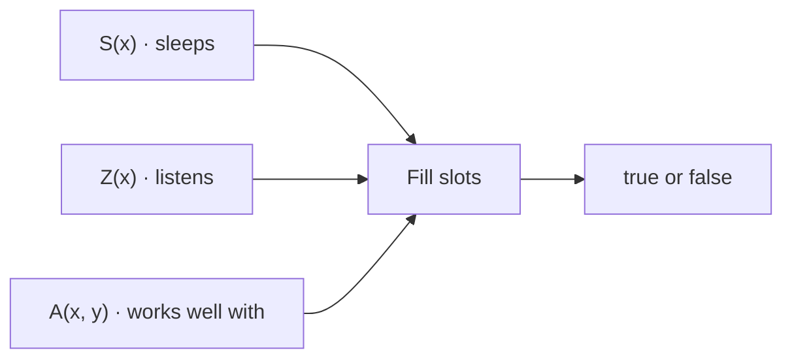
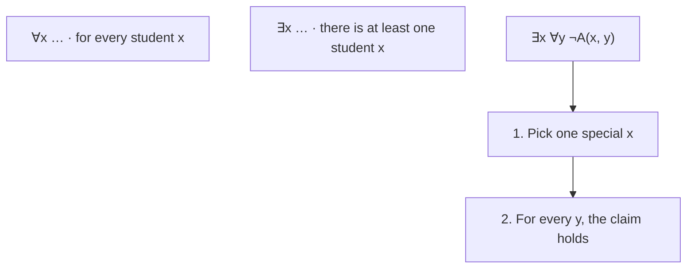
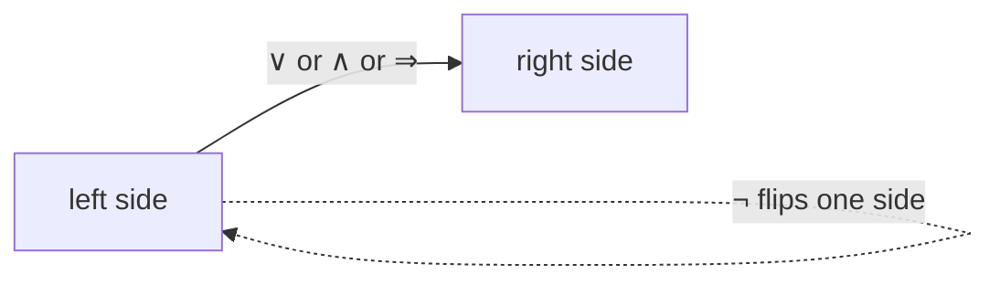
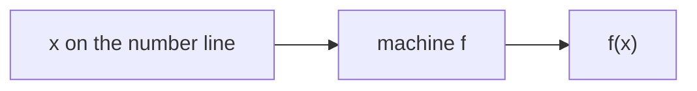
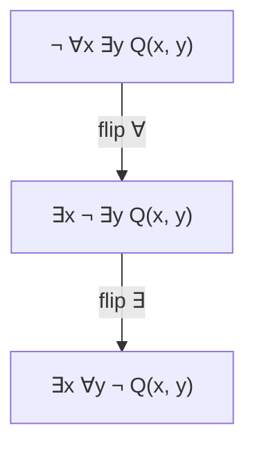

# Exercise 05 · Logic III

| | |
|---|---|
| Student | Becky |
| Subject | Mathematical Foundations · Mathematische Grundlagen der Informatik (Hochschule Hannover) |
| Language | Written |
| Created | 2026-10-23 |

## The story in one sentence

Logic is a **tiny language for exact claims**. Today you turn that language into plain English, write claims about a number function in logic, and push a “not” through a stack of “for all / there exists” until the not sits only on the claim itself.

## Tasks

Do them in order: each one is a bit harder than the one before. Every task has its own folder with the task, a desk for your written answers (`my-solution/`) and the sample solution (`solution/`).

<!-- index:start -->
| Task | Topic | Status |
|------|-------|--------|
| 05_1 | [Predicates to everyday language](task-05-1-predicates-to-everyday-language/README.md) | todo |
| 05_2 | [Function properties](task-05-2-function-properties/README.md) | todo |
| 05_3 | [Negating a formula](task-05-3-negating-a-formula/README.md) | todo |
<!-- index:end -->

Status words: `todo` → `in progress` → `done`. Change them here when you finish a task (or let `/done` do it).

## How to work

1. Read this page to the end: it explains every new idea once, for all three tasks.
2. Open the first task and read its `README.md`.
3. Write your answers in its `my-solution/` folder. That is your desk.
4. Check yourself against the “check” examples in the task.
5. Only when you are done (or really stuck for a long time): look at `solution/`.

In Cursor you can ask for help at any time, without getting the answer: `/next` (where am I?), `/stuck` (stuck or a new word), `/check` (is it right?), `/done` (finished).

These tasks are **written answers**, not programs. There are no automated `make test-task` checks — your tutor (or `/check`) is the check.

---

## What you will learn

### 1. Predicates — name tags for claims

> [!PICTURE]
> A classroom. On every student’s desk sits a sticky note with a short claim and empty slots. Fill a slot with a name and the claim becomes true or false.



Tiny example:

- `S(Anna)` — “Anna sleeps in the lecture.”
- `A(Ben, Cara)` — “Ben works well with Cara.”

**In task 05_1** you use this to say the formulas in everyday English.

### 2. Quantifiers — “every” and “someone”

> [!PICTURE]
> The same classroom again. `∀` points at **every** desk. `∃` points at **at least one** desk. When two quantifiers stack, read from the outside in — like nested boxes.



Tiny example:

- `∀x S(x)` — “Every student sleeps in the lecture.”
- `∃x Z(x)` — “At least one student listens.”

**In task 05_1** you use this to turn `∀` and `∃` into words. **In task 05_2** you use the same idea for numbers on the number line.

### 3. Connectives — and, or, not, if-then

> [!PICTURE]
> Traffic lights for claims. Each connective flips, joins, or guards two sides.

| Symbol | Words | Picture |
|--------|-------|---------|
| `¬` | not | flip true ↔ false |
| `∨` | or | at least one side is true |
| `∧` | and | both sides are true |
| `⇒` | if … then … | when the left is true, the right must be true too |



Useful rewrite (same meaning):

- `¬S(x) ⇒ Z(x)` means the same as `S(x) ∨ Z(x)` (either sleeps, or listens — or both).

You do **not** have to rewrite unless it helps you say it clearly. The sheet asks for an everyday sentence that matches the formula.

**In task 05_1** you use this for parts (a) and (c).

### 4. Talking about a function with logic

> [!PICTURE]
> A machine `f` that eats a real number and spits out a real number: `f: ℝ → ℝ`. “Monotonically increasing” means: bigger (or equal) input never gives a smaller output.



```text
∀x ∀y ( x ≤ y  ⇒  f(x) ≤ f(y) )
```

“Strictly” means: a **strictly** bigger input gives a **strictly** bigger output (`<` instead of `≤`).

“Point-symmetric (about the origin)” means the graph looks the same after a 180° spin around (0, 0): `f(−x) = −f(x)` for every *x*.  
“**Not** point-symmetric” means that fails for **at least one** *x*.

**In task 05_2** you write these three properties as formulas.

### 5. Pushing ¬ through quantifiers

> [!PICTURE]
> A row of locked boxes. A “not” in front of the whole row must walk inside, and **every lock flips** (`∀` ↔ `∃`) until the `¬` sits only on the predicate.



| Outside | Becomes inside |
|---------|----------------|
| `¬ ∀x …` | `∃x ¬ …` |
| `¬ ∃x …` | `∀x ¬ …` |

**In task 05_3** you use this on `F = ∀x ∃y ∀z P(x, y, z)`.

---

## Words to know

| Word | Means |
|------|-------|
| **predicate** | A claim with slots, like `S(x)` or `A(x, y)` |
| **quantifier** | `∀` (“for all”) or `∃` (“there exists”) |
| **domain** | The set the variables come from (here: students, or real numbers) |
| **monotonically increasing** | Bigger input never gives a smaller output (`≤`) |
| **strictly monotonically increasing** | Bigger input always gives a bigger output (`<`) |
| **point-symmetric (about the origin)** | `f(−x) = −f(x)` for every real *x* |
| **negation** | The claim “it is not the case that …” (`¬`) |

German on the paper sheet (if you match notes): *Prädikat* → predicate, *Allquantor* → ∀, *Existenzquantor* → ∃, *monoton steigend* → monotonically increasing, *streng monoton steigend* → strictly monotonically increasing, *punktsymmetrisch* → point-symmetric.

## Source

Prof. Dr.-Ing. Dennis Chong, Hochschule Hannover, Fakultät IV — Wirtschaft und Informatik | Abteilung WI.  
Course: Mathematical Foundations of Computer Science (*Mathematische Grundlagen der Informatik*).  
Sheet: Exercise 05 — Logic III (*Übung 05 Logik III*), tasks 05_1–05_3.

Back to [all exercises](../README.md).
