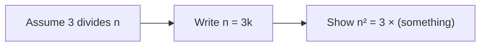
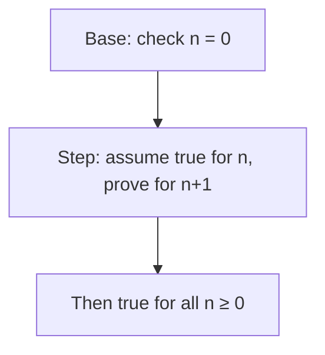

# Exercise 06 · Logic IV

| | |
|---|---|
| Student | Becky |
| Subject | Mathematical Foundations · Mathematische Grundlagen der Informatik (Hochschule Hannover) |
| Language | Written |
| Created | 2026-11-01 |

## The story in one sentence

You learn to **prove** number facts on paper: first with a straight “assume → show” argument, then with a ladder called **induction** that climbs through all natural numbers.

## Tasks

Do them in order: each one is a bit harder than the one before. Every task has its own folder with the task, a desk for your written proof (`my-solution/`) and the sample solution (`solution/`).

<!-- index:start -->
| Task | Topic | Status |
|------|-------|--------|
| 06_1 | [n squared divisible by 3](task-06-1-n-squared-divisible-by-3/README.md) | todo |
| 06_2 | [Three consecutive numbers sum](task-06-2-three-consecutive-numbers-sum/README.md) | todo |
| 06_3 | [n squared plus n is even](task-06-3-n-squared-plus-n-is-even/README.md) | todo |
<!-- index:end -->

Status words: `todo` → `in progress` → `done`. Change them here when you finish a task (or let `/done` do it).

## How to work

1. Read this page to the end: it explains every new idea once, for all three tasks.
2. Open the first task and read its `README.md`.
3. Write your proof in its `my-solution/` folder. That is your desk.
4. Check yourself against the “check” examples in the task.
5. Only when you are done (or really stuck for a long time): look at `solution/`.

In Cursor you can ask for help at any time, without getting the answer: `/next` (where am I?), `/stuck` (stuck or a new word), `/check` (is it right?), `/done` (finished).

These tasks are **written proofs**, not programs. There are no automated `make test-task` checks — your tutor (or `/check`) is the check.

---

## What you will learn

Read this slowly. One picture at a time. Then do the matching task.

### 1. “If … then …” claims about numbers

> [!PICTURE]
> A gate on a path. The sign says: **If** you wear a blue sticker, **then** you may enter the slide. A proof of that rule does not check every person in the world. You **pretend** someone already has the sticker, and show they really may enter.

On the sheet the claim looks like this:

```text
If 3 divides n, then 3 divides n².
```

Read “3 divides n” as: *n* is a whole-number multiple of 3 (…, −6, −3, 0, 3, 6, 9, …).

Tiny example (not a full proof, just the idea):

- Suppose *n* = 6. Then 3 divides 6.
- Compute *n*² = 36. Is 36 a multiple of 3? Yes — 36 = 3 × 12.

**In task 06_1** you write a **direct proof**: assume the “if” part, then algebra until the “then” part is obvious.

### 2. Divisibility — the recipe you reuse

> [!PICTURE]
> Sharing cookies equally. “*a* divides *b*” means you can split *b* cookies into piles of size *a* with **no crumbs left**.

| Symbol | In words | Algebra shape |
|--------|----------|---------------|
| *a* \| *b* | *a* divides *b* | *b* = *a* · *k* for some integer *k* |
| 3 \| *n* | *n* is a multiple of 3 | *n* = 3*k* |



**In task 06_1** you start from *n* = 3*k* and square both sides.  
**In task 06_2** you add three neighbours and factor out a 3.

### 3. Naming three neighbours on the number line

> [!PICTURE]
> Three houses in a row on the same street. You pick the first house number *n*; the next two are *n* + 1 and *n* + 2.

```text
n ,  n+1 ,  n+2
```

Add them:

```text
n + (n+1) + (n+2) = 3n + 3 = 3(n+1)
```

The last line is “3 times an integer” — that **is** the definition of “divisible by 3”.

**In task 06_2** you write that chain as a direct proof (no induction needed).

### 4. Even numbers

> [!PICTURE]
> Pairs of socks. A number is **even** when it splits into equal pairs with nothing left — or when it equals 2 times some integer.

| Idea | Algebra |
|------|---------|
| *m* is even | *m* = 2*t* for some integer *t* |
| 2 times anything | always even |

**In task 06_3** the formula *n*² + *n* must be even for **every** natural number *n* ≥ 0. That is too many values to check one by one — so you use induction.

### 5. Complete induction — the ladder

> [!PICTURE]
> A ladder with rungs labelled 0, 1, 2, 3, …. You prove two things: you can stand on the bottom rung (**base**), and from any rung you can step to the next (**inductive step**). Then you know **every** rung is safe.



#### Methods on the table

| Method | When you choose it |
|--------|---------------------|
| **Direct proof** | One “if … then …” where you assume the if-part and calculate | **Tasks 06_1 and 06_2** |
| **Complete induction** | “For **all** natural numbers *n* ≥ 0 …” | **Task 06_3** |
| Check finitely many examples | Quick sanity check only | Not enough for “all *n*” |

#### Induction recipe (task 06_3)

1. **Aim:** show *n*² + *n* is even for every *n* ≥ 0.
2. **Base:** plug in *n* = 0 and see an even number.
3. **Inductive hypothesis (IH):** assume *n*² + *n* is even for **this** fixed *n*.
4. **Inductive step:** look at (*n* + 1)² + (*n* + 1). Expand and rearrange until you see “even + even” or “2 × integer”.
5. **Conclusion:** by induction, the claim holds for all *n* ≥ 0.

At each algebra step, ask: *what do I see → which rewrite matches → why that rewrite (not guessing a new formula)?*

**In task 06_3** you follow that recipe exactly.

---

## Words to know

| Word | Means |
|------|-------|
| **direct proof** | To prove “if *P* then *Q*”, assume *P* is true and show *Q* must follow |
| **divides** | *a* divides *b* (*a* \| *b*) when *b* = *a* · *k* for some integer *k* |
| **natural number** | Here: 0, 1, 2, 3, … (non-negative whole numbers) |
| **even** | A number of the form 2*t* for some integer *t* |
| **complete induction** | Prove a base case, then prove “if it holds for *n*, it holds for *n* + 1” |
| **inductive hypothesis** | The temporary assumption that the claim is true for one fixed *n* during the step |

German on the paper sheet (if you match notes): *direkter Beweis* → direct proof, *vollständige Induktion* → complete induction, *gerade* → even, *durch 3 teilbar* → divisible by 3.

## Source

Prof. Dr.-Ing. Dennis Chong, Hochschule Hannover, Fakultät IV — Wirtschaft und Informatik | Abteilung WI.  
Course: Mathematical Foundations of Computer Science (*Mathematische Grundlagen der Informatik*).  
Sheet: Exercise 06 — Logic IV (*Übung 06 Logik IV*), tasks 06_1–06_3.

Back to [all exercises](../README.md).
