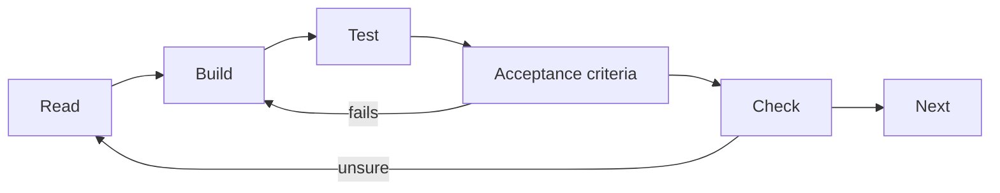

# ParcelPilot roadmap

> [!PICTURE]
> The ParcelPilot depot grows one room at a time. First a **label card** for one parcel. Then a **front desk** that takes parcels in (controller), a **sorting room** that applies the rules (service) and a **shelf** that keeps parcels overnight (repository). Later a **logbook**, a **morning drill** (tests) and a **shipping container** (Docker) that carries the whole depot anywhere.

This is your map. Walk it **one step at a time**, top to bottom. Each step creates the problem that the next step solves.

## Before you start

You finished the Java stages and the **Databases and Docker** stage of the path. This course does not re-teach Java, SQL, HTTP or Docker. Each step links to the page that teaches an idea:

| Idea | Home |
|---|---|
| Java language | [Java hub](../java/index.html) |
| HTTP, SQL, Docker, Git, terminal | [Computer science](../computer-science/index.html) |
| Git, your daily loop | [Git sheet](../../sheets/git/README.md) |
| A plain word you do not know | [Glossary](../../sheets/start/glossary.md) · Spring words: [Spring glossary](references/java/glossary.md) |

Read [PROJECT-STORY.md](PROJECT-STORY.md) once. Then start with [Step 00](topics/00-start-here/README.md).

## How every step works

Each step is a folder in `topics/` and one change to the same product.



| Section | What it gives you |
|---|---|
| **Picture** | The depot story for this step, so the idea has a shape. |
| **The problem right now** | What the current ParcelPilot cannot do yet. |
| **Key words** | Short meanings of the new words. |
| **Build it in ParcelPilot** | The exact, small changes to make, inside `applications/`. |
| **Test it** | The command that shows the change working. |
| **Acceptance criteria** | The list that defines "done". Every box must be tickable. |
| **Say it like a developer** | Sentences that use the new words the way engineers do. |
| **Check** | Questions with hidden answers. Answer out loud first, then open the answer. |
| **Next** | Where the road goes now. |

Two rules:

- Add **only** what the step asks for. No next-step ideas early.
- Type the code yourself before you compare it with the examples.

## The steps

| Step | Goal | ParcelPilot after the step |
| --- | --- | --- |
| [00](topics/00-start-here/README.md) | Check your tools and the two-terminal loop. | No code yet. |
| [01](topics/01-java-basics/README.md) | Describe one parcel in Java. | A parcel can be printed. |
| [02](topics/02-oop-and-composition/README.md) | Give parcels rules. | A parcel only moves in allowed ways. |
| [03](topics/03-maven/README.md) | One command builds and tests. | `mvn test` checks the rules. |
| [04](topics/04-first-spring-api/README.md) | Let other programs create and read parcels. | A web API answers requests. |
| [05](topics/05-validation-and-inputs/README.md) | Reject messy input politely. | Bad requests get a clear `400`. |
| [06](topics/06-error-handling/README.md) | One shape for every error. | Callers understand what went wrong. |
| [07](topics/07-logging-and-observability-basics/README.md) | Leave useful notes while running. | You can follow a request in the logs. |
| [08](topics/08-testing/README.md) | Turn manual checks into tests. | The API proves its own behaviour. |
| [09](topics/09-docker/README.md) | Package the app. | ParcelPilot runs from a Docker image. |
| [10](topics/10-persistence/README.md) | Keep parcels after a restart. | Parcels live in PostgreSQL. |
| [11](topics/11-monolith/README.md) | Split a growing app into clear parts. | Parcels and notifications are separate modules. |
| [12](topics/12-queues/README.md) | Do slow work later. | Notifications go through a queue. |
| [13](topics/13-split-services/README.md) | Move one job into its own app. | A separate notification service. |
| [14](topics/14-compose-and-observe/README.md) | Start everything together. | One `docker compose up`. |
| [15](topics/15-performance-and-safety/README.md) | Stay fast and safe under pressure. | Caching, locking, rate limits. |
| [16](topics/16-jwt-authentication/README.md) | Protect operator actions. | Login with JWT. |

Steps 00–10 are the **Spring Boot · ParcelPilot** stage. Steps 11–16 are the **ParcelPilot · Queues and login** stage. Monolith or microservices? The beginner explanation is [Monoliths and microservices](references/architecture/monolith-and-microservices.md).

## Save your work with Git

After each step, commit: `git add`, `git commit -m "step 04: first API"`, `git push`. The daily loop is in the [Git sheet](../../sheets/git/README.md). Tags and the Maven `.gitignore` for this course: [Git for this course](references/tooling/git-for-this-course.md).

## Running several containers (read before step 10)

> [!PICTURE]
> Two containers are two separate little houses. Inside each house, "home" (`localhost`) means *that* house. To visit the neighbour, you use the neighbour's **name** on a shared street.

From step 10 on, ParcelPilot and its database run in two containers. Inside a container, `localhost` means the container itself, so the app finds no database at `localhost:5432`. Put both containers on one **user-defined network** and use the container name as the host name:

```bash
docker network create parcelpilot-net                  # once
docker run -d --name parcelpilot-db --network parcelpilot-net \
  -e POSTGRES_PASSWORD=local-dev-only postgres:16-alpine
# the app then connects to: jdbc:postgresql://parcelpilot-db:5432/postgres
```

Step 10 gives the full command, with a volume so the data survives.

Step 14 replaces these commands with one Docker Compose file. The idea behind it: [Docker Compose](../computer-science/index.html#docker-compose).

## What "done with a step" means

- You can explain the new idea in one plain sentence.
- Every acceptance box is ticked from a fresh run.
- You added only what the step asked for.
- You can say which problem the next step will fix.

Keep a short `NOTES.md` in your application folder: what you ran, what you saw, and one question.
