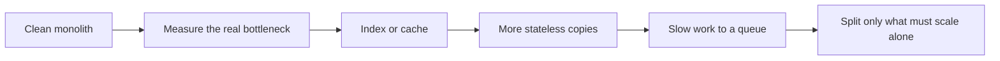

# Scaling: the big picture

> [!PICTURE]
> One parcel depot gets busy. You can hire a stronger worker (scale **up**), or open more counters that all share one warehouse (scale **out**). Extra counters only work if no counter keeps parcels in its own drawer.

That last sentence is the core idea. A server that keeps no data in its own memory is **stateless**. You can run many copies of it behind a load balancer. ParcelPilot becomes stateless in [Step 10](../../topics/10-persistence/README.md), when parcels move from a `Map` into PostgreSQL.

## Where each idea lives

| Idea | Beginner home | ParcelPilot step |
|---|---|---|
| Monolith vs microservices | [Monoliths and microservices](monolith-and-microservices.md) | [11](../../topics/11-monolith/README.md), [13](../../topics/13-split-services/README.md) |
| Queues and slow work | [Messaging and queues](messaging-and-queues.md) | [12](../../topics/12-queues/README.md) |
| Caching and locking | [Databases, caching and locking](databases-caching-and-locking.md) | [10](../../topics/10-persistence/README.md), [15](../../topics/15-performance-and-safety/README.md) |
| Indexes, replicas, sharding | CS lesson [Database design and scaling](../../../computer-science/index.html#database-design-scaling) | [10](../../topics/10-persistence/indexes-intro.md) |
| Load balancers, health, metrics | CS lesson [Observability](../../../computer-science/index.html#observability) | [14](../../topics/14-compose-and-observe/README.md) |
| Login across many servers | [Authentication](../web-and-api/authentication.md) | [16](../../topics/16-jwt-authentication/README.md) |
| Running it for real | [Production thinking](../operations/production-thinking.md) | — |

## A sensible order

**Measure first.** Most slow apps miss an index or a cache. They do not need microservices.

## After the course

Outbox, CQRS, sagas, Kafka, API gateways, Kubernetes, circuit breakers and canary deploys are senior topics. They live in the [Architecture track](../../../architecture/index.html). Open it after ParcelPilot is finished.

> [!CHECK]
> 1. What makes it possible to run ten copies of the ParcelPilot API?
>    

Answer
The API is stateless: parcels live in PostgreSQL, not in one server's memory.

> 2. Your app is slow. What do you do first?
>    

Answer
Measure. Then usually add an index or a cache before anything bigger.

