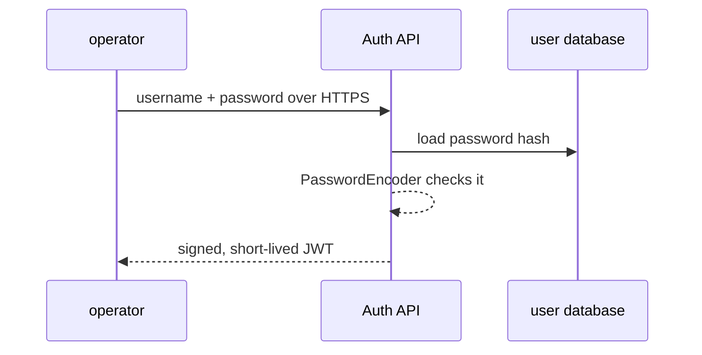

# Password login and JWT

> [!PICTURE]
> At the depot gate, a guard checks your ID card once (**login**). Then you get a visitor badge with your name, your role and an end time (**JWT**). Every door checks the badge, not your ID card again.

The ideas are taught in the CS lessons [Authentication and sessions](../../../computer-science/index.html#authentication-sessions), [Roles and authorization](../../../computer-science/index.html#authorization-roles), [Passwords, MFA and passkeys](../../../computer-science/index.html#passwords-mfa-passkeys) and [Tokens, JWT and OAuth](../../../computer-science/index.html#tokens-jwts-oauth). This page is the short Spring checklist for [Step 16](../../topics/16-jwt-authentication/README.md).

> [!WARN]
> Login is security code. Never invent your own password storage or token format. Use Spring Security.

## Four words

- **Authentication**: prove who the caller is.
- **Authorization**: decide what that caller may do.
- **Password hash**: a slow, salted, one-way fingerprint of a password.
- **JWT**: a signed token with facts ("claims") inside. Signed does **not** mean secret: anyone holding it can read it.

## Passwords

Never store, log or return a plain password. Let Spring Security's `PasswordEncoder` hash and check it, with Argon2id or bcrypt.

## The JWT steps

1. `POST /auth/login` checks username and password.
2. The server signs a short-lived token with few claims, like subject and role.
3. The client sends `Authorization: Bearer <token>` on protected requests.
4. The API checks signature, expiry, issuer and audience, then decides.

Never put passwords, secrets or private data in claims.

## Limits

Logging out a JWT before it expires is hard. In this course you build only short-lived access tokens and write that limit down. Real systems also need HTTPS, refresh tokens, key rotation, brute-force protection and an audit log.

> [!CHECK]
> 1. Is a signed JWT secret?
>    

Answer
No. Anyone holding it can read the claims. The signature only proves nobody changed them.

> 2. What is the difference between `401` and `403`?
>    

Answer
<code>401</code>: we do not know who you are. <code>403</code>: we know who you are, but you may not do this.

