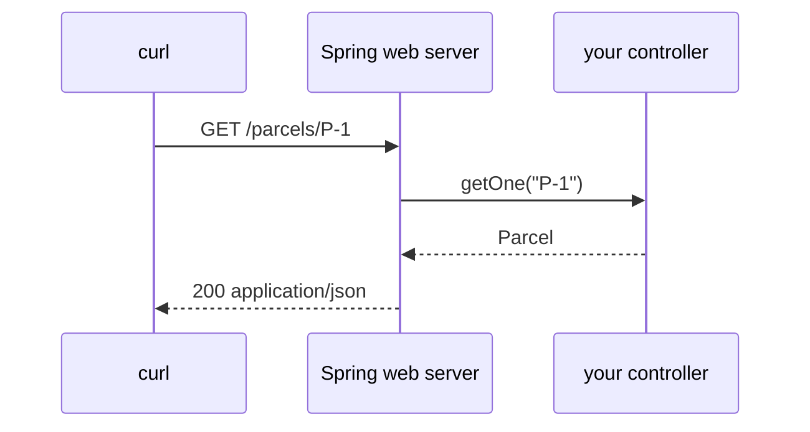

# Spring Boot: controllers and dependency injection

> [!PICTURE]
> Think of a parcel depot. The front desk (the **controller**) takes a request and hands it to the back room. Nobody at the desk builds their own shelves: the depot manager (**Spring**) gives every worker the tools they need on their first day.

HTTP itself is taught in the CS lesson [HTTP requests and responses](../../../computer-science/index.html#http-requests-responses). REST in Java is on the Java hub page [REST and HTTP](../../../java/topics/rest-and-http/index.html). This page covers only the Spring part.

## The controller

Spring Boot starts your Java program with a web server inside. A **controller** maps one HTTP request to one Java method. Spring turns the method's return value into JSON.



You build it in [Step 04](../../topics/04-first-spring-api/README.md).

## Dependency injection

Spring creates your objects (they are called **beans**) and hands each one what it needs. Ask for your helpers in the constructor:

```java
class ParcelService {
  private final ParcelRepository repository;

  ParcelService(ParcelRepository repository) {
    this.repository = repository;
  }
}
```

This is plain composition. Spring only does the wiring. Avoid `@Autowired` on fields: it hides what a class needs and makes tests harder. The full walk-through is [Dependency injection walkthrough](../../topics/04-first-spring-api/dependency-injection-walkthrough.md).

## Start simple

In the first API, one controller may keep parcels in a `Map`. Split it into controller, service and repository only when their jobs really differ. Architecture should make behaviour clearer, not make a tiny app look big.

> [!CHECK]
> 1. Who turns the controller's return value into JSON?
>    <details><summary>Answer</summary>Spring (with the Jackson library). Your method returns a Java object.</details>
> 2. Why ask for helpers in the constructor?
>    <details><summary>Answer</summary>You can see at once what a class needs, and a test can pass in a fake helper.</details>
