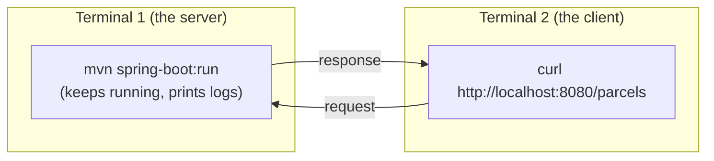

# The two-terminal workflow

> [!PICTURE]
> In the depot, one person stands at the front desk all day and answers. Another person walks up with a question. One cannot do both jobs at once. Your server is the person at the desk: it keeps **terminal 1** busy. You need **terminal 2** to walk up and ask.

## The idea

A running server occupies its terminal. It prints logs and does not take new commands. So almost every step of this course uses two terminals: **terminal 1 runs the server, terminal 2 talks to it.**

In step 00, terminal 1 runs `docker run`. From step 04 on, it usually runs `mvn spring-boot:run`.

## How to open a second terminal

| Where you are | How |
|---|---|
| Ubuntu terminal, Konsole, most Linux terminals | `Ctrl+Shift+T` opens a new tab |
| macOS Terminal | `Cmd+T` |
| IntelliJ IDEA | View → Tool Windows → Terminal, then `+` |
| VS Code | `` Ctrl+` ``, then `+` or the split icon |

Both terminals must stand in the project folder. Run `cd applications/parcelpilot` in each one.

Need an editor first? See [Get set up](../../../../sheets/setup/README.md#3-install-an-editor). Terminal basics (`cd`, `ls`, `Ctrl+C`, `Tab`) are in the [Linux terminal lesson](../../../computer-science/index.html#linux-terminal-os).

> [!NOTE]
> The course never asks you to press an IDE's green Run button. Every build, run and test is a terminal command. The same command works later in Docker and on a build server, where there is no IDE. Use the editor to write code and debug; run things in the terminal.

> [!TRY]
> 1. Open two terminal tabs and `cd` into the same folder in both.
> 2. Terminal 1: `docker run --rm -p 8080:80 nginx:alpine`
> 3. Terminal 2: `curl -i http://localhost:8080`
>
> You should see: logs appear in terminal 1 at the same moment `HTTP/1.1 200 OK` appears in terminal 2.

> [!CHECK]
> 1. Why can't you type the `curl` command into terminal 1?
>    

Answer
The server is running there. It keeps the terminal busy until you stop it with Ctrl+C.

> 2. Which terminal shows the server's logs?
>    

Answer
Terminal 1, where the server runs.

**Next:** back to [Step 00](README.md).
