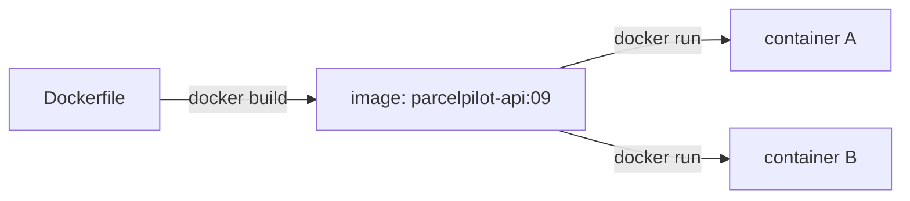
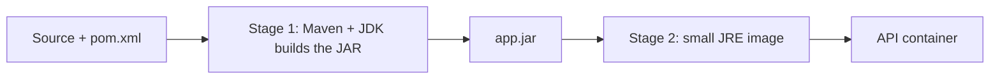

# Step 09: Docker, ship the API as one unit

> [!PICTURE]
> Imagine you could pack the **whole depot** (desk, shelves, rules, tools) into one **shipping container**. Put the container on any ship or truck, open the doors, and the depot works the same everywhere. A Docker image is that container for ParcelPilot.

## The problem right now

ParcelPilot has grown up since step 04: it validates input, returns clean errors, logs to stdout, and has tests (steps 05–08). But it still only runs where the source code and the right JDK are installed. Sharing it means telling someone "install Java 21, clone the repo, run Maven…". That's fragile and error-prone. You want to hand over **one runnable thing** that behaves identically everywhere.

## Key words

| Word | Beginner meaning |
|---|---|
| **Dockerfile** | A recipe listing the steps to build an image. |
| **Image** | The frozen, ready-to-run package built from the Dockerfile. |
| **Container** | A running instance of an image (you can start many from one image). |
| **Layer** | Each Dockerfile instruction creates a cached layer, and unchanged layers are reused (faster builds). |
| **Build context** | The folder Docker may read while building (usually your project). |
| **Multi-stage build** | Build in a big image, then copy only the result into a small image. |
| **JDK vs JRE** | JDK *builds* Java, while JRE only *runs* it (smaller, enough to ship). |
| **`.dockerignore`** | Files Docker should not copy (like `.gitignore`). |
| **`EXPOSE` / `-p`** | Declares / maps the port the app listens on. |
| **Tag** | A name + version for an image, e.g. `parcelpilot-api:09`. |

## Image and container, in one line

You met Docker in [Docker and containers](../../../computer-science/index.html#docker-containers): an **image** is the frozen package on disk, a **container** is one running copy of it. This step is about building **your own** image for a Java app.



## What is a multi-stage build, and why?

Compiling Java needs Maven + a full JDK (large). *Running* the app only needs a JRE (small). A **multi-stage** Dockerfile uses a big "build" image to produce the JAR, then copies just that JAR into a small "runtime" image. Result: a leaner, safer final image.



## What it costs

Images use disk and add a build step. Most important: **data inside a container is lost when the container is replaced**. Step 10 fixes exactly that.

## Build it in ParcelPilot (do this exactly)

In `applications/parcelpilot`:

### 1. Create the `Dockerfile`

```dockerfile
# ---------- Stage 1: build ----------
FROM maven:3-eclipse-temurin-21 AS build
WORKDIR /app
COPY pom.xml .
# Download dependencies first (cached unless pom.xml changes) for faster rebuilds
RUN mvn -q dependency:go-offline
COPY src ./src
RUN mvn -q -DskipTests package

# ---------- Stage 2: run ----------
FROM eclipse-temurin:21-jre
WORKDIR /app
# Copy only the built JAR from the build stage
COPY --from=build /app/target/*.jar app.jar
EXPOSE 8080
ENTRYPOINT ["java", "-jar", "app.jar"]
```

**Line by line** (short version here; every instruction is explained in depth in [The Dockerfile, line by line](dockerfile-line-by-line.md)):

- `FROM ... AS build`: start from an image that already has Maven + JDK, and name this stage `build`.
- `WORKDIR /app`: work inside `/app` in the image.
- `COPY pom.xml .` then `dependency:go-offline`: download libraries in their own layer so later code changes don't re-download everything.
- `COPY src ./src` + `mvn package`: compile and build the JAR.
- Second `FROM`: a fresh, small JRE-only image for running.
- `COPY --from=build`: take just the JAR from stage 1.
- `EXPOSE 8080`: document the port.
- `ENTRYPOINT`: the command that runs when the container starts.

### 2. Create `.dockerignore`

Keeps the build fast and clean:

```text
target/
.git/
*.iml
.idea/
```

## Test it

```bash
cd applications/parcelpilot
docker build -t parcelpilot-api:09 .
docker run --rm -p 8080:8080 parcelpilot-api:09

# in another terminal
curl -i -X POST http://localhost:8080/parcels \
  -H 'Content-Type: application/json' -d '{"id":"P-1","recipient":"Ava"}'
curl -i http://localhost:8080/parcels/P-1
```

Now prove the data problem: stop the container (`Ctrl+C`), start a **fresh** one, and query `P-1` again. It's gone.

If anything misbehaves — build fails, container exits instantly, port conflicts, "works locally but not in the container" — [Troubleshooting Docker](troubleshooting-docker.md) covers the classic failures symptom by symptom.

## Acceptance criteria

- [ ] `docker build -t parcelpilot-api:09 .` succeeds.
- [ ] `docker run -p 8080:8080 ...` serves the API and `curl` gets JSON.
- [ ] After replacing the container, the previously created parcel is **gone**.
- [ ] Your Dockerfile is multi-stage (build stage + smaller runtime stage) and you have a `.dockerignore`.
- [ ] You can explain the difference between an image and a container.

## Say it like a developer

- "The **Dockerfile** is the recipe, `docker build` turns it into an **image**, and `docker run` starts a **container** from it."
- "It's a **multi-stage build**: I compile in a big Maven+JDK image, then copy just the JAR into a small **JRE** image."
- "Each instruction is a cached **layer**, so unchanged layers make rebuilds fast."
- "`EXPOSE 8080` documents the port, and `-p 8080:8080` maps it to my machine."
- "The container is **disposable**: data inside it is gone when it's replaced."

## Check

> [!CHECK]
> 1. What is the difference between an **image** and a **container**?
>    <details><summary>Answer</summary>An image is the frozen, built package on disk. A container is a running instance of that image. One image can run as many containers.</details>
> 2. Why use a **multi-stage** build instead of one stage?
>    <details><summary>Answer</summary>Building needs Maven and a full JDK (large), while running only needs a JRE (small). Multi-stage builds in the big image and copies just the resulting JAR into a small runtime image, which is leaner and safer.</details>
> 3. Why do we `COPY pom.xml` and download dependencies **before** copying `src`?
>    <details><summary>Answer</summary>Docker caches layers. Dependencies rarely change, so putting them in their own earlier layer means editing your source code doesn't force Docker to re-download every library, so rebuilds are much faster.</details>
> 4. What does `ENTRYPOINT ["java", "-jar", "app.jar"]` do?
>    <details><summary>Answer</summary>It's the command that runs when the container starts: here, launching the app by running the packaged JAR.</details>

## Reflect (stretch)

The disappearing parcel isn't a bug. It's the point. A container is disposable, so real data must live somewhere that outlives it. That "somewhere" is a database with a volume.

## Next

[Step 10](../10-persistence/README.md): add PostgreSQL so parcels survive restarts.
