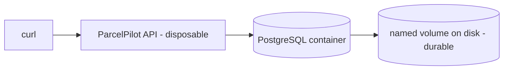
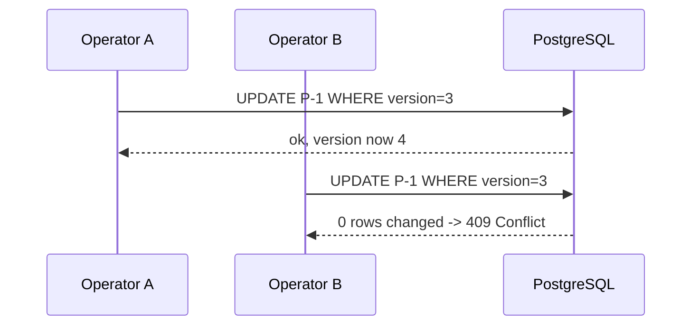

# Step 10: Persistence, keep the parcels

> [!PICTURE]
> Until now the depot kept parcels in the clerk's head: when the lights went out at night, every parcel was forgotten. Now the depot gets a real **warehouse with shelves**. Parcels stay on the shelf when the lights go out and are still there in the morning. The shelf is the database, and the **repository** is the warehouse worker who puts parcels on the shelf and fetches them again.

## The problem right now

Step 09 proved parcels vanish when the container is replaced, because they live in an in-memory `Map`. A delivery company cannot lose all parcels on every deploy. Data needs a **durable** home separate from the disposable app.

## Key words

| Word | Beginner meaning |
|---|---|
| **Database** | A separate program built to store and query data reliably. |
| **PostgreSQL** | The relational (table-based) database this course uses. |
| **Relational / SQL** | Data in tables (rows + columns), queried with the SQL language. |
| **Persistence** | Data that survives even after the app stops. |
| **Volume** | Docker storage living *outside* a container, so data isn't lost when the container is replaced. |
| **Environment variable** | A setting passed to a program at startup (e.g. DB address, password). |
| **JPA / entity** | Java's way to map a class to a database table (an `@Entity`). |
| **Repository** | A Spring interface that reads/writes entities without you writing SQL. |
| **Migration** | A versioned script that creates/changes tables (via Flyway). |
| **Transaction** | A group of changes that all succeed or all fail together. |
| **Optimistic locking** | Detecting clashing edits with a `version` number. |
| **`409 Conflict`** | HTTP status meaning "your update clashed with someone else's". |

## Read first, then build

Tables, rows, `SELECT`/`INSERT`/`UPDATE` and "relational or NoSQL?" are taught once, in the CS track: [Databases and SQL](../../../computer-science/index.html#database-sql-fundamentals) and [Database design and scaling](../../../computer-science/index.html#database-design-scaling). ParcelPilot uses **PostgreSQL**: parcels have a fixed shape, we want reliable transactions, and it runs in one Docker command.

The Spring side of this step has four short companion pages. Read them in this order:

1. [JPA, entities, and repositories](jpa-and-repositories.md): how Java talks to the database without hand-written SQL.
2. [Flyway migrations explained](flyway-migrations-explained.md): why the schema is versioned, and the never-edit-history rule.
3. [Locking explained](locking-explained.md): optimistic vs pessimistic, and why we pick optimistic.
4. [EXPLAIN and the N+1 problem](indexes-intro.md): how to see what a query really does.

## What "persistence" means, and why a volume matters

Two separate containers now:

- the **app** container: disposable, replaced on every deploy.
- the **database** container: stores data in a Docker **volume** on your disk.

Replace the app as often as you like, and the database and its volume keep the parcels.



## The clashing-updates problem (locking)

Two operators both load parcel `P-1` at version 3 and both save. Without protection, the second silently overwrites the first, a **lost update**. **Optimistic locking** adds a `version` column: an update only succeeds if the version still matches. Otherwise the API returns `409` and the caller reloads and retries.



## Build it in ParcelPilot (do this exactly)

### 1. Start PostgreSQL in Docker with a named volume

On Ubuntu, put the database and the API on a shared **user-defined network** so the API can reach the database by name. See [Running several containers](../../GUIDE.md#running-several-containers-read-before-step-10) in the GUIDE for why `localhost` does not work between containers.

```bash
# create the shared network once (safe to re-run if it already exists)
docker network create parcelpilot-net

docker run --name parcelpilot-db \
  --network parcelpilot-net \
  -e POSTGRES_DB=parcelpilot \
  -e POSTGRES_USER=parcelpilot \
  -e POSTGRES_PASSWORD=local-dev-only \
  -p 5432:5432 \
  -v parcelpilot-postgres:/var/lib/postgresql/data \
  -d postgres:16-alpine
```

The `-v parcelpilot-postgres:/var/lib/postgresql/data` part is the **volume**: it keeps data on your disk. The password here is an intentionally visible local-only value, so never commit real secrets. The `-p 5432:5432` publish is only so you can inspect the database from your laptop. The API reaches it over the shared network by name.

### 2. Add dependencies to `pom.xml`

```xml
<dependency>
    <groupId>org.springframework.boot</groupId>
    <artifactId>spring-boot-starter-data-jpa</artifactId>
</dependency>
<dependency>
    <groupId>org.postgresql</groupId>
    <artifactId>postgresql</artifactId>
    <scope>runtime</scope>
</dependency>
<dependency>
    <groupId>org.flywaydb</groupId>
    <artifactId>flyway-core</artifactId>
</dependency>
<dependency>
    <!-- Flyway 10+ keeps PostgreSQL support in its own module; without it: "Unsupported Database" -->
    <groupId>org.flywaydb</groupId>
    <artifactId>flyway-database-postgresql</artifactId>
</dependency>
```

Also pin the Testcontainers version in the `<properties>` block. You need it when you come back to the [Testcontainers lab](../08-testing/testcontainers-lab.md): the version that comes with Spring Boot 3.3 cannot talk to current Docker Engines.

```xml
<properties>
    <java.version>21</java.version>
    <testcontainers.version>1.21.4</testcontainers.version>
</properties>
```

### 3. Configure from environment variables

In `src/main/resources/application.properties` (values come from the environment so nothing is hard-coded):

```properties
spring.datasource.url=jdbc:postgresql://${DB_HOST:localhost}:5432/parcelpilot
spring.datasource.username=${DB_USER:parcelpilot}
spring.datasource.password=${DB_PASSWORD:local-dev-only}
spring.jpa.hibernate.ddl-auto=validate
spring.flyway.enabled=true
```

### 4. Add a migration

Create `src/main/resources/db/migration/V1__create_parcels.sql`:

```sql
CREATE TABLE parcels (
    id         VARCHAR(64) PRIMARY KEY,
    recipient  VARCHAR(255) NOT NULL,
    status     VARCHAR(32)  NOT NULL,
    version    BIGINT       NOT NULL DEFAULT 0
);
```

### 5. Turn `Parcel` into an entity and add a repository

An `@Entity` maps to the table, and `@Version` enables optimistic locking automatically. The two status rules move along from your step-02 `Parcel`:

```java
package com.parcelpilot;

import jakarta.persistence.*;

@Entity
@Table(name = "parcels")
public class ParcelEntity {
    @Id
    private String id;
    @Column(nullable = false)
    private String recipient;
    @Enumerated(EnumType.STRING)
    @Column(nullable = false)
    private Status status;
    @Version
    private Long version;   // Long, not long: null tells Spring Data "new parcel", so save() inserts instead of merging

    protected ParcelEntity() {
        // JPA needs an empty constructor to build objects from rows
    }

    public ParcelEntity(String id, String recipient, Status status) {
        this.id = id;
        this.recipient = recipient;
        this.status = status;
    }

    public void markPickedUp() {
        if (status != Status.CREATED) {
            throw new IllegalStateException("can only pick up a CREATED parcel");
        }
        status = Status.PICKED_UP;
    }

    public void markDelivered() {
        if (status != Status.PICKED_UP) {
            throw new IllegalStateException("can only deliver a PICKED_UP parcel");
        }
        status = Status.DELIVERED;
    }

    public String id() { return id; }
    public String recipient() { return recipient; }
    public Status status() { return status; }
    public long version() { return version == null ? 0 : version; }
}
```

```java
package com.parcelpilot;

import org.springframework.data.jpa.repository.JpaRepository;
import java.util.List;

public interface ParcelRepository extends JpaRepository<ParcelEntity, String> {
    List<ParcelEntity> findByStatus(Status status);
}
```

Then the controller uses the repository instead of the in-memory `Map`. Delete the `store` field, receive the repository in the constructor, and rewrite the four endpoints:

```java
private final ParcelRepository repository;

public ParcelController(ParcelRepository repository) {
    this.repository = repository;
}

@PostMapping
@ResponseStatus(HttpStatus.CREATED)
public ParcelResponse create(@Valid @RequestBody CreateParcelRequest req) {
    if (repository.existsById(req.id())) {
        throw new IllegalStateException("parcel " + req.id() + " already exists");   // -> 409
    }
    return toResponse(repository.save(new ParcelEntity(req.id(), req.recipient(), Status.CREATED)));
}

@GetMapping("/{id}")
public ParcelResponse getOne(@PathVariable String id) {
    return toResponse(load(id));
}

@GetMapping
public List<ParcelResponse> list(@RequestParam(required = false) Status status) {
    List<ParcelEntity> parcels = status == null ? repository.findAll() : repository.findByStatus(status);
    return parcels.stream().map(this::toResponse).toList();
}

@PatchMapping("/{id}/status")
public ParcelResponse changeStatus(@PathVariable String id, @Valid @RequestBody UpdateStatusRequest req) {
    ParcelEntity parcel = load(id);
    switch (Status.valueOf(req.status())) {   // status is a String since the step-05 lab (@Pattern)
        case PICKED_UP -> parcel.markPickedUp();
        case DELIVERED -> parcel.markDelivered();
        case CREATED -> throw new IllegalStateException("a parcel cannot go back to CREATED");
    }
    return toResponse(repository.save(parcel));   // UPDATE ... WHERE version = ?, then version + 1
}

private ParcelEntity load(String id) {
    return repository.findById(id).orElseThrow(() -> new ParcelNotFoundException(id));
}

private ParcelResponse toResponse(ParcelEntity p) {
    return new ParcelResponse(p.id(), p.recipient(), p.status().name());
}
```

Rules, storage and HTTP now sit in one class. That works, and it is the tangle step 11 cleans up.

### 6. Turn a lost-update clash into `409`

When `@Version` detects a clash, Spring throws `ObjectOptimisticLockingFailureException`. Add one handler to your `GlobalErrorHandler` from step 06, so the clash gets the same error shape as every other failure:

```java
@ExceptionHandler(ObjectOptimisticLockingFailureException.class)
@ResponseStatus(HttpStatus.CONFLICT)
public ErrorResponse versionClash(ObjectOptimisticLockingFailureException ex, HttpServletRequest request) {
    return new ErrorResponse("VERSION_CONFLICT", "The parcel was changed by someone else. Reload and retry.",
            Map.of(), request.getRequestURI());
}
```

A real clash needs two writes in the same millisecond, so you cannot easily click one by hand. You will provoke it on purpose in [step 15](../15-performance-and-safety/optimistic-locking-lab.md). Today you prove that the version counter works.

## Test it

Run the API container on the same network as the database and point it at the database by name with `DB_HOST`:

```bash
# run the API on the shared network; it reaches the DB at host name parcelpilot-db
docker run --name parcelpilot-api \
  --network parcelpilot-net \
  -e DB_HOST=parcelpilot-db \
  -e DB_USER=parcelpilot \
  -e DB_PASSWORD=local-dev-only \
  -p 8080:8080 \
  -d parcelpilot-api:10
```

```bash
# 1. create a parcel
curl -i -X POST http://localhost:8080/parcels \
  -H 'Content-Type: application/json' -d '{"id":"P-1","recipient":"Ava"}'

# 2. replace ONLY the API container: stop and remove it, then run it again
docker rm -f parcelpilot-api
# (re-run the docker run command above)

# 3. it is still there, because the data lives in the database volume
curl -i http://localhost:8080/parcels/P-1
```

Now watch the version counter. Look inside the database, change the status, and look again:

```bash
docker exec -it parcelpilot-db psql -U parcelpilot -c "SELECT id, status, version FROM parcels;"
curl -i -X PATCH http://localhost:8080/parcels/P-1/status \
  -H 'Content-Type: application/json' -d '{"status":"PICKED_UP"}'
docker exec -it parcelpilot-db psql -U parcelpilot -c "SELECT id, status, version FROM parcels;"
```

You should see `version` go from `0` to `1`. Every successful update bumps it; an update based on an old version would change zero rows and get your `409`.

## Acceptance criteria

- [ ] After recreating the **API** container, a previously created parcel is still returned.
- [ ] PostgreSQL runs in Docker with a named volume, and keeping the volume preserves data across DB container recreation.
- [ ] DB credentials come from environment variables, not source code.
- [ ] A status change bumps `version` in the `parcels` table, and `GlobalErrorHandler` maps `ObjectOptimisticLockingFailureException` to `409`.
- [ ] You can explain what a volume, a migration, an entity, and optimistic locking are.
- [ ] You can say why we chose PostgreSQL over a NoSQL store for parcels (see [Database design and scaling](../../../computer-science/index.html#database-design-scaling)).
- [ ] You can explain what an ORM/JPA does and why we don't hand-write SQL (see [JPA and repositories](jpa-and-repositories.md)).

> **Return to testing:** ParcelPilot now has a real database — go back and complete the [Testcontainers lab](../08-testing/testcontainers-lab.md) from step 08 so your repository is covered by tests against real PostgreSQL.

## Say it like a developer

- "Parcels are now **persisted** in PostgreSQL, so they **survive a restart**."
- "The database's data lives in a Docker **volume**, so it outlives the container."
- "`ParcelEntity` is a JPA **entity**: it maps to the `parcels` **table**."
- "The **repository** reads and writes entities so I don't hand-write SQL."
- "A **migration** (Flyway) creates the table in a versioned, repeatable way."
- "`@Version` gives me **optimistic locking**: a clashing update returns `409 Conflict`."
- "DB credentials come from **environment variables**, never from source code."

## Check

> [!CHECK]
> 1. Why does putting data in a **volume** matter?
>    <details><summary>Answer</summary>A container is disposable, so replacing it wipes its contents. A volume stores data on disk <em>outside</em> the container, so the database keeps the parcels even when the container is recreated.</details>
> 2. What does an **entity** (`@Entity`) do?
>    <details><summary>Answer</summary>It maps a Java class to a database table, so each object corresponds to a row. JPA/Hibernate then translates between objects and SQL for you.</details>
> 3. What is a **migration**, and why not just create tables by hand?
>    <details><summary>Answer</summary>A migration is a versioned SQL script (via Flyway) that creates/changes tables. It runs the same way on every machine and in CI, so the schema is reproducible and tracked in version control, which hand-creating tables isn't.</details>
> 4. Explain **optimistic locking** with the `version` column.
>    <details><summary>Answer</summary>Each row has a <code>version</code>. An update only succeeds if the version still matches what you read. Otherwise someone else changed it first, so the update fails and the API returns <code>409 Conflict</code>, prompting a reload-and-retry. This prevents silent lost updates.</details>

## Reflect (stretch)

ParcelPilot now has HTTP, business rules, and durable data, but a lot of responsibilities are mixed in a few classes. The next step gives them clean internal boundaries **without** adding network complexity.

## Next

[Step 11](../11-monolith/README.md): organize everything into a clean modular monolith.
