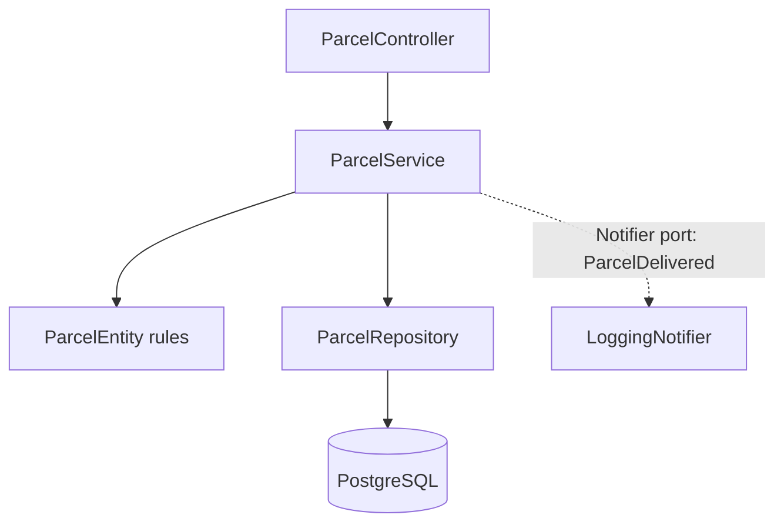

# Step 11: The modular monolith

> [!PICTURE]
> The depot has grown. Everything happens in one big hall, and people bump into each other. So you build **rooms with doors**: the front desk, the sorting room (the service with the rules), and the notification room that sends "your parcel is here" messages. It is still **one building**, but each room has one job, and rooms talk only through their doors.

## The problem right now

ParcelPilot now does HTTP, parcel rules, storage, and (soon) notifications, often tangled together in a few classes. That makes changes risky and tests awkward. But splitting into networked services now would add huge complexity **before** you have a proven reason. The middle path is a **modular monolith**.

## Key words

| Word | Beginner meaning |
|---|---|
| **Monolith** | One application, built and deployed as a single unit. |
| **Modular monolith** | A monolith with clear internal modules (boundaries), still one deployable. |
| **Module** | A self-contained slice of the app for one feature (e.g. `parcel`, `notification`). |
| **Domain** | The core business rules and objects (e.g. parcel lifecycle). |
| **Use case / application layer** | The steps that carry out an operation (e.g. "mark delivered"). |
| **Adapter** | Code that translates between the outside world (HTTP, DB) and your domain. |
| **Coupling** | How tightly parts depend on each other (less is usually better). |
| **Cohesion** | How focused a module is on one job (more is better). |
| **Boundary** | A clear line separating one responsibility from another. |

## What is a modular monolith (and why not microservices yet)?

One building with well-labelled rooms: one deploy, no network between rooms, but each room has a clear purpose, so you can later move a room into its own building if needed. The beginner explanation of monolith vs microservices, with pros and cons, is in [Monoliths and microservices](../../references/architecture/monolith-and-microservices.md). Read it first.

Organize **by feature**, not by generic layers (this is Shape 5 in [Code organization](../../references/architecture/code-organization.md), and it applies the [package-by-feature best practice](../../references/java/java-best-practices.md#12-organize-by-feature-not-by-layer) — the full side-by-side comparison of both layouts is in [Layered vs feature packages](layered-vs-feature-packages.md)):

```text
com/parcelpilot/
├── parcel/
│   ├── Notifier.java             # PUBLIC: the port parcel needs someone to implement
│   ├── ParcelDelivered.java      # PUBLIC: the event handed across the boundary
│   └── internal/
│       ├── ParcelEntity.java     # entity + status rules (step 10)
│       ├── ParcelRepository.java # adapter: persistence
│       ├── ParcelService.java    # use cases
│       ├── ParcelController.java # adapter: HTTP in/out
│       └── Status.java, CreateParcelRequest.java, UpdateStatusRequest.java, ParcelResponse.java
└── notification/
    └── LoggingNotifier.java      # implements parcel's Notifier port
```

`ErrorResponse`, `GlobalErrorHandler`, `ParcelNotFoundException` and `RequestIdFilter` stay in `com.parcelpilot`: they serve the whole app.



## Why do it? Pros and cons

**What it brings us:** each feature is understandable and testable on its own, and future extraction (step 13) becomes a copy-paste-sized job instead of a rewrite.

**Pros of the monolith:** one deploy, fast local calls (no network), easy debugging, and simple data consistency.
**Cons:** everything scales and deploys together, a heavy feature can't be scaled alone, and the codebase can grow large.

**Real-world example:** most successful products start as a well-structured monolith and only extract services where a real bottleneck or team boundary appears.

## Build it in ParcelPilot

Keep it one app in `applications/parcelpilot`. This is reorganization, not new features: same endpoints, same database.

### 1. Move the classes into feature packages

Create the folders from the tree above and move the classes. Change each `package` line (your editor's "Move class" refactoring does this for you). Types that other packages use must be `public`.

### 2. The port and the event: the parcel module's public API

The parcel module depends on this interface only, never on notification code. The intro-level pattern behind it is [ports and adapters](ports-and-adapters.md).

```java
package com.parcelpilot.parcel;

public interface Notifier {
    void parcelDelivered(ParcelDelivered event);
}
```

The event carries exactly what a listener needs, as a small immutable record. Past tense: it states a fact.

```java
package com.parcelpilot.parcel;

import java.time.Instant;

public record ParcelDelivered(String parcelId, String recipient, Instant occurredAt) {}
```

### 3. The notification module implements the port

```java
package com.parcelpilot.notification;

import com.parcelpilot.parcel.Notifier;
import com.parcelpilot.parcel.ParcelDelivered;
import org.slf4j.Logger;
import org.slf4j.LoggerFactory;
import org.springframework.stereotype.Component;

@Component
public class LoggingNotifier implements Notifier {

    private static final Logger log = LoggerFactory.getLogger(LoggingNotifier.class);

    @Override
    public void parcelDelivered(ParcelDelivered event) {
        log.info("notification sent for {} to {}", event.parcelId(), event.recipient());
    }
}
```

### 4. The use cases move into `ParcelService`

The rules, the repository calls and the notification move out of the controller. `ParcelService` receives a `Notifier` by constructor (dependency injection = composition), so it never knows *how* notifications are sent:

```java
package com.parcelpilot.parcel.internal;

import com.parcelpilot.ParcelNotFoundException;
import com.parcelpilot.parcel.Notifier;
import com.parcelpilot.parcel.ParcelDelivered;
import org.springframework.stereotype.Service;
import org.springframework.transaction.annotation.Transactional;

import java.time.Instant;
import java.util.List;

@Service
public class ParcelService {

    private final ParcelRepository repository;
    private final Notifier notifier;

    public ParcelService(ParcelRepository repository, Notifier notifier) {
        this.repository = repository;
        this.notifier = notifier;
    }

    @Transactional
    public ParcelResponse create(CreateParcelRequest request) {
        if (repository.existsById(request.id())) {
            throw new IllegalStateException("parcel " + request.id() + " already exists");
        }
        return toResponse(repository.save(new ParcelEntity(request.id(), request.recipient(), Status.CREATED)));
    }

    @Transactional(readOnly = true)
    public ParcelResponse get(String id) {
        return toResponse(load(id));
    }

    @Transactional(readOnly = true)
    public List<ParcelResponse> list(Status status) {
        List<ParcelEntity> parcels = status == null ? repository.findAll() : repository.findByStatus(status);
        return parcels.stream().map(this::toResponse).toList();
    }

    @Transactional
    public ParcelResponse changeStatus(String id, Status target) {
        ParcelEntity parcel = load(id);
        switch (target) {
            case PICKED_UP -> parcel.markPickedUp();
            case DELIVERED -> parcel.markDelivered();
            case CREATED -> throw new IllegalStateException("a parcel cannot go back to CREATED");
        }
        ParcelEntity saved = repository.save(parcel);

        if (saved.status() == Status.DELIVERED) {
            // still inline: the request waits for the notification (step 12 fixes this)
            notifier.parcelDelivered(new ParcelDelivered(saved.id(), saved.recipient(), Instant.now()));
        }
        return toResponse(saved);
    }

    private ParcelEntity load(String id) {
        return repository.findById(id).orElseThrow(() -> new ParcelNotFoundException(id));
    }

    private ParcelResponse toResponse(ParcelEntity parcel) {
        return new ParcelResponse(parcel.id(), parcel.recipient(), parcel.status().name());
    }
}
```

`ParcelController` keeps only HTTP: it receives `ParcelService` instead of `ParcelRepository`, and each endpoint becomes one call, for example `return service.changeStatus(id, Status.valueOf(request.status()));`.

### 5. Test a use case without the web server

`src/test/java/com/parcelpilot/ParcelServiceTest.java` is a plain unit test: no Spring, no HTTP, no database. That proves HTTP is only an adapter.

```java
package com.parcelpilot;

import com.parcelpilot.parcel.Notifier;
import com.parcelpilot.parcel.ParcelDelivered;
import com.parcelpilot.parcel.internal.*;
import org.junit.jupiter.api.Test;
import org.mockito.ArgumentCaptor;

import java.util.Optional;

import static org.assertj.core.api.Assertions.assertThat;
import static org.mockito.ArgumentMatchers.any;
import static org.mockito.Mockito.*;

class ParcelServiceTest {

    private final ParcelRepository repository = mock(ParcelRepository.class);
    private final Notifier notifier = mock(Notifier.class);
    private final ParcelService service = new ParcelService(repository, notifier);

    @Test
    void deliveringAParcel_notifiesOnceWithTheEvent() {
        ParcelEntity parcel = new ParcelEntity("P-11", "Ava", Status.CREATED);
        parcel.markPickedUp();
        when(repository.findById("P-11")).thenReturn(Optional.of(parcel));
        when(repository.save(any(ParcelEntity.class))).thenAnswer(call -> call.getArgument(0));

        service.changeStatus("P-11", Status.DELIVERED);

        ArgumentCaptor<ParcelDelivered> event = ArgumentCaptor.forClass(ParcelDelivered.class);
        verify(notifier).parcelDelivered(event.capture());
        assertThat(event.getValue().parcelId()).isEqualTo("P-11");
        assertThat(event.getValue().recipient()).isEqualTo("Ava");
    }

    @Test
    void pickingUp_doesNotNotify() {
        when(repository.findById("P-12")).thenReturn(Optional.of(new ParcelEntity("P-12", "Ben", Status.CREATED)));
        when(repository.save(any(ParcelEntity.class))).thenAnswer(call -> call.getArgument(0));

        service.changeStatus("P-12", Status.PICKED_UP);

        verifyNoInteractions(notifier);
    }
}
```

The [module boundaries lab](module-boundaries-lab.md) turns "notification never touches `parcel.internal`" into a rule you can check with a grep.

## Test it

```bash
cd applications/parcelpilot
mvn test    # includes ParcelServiceTest, which starts no web server
mvn spring-boot:run
```

In a second terminal, create, pick up and deliver a parcel `P-11` with the `curl` commands from step 10. You should see the same answers as before, and `notification sent for P-11 to Ava` in the app log.

## Acceptance criteria

- [ ] Code is organized by feature (`parcel`, `notification`), each with clear responsibilities.
- [ ] There is a test for a **use case** that runs without starting the web server (proving HTTP is just an adapter).
- [ ] All existing `curl` requests behave exactly as before.
- [ ] The parcel module talks to notifications through an interface, not internal details.
- [ ] You can explain "modular monolith" and why it comes before microservices.

## Say it like a developer

- "It's a **modular monolith**: one deployable app, but organized into clear feature **modules**."
- "I organized code **by feature** (`parcel`, `notification`), not by generic layers."
- "The parcel module talks to notifications only through a small **interface** (a **port**): low **coupling**."
- "Each module has high **cohesion**: everything in it is about one job."
- "The `Notifier` implementation is **injected**, so the parcel use case never knows *how* notifications are sent."

## Check

> [!CHECK]
> 1. What is a **modular monolith**, and why choose it before microservices?
>    <details><summary>Answer</summary>One app, deployed as a single unit, but split into clear internal modules with boundaries. It gives you clean structure without the network complexity of microservices, and it makes a <em>real</em> future split easy once a genuine boundary appears.</details>
> 2. Why organize **by feature** (`parcel`, `notification`) instead of by layer (`controllers`, `services`, `repositories`)?
>    <details><summary>Answer</summary>Feature packages keep everything about one capability together (high cohesion) and make a feature easy to understand, test, or later extract. Layer folders scatter one feature across many places.</details>
> 3. What are **coupling** and **cohesion**, and which do you want more/less of?
>    <details><summary>Answer</summary>Coupling is how tightly parts depend on each other: you want <strong>less</strong>. Cohesion is how focused a module is on one job: you want <strong>more</strong>.</details>
> 4. Why does `ParcelService` depend on the `Notifier` **interface** rather than the concrete `LoggingNotifier`?
>    <details><summary>Answer</summary>So the parcel module doesn't depend on notification internals. You can swap the implementation (log, email, queue) without touching parcel code, and later extract notifications into its own service with minimal changes.</details>

## Reflect (stretch)

Right now, marking a parcel delivered probably calls notification code **inline**, so the HTTP response waits for it. If notifications get slow or fail, parcel updates suffer. That shared-timing problem is what the queue in step 12 removes.

## Next

[Step 12](../12-queues/README.md): move notification work off the request path with a queue.
