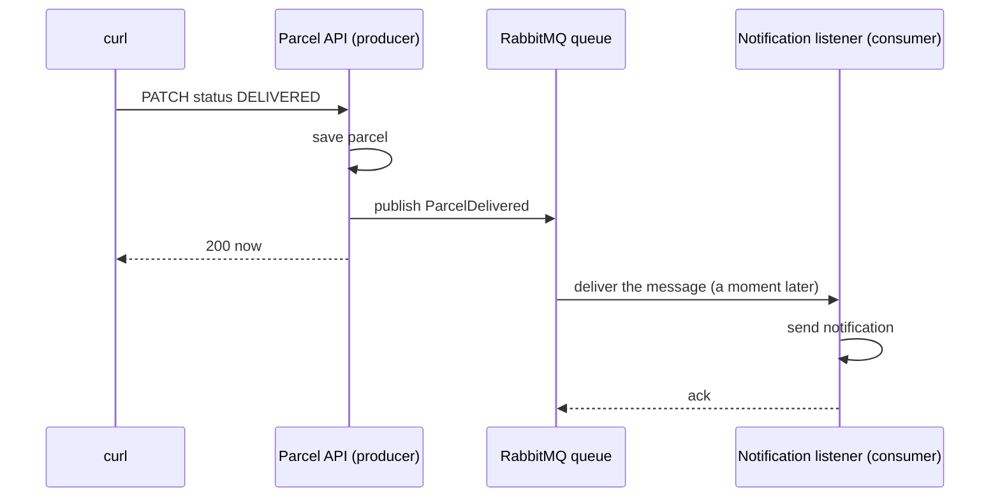

# Step 12: Queues, do slow work later

> [!PICTURE]
> In the depot, the clerk at the counter does not carry every parcel to the van. She puts it on a **conveyor belt** and turns to the next customer. A worker at the other end takes parcels off the belt when he is ready. If a parcel falls off again and again, it goes into a box labelled **"dead letters"**, so a person can look at it later. The belt is a **queue**. The box is a **dead-letter queue**.

## The problem right now

When an operator marks a parcel `DELIVERED`, your step-11 code saves the parcel **and** sends the notification inside the same request. If the email or SMS provider is slow or down, a good parcel update becomes slow or fails, for a reason that has nothing to do with parcels.

```text
now:   operator -> API -> save parcel -> send notification (slow!) -> response
queue: operator -> API -> save parcel -> put event on the belt -> response NOW
                                                  |
                                   worker takes it later -> send notification
```

## Key words

| Word | Beginner meaning |
|---|---|
| **Queue** | A waiting line for messages: in at the back, out at the front. |
| **Message / event** | A small note about something that happened, like `ParcelDelivered`. Events use past tense. |
| **Producer** | The code that puts a message on the queue. |
| **Consumer / listener** | The code that takes messages off the queue and does the work. |
| **Broker** | The program that holds the queues. We use **RabbitMQ**. |
| **Ack (acknowledge)** | The consumer says "done". Only then does the broker delete the message. |
| **Idempotent** | Doing it twice has the same result as doing it once. |
| **Dead-letter queue (DLQ)** | Where a message goes after it failed too many times. |

New to queues? Read [What is a queue, really?](what-is-a-queue.md) first. It is short and has the post-office picture in detail.

## When to use a queue, and when not

**Use one** when the work can happen after the answer: emails, SMS, PDFs, slow webhooks, audit logs.

**Do not use one** when the caller needs the result **now**: "does parcel P-1 exist?", "is this password right?".



We learn on RabbitMQ because its web page shows queues, messages and acks while they happen. Kafka and AWS SQS solve related problems; the comparison and the deeper theory (delivery guarantees, ordering, the outbox pattern) live in the [architecture track](../../../architecture/index.html) and in [Messaging and queues](../../references/architecture/messaging-and-queues.md).

## Build it in ParcelPilot (do this exactly)

The full files of this step are in [solution/](solution/README.md). Compare with them when you are stuck.

### 1. Start RabbitMQ

```bash
docker run --name rabbitmq --network parcelpilot-net \
  -p 5672:5672 -p 15672:15672 -d rabbitmq:3-management
```

Port `5672` is for your app. Port `15672` is the web page: open `http://localhost:15672` and log in with `guest` / `guest`.

### 2. Add the dependencies to `pom.xml`

```xml
<!-- RabbitMQ -->
<dependency>
    <groupId>org.springframework.boot</groupId>
    <artifactId>spring-boot-starter-amqp</artifactId>
</dependency>

<!-- tests: a real RabbitMQ in a container, and a helper that waits for async work -->
<dependency>
    <groupId>org.testcontainers</groupId>
    <artifactId>rabbitmq</artifactId>
    <scope>test</scope>
</dependency>
<dependency>
    <groupId>org.awaitility</groupId>
    <artifactId>awaitility</artifactId>
    <scope>test</scope>
</dependency>
```

### 3. Tell Spring where RabbitMQ is

Add to `src/main/resources/application.properties`:

```properties
spring.rabbitmq.host=${RABBIT_HOST:localhost}
spring.rabbitmq.port=5672
spring.rabbitmq.username=guest
spring.rabbitmq.password=guest

# a failing listener is retried 3 times (wait 1s, then 3s), then dead-lettered
spring.rabbitmq.listener.simple.retry.enabled=true
spring.rabbitmq.listener.simple.retry.max-attempts=3
spring.rabbitmq.listener.simple.retry.initial-interval=1s
spring.rabbitmq.listener.simple.retry.multiplier=3
spring.rabbitmq.listener.simple.default-requeue-rejected=false
```

The last five lines decide what happens to a message that keeps failing. [Retries and dead letters](retries-and-dead-letters.md) explains them.

### 4. Give the event an id

A message can arrive twice (you will see why in the [idempotency lab](idempotency-lab.md)). The consumer needs a way to say "I know this one". Add `eventId` as the first field of `parcel/ParcelDelivered.java`:

```java
package com.parcelpilot.parcel;

import java.time.Instant;
import java.util.UUID;

/** Event: a parcel WAS delivered (past tense = a fact). */
public record ParcelDelivered(UUID eventId, String parcelId, String recipient, Instant occurredAt) {}
```

### 5. Declare the belt and the dead-letter box

Create `src/main/java/com/parcelpilot/messaging/MessagingConfig.java`:

```java
package com.parcelpilot.messaging;

import com.fasterxml.jackson.databind.ObjectMapper;
import org.springframework.amqp.core.Queue;
import org.springframework.amqp.core.QueueBuilder;
import org.springframework.amqp.support.converter.Jackson2JsonMessageConverter;
import org.springframework.amqp.support.converter.MessageConverter;
import org.springframework.context.annotation.Bean;
import org.springframework.context.annotation.Configuration;

@Configuration
public class MessagingConfig {

    public static final String PARCEL_DELIVERED_QUEUE = "parcel-delivered";
    public static final String PARCEL_DELIVERED_DLQ = "parcel-delivered.dlq";

    @Bean
    Queue parcelDeliveredQueue() {          // the belt; failures slide into the DLQ
        return QueueBuilder.durable(PARCEL_DELIVERED_QUEUE)
                .withArgument("x-dead-letter-exchange", "")
                .withArgument("x-dead-letter-routing-key", PARCEL_DELIVERED_DLQ)
                .build();
    }

    @Bean
    Queue parcelDeliveredDeadLetterQueue() { // the "dead letters" box
        return QueueBuilder.durable(PARCEL_DELIVERED_DLQ).build();
    }

    @Bean
    MessageConverter jsonMessageConverter(ObjectMapper objectMapper) {
        return new Jackson2JsonMessageConverter(objectMapper);   // events travel as readable JSON
    }
}
```

`durable` means the queue survives a RabbitMQ restart. The JSON converter matters later: in step 13 another program reads these messages, and JSON is a format every program understands.

### 6. The producer: a new `Notifier`

The parcel module already talks to the outside through its `Notifier` port (step 11). Now the port gets a new adapter that puts the event on the belt. Create `parcel/internal/RabbitNotifier.java`:

```java
package com.parcelpilot.parcel.internal;

import com.parcelpilot.messaging.MessagingConfig;
import com.parcelpilot.parcel.Notifier;
import com.parcelpilot.parcel.ParcelDelivered;
import org.slf4j.Logger;
import org.slf4j.LoggerFactory;
import org.springframework.amqp.rabbit.core.RabbitTemplate;
import org.springframework.stereotype.Component;

@Component
public class RabbitNotifier implements Notifier {

    private static final Logger log = LoggerFactory.getLogger(RabbitNotifier.class);
    private final RabbitTemplate rabbit;

    public RabbitNotifier(RabbitTemplate rabbit) {
        this.rabbit = rabbit;
    }

    @Override
    public void parcelDelivered(ParcelDelivered event) {
        rabbit.convertAndSend(MessagingConfig.PARCEL_DELIVERED_QUEUE, event);  // routing key = queue name
        log.info("Published ParcelDelivered for {} (eventId {})", event.parcelId(), event.eventId());
    }
}
```

**Delete `notification/LoggingNotifier.java`.** Two `Notifier` beans would confuse Spring, and the notification work moves into the listener in sub-step 8.

### 7. Publish after the save

In `parcel/internal/ParcelService.java`, change the end of `changeStatus`:

```java
// saveAndFlush: the database accepts the change NOW, so we never announce
// a delivery that the database then refuses.
ParcelEntity saved = repository.saveAndFlush(parcel);

if (saved.status() == Status.DELIVERED) {
    notifier.parcelDelivered(new ParcelDelivered(
            UUID.randomUUID(), saved.id(), saved.recipient(), Instant.now()));
}
return toResponse(saved);
```

`ParcelService` did not change its constructor: it still receives a `Notifier`. That is the payoff of step 11's port: the use case does not know that a queue exists.

### 8. The consumer: a listener that is safe to call twice

First the memory of handled events. Create `src/main/resources/db/migration/V2__create_notifications.sql`:

```sql
-- One row per handled event. The primary key makes a second insert impossible.
CREATE TABLE notifications (
    event_id     UUID PRIMARY KEY,
    parcel_id    VARCHAR(64) NOT NULL,
    processed_at TIMESTAMP   NOT NULL DEFAULT now()
);
```

Then the listener, `notification/internal/ParcelDeliveredListener.java`:

```java
package com.parcelpilot.notification.internal;

import com.parcelpilot.messaging.MessagingConfig;
import com.parcelpilot.parcel.ParcelDelivered;
import org.slf4j.Logger;
import org.slf4j.LoggerFactory;
import org.springframework.amqp.rabbit.annotation.RabbitListener;
import org.springframework.jdbc.core.JdbcTemplate;
import org.springframework.stereotype.Component;

@Component
public class ParcelDeliveredListener {

    private static final Logger log = LoggerFactory.getLogger(ParcelDeliveredListener.class);
    private final JdbcTemplate jdbc;

    public ParcelDeliveredListener(JdbcTemplate jdbc) {
        this.jdbc = jdbc;
    }

    @RabbitListener(queues = MessagingConfig.PARCEL_DELIVERED_QUEUE)
    public void handle(ParcelDelivered event) {
        // Record first, act second.
        int inserted = jdbc.update("""
                INSERT INTO notifications (event_id, parcel_id)
                VALUES (?, ?) ON CONFLICT (event_id) DO NOTHING
                """, event.eventId(), event.parcelId());

        if (inserted == 0) {   // 0 rows: we handled this event before
            log.info("Duplicate event {} for parcel {}, skipping", event.eventId(), event.parcelId());
            return;            // returning normally = ack, the duplicate leaves the queue
        }
        // a real app calls the email or SMS provider here
        log.info("notification sent for {} to {}", event.parcelId(), event.recipient());
    }
}
```

The listener only uses the parcel module's **public** `ParcelDelivered`, never `parcel/internal`. The step-11 boundary grep still prints `0`. Why record **before** sending: if the app crashes after sending but before the ack, the redelivered message finds its row and is skipped, so nobody gets two texts. The price and the alternatives are in the [idempotency lab](idempotency-lab.md).

### 9. Test the whole trip

Tests need a real RabbitMQ next to the real PostgreSQL. Create `src/test/java/com/parcelpilot/TestcontainersConfiguration.java`:

```java
@TestConfiguration(proxyBeanMethods = false)
public class TestcontainersConfiguration {

    @Bean
    @ServiceConnection   // hands Spring the container's host and port, no @DynamicPropertySource needed
    PostgreSQLContainer<?> postgres() {
        return new PostgreSQLContainer<>("postgres:16-alpine");
    }

    @Bean
    @ServiceConnection
    RabbitMQContainer rabbit() {
        return new RabbitMQContainer("rabbitmq:3-management");
    }
}
```

Then `src/test/java/com/parcelpilot/ParcelDeliveredFlowTest.java`:

```java
@SpringBootTest
@Import(TestcontainersConfiguration.class)
class ParcelDeliveredFlowTest {

    @Autowired ParcelService parcels;
    @Autowired ParcelDeliveredListener listener;
    @Autowired JdbcTemplate jdbc;

    @Test
    void deliveringAParcel_leadsToExactlyOneNotification() {
        parcels.create(new CreateParcelRequest("P-Q1", "Ava"));
        parcels.changeStatus("P-Q1", Status.PICKED_UP);
        parcels.changeStatus("P-Q1", Status.DELIVERED);

        // the listener runs on another thread, a moment later: wait for it
        await().atMost(Duration.ofSeconds(10))
               .untilAsserted(() -> assertThat(notificationsFor("P-Q1")).isEqualTo(1));
    }

    @Test
    void theSameEventTwice_isHandledOnlyOnce() {
        ParcelDelivered event = new ParcelDelivered(UUID.randomUUID(), "P-Q2", "Ben", Instant.now());
        listener.handle(event);
        listener.handle(event);   // a redelivered duplicate
        assertThat(notificationsFor("P-Q2")).isEqualTo(1);
    }

    private int notificationsFor(String parcelId) {
        return jdbc.queryForObject(
                "SELECT count(*) FROM notifications WHERE parcel_id = ?", Integer.class, parcelId);
    }
}
```

The imports are in the solution files: [TestcontainersConfiguration](solution/src/test/java/com/parcelpilot/TestcontainersConfiguration.java) and [ParcelDeliveredFlowTest](solution/src/test/java/com/parcelpilot/ParcelDeliveredFlowTest.java).

## Test it

> [!TRY]
> 1. Run the tests: `cd applications/parcelpilot && mvn test`. You should see `BUILD SUCCESS`.
> 2. Start the app with the listener **switched off**: `SPRING_RABBITMQ_LISTENER_SIMPLE_AUTO_STARTUP=false mvn spring-boot:run`
> 3. In a second terminal, create a parcel and deliver it:
>    ```bash
>    curl -i -X POST http://localhost:8080/parcels \
>      -H 'Content-Type: application/json' -d '{"id":"P-12","recipient":"Ava"}'
>    curl -i -X PATCH http://localhost:8080/parcels/P-12/status \
>      -H 'Content-Type: application/json' -d '{"status":"PICKED_UP"}'
>    curl -i -X PATCH http://localhost:8080/parcels/P-12/status \
>      -H 'Content-Type: application/json' -d '{"status":"DELIVERED"}'
>    ```
>    The last answer is a fast `200`, although nobody sends notifications.
> 4. Open `http://localhost:15672` → **Queues**. `parcel-delivered` shows `Ready: 1`. The message waits on the belt.
> 5. Stop the app (Ctrl+C) and start it normally: `mvn spring-boot:run`.
>
> You should see `notification sent for P-12 to Ava` in the log, and `Ready: 0` on the queue page.

## Go deeper (labs)

- [Idempotency lab](idempotency-lab.md): make a message arrive twice and prove only one notification goes out. Concept: [idempotency in HTTP](../../../computer-science/index.html#http-requests-responses).
- [Retries and dead letters](retries-and-dead-letters.md): feed the listener a "poison" message and watch it land in the dead-letter box.
- [Event-driven lab](event-driven-lab.md): kill the worker at the worst moment and watch RabbitMQ redeliver.

## Done when

- [ ] `mvn test` is green, including `ParcelDeliveredFlowTest`.
- [ ] Marking a parcel delivered answers fast even while the listener is switched off.
- [ ] The waiting message is visible in the RabbitMQ web page, and the listener picks it up after a restart.
- [ ] The same event handled twice gives **one** row in `notifications`.
- [ ] `LoggingNotifier` is gone, and no `notification` class imports `parcel.internal`.
- [ ] You can name one good and one bad use for a queue.

## Check yourself

> [!CHECK]
> 1. Why does the `PATCH` answer fast now, even when sending notifications is slow?
>    <details><summary>Answer</summary>The request only saves the parcel and puts a small message on the queue. The slow sending happens later, in the listener, on another thread. The caller does not wait for it.</details>
> 2. What is `eventId` for?
>    <details><summary>Answer</summary>RabbitMQ can deliver the same message twice. The listener stores every <code>eventId</code> it handled in the <code>notifications</code> table (primary key). A second insert of the same id inserts 0 rows, so the listener knows it is a duplicate and skips it.</details>
> 3. Why did `ParcelService` not change its constructor in this step?
>    <details><summary>Answer</summary>It depends on the <code>Notifier</code> interface (the port from step 11), not on a concrete class. We only swapped the adapter behind the port: <code>LoggingNotifier</code> out, <code>RabbitNotifier</code> in.</details>
> 4. What happens to a message whose listener throws an exception every time?
>    <details><summary>Answer</summary>Spring retries it 3 times with a pause (1 s, then 3 s). After the last try it rejects the message without putting it back, and RabbitMQ moves it to <code>parcel-delivered.dlq</code>, the dead-letter box, where a person can inspect it.</details>

## Reflect

Notification work now runs on its own schedule, in its own listener, with its own table. Nothing in it needs the parcel code except one small event. That is a strong hint that it could live in its own program.

## Next

[Step 13](../13-split-services/README.md): move the notification listener into its own service.
