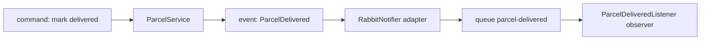

# Event-driven lab: watch a message come back

Companion to [Step 12](README.md). Do it after the build works.

> [!PICTURE]
> The worker takes a parcel off the belt, puts it in the van, and faints before he can tick it off on his list. The next worker sees no tick, so he puts the same parcel in the van again. Nobody did anything wrong. The list did not know.

## Four names for what you built

The patterns are not new words to learn by heart. They are names for code you already have:

| Pattern | In ParcelPilot |
|---|---|
| **Command** (asks for work, imperative name) | `PATCH /parcels/P-1/status {"status":"DELIVERED"}` |
| **Event** (a fact, past tense) | `ParcelDelivered(eventId, parcelId, recipient, occurredAt)` |
| **Adapter** (wraps broker code behind a port) | `RabbitNotifier implements Notifier` |
| **Observer** (reacts to an event it subscribed to) | `ParcelDeliveredListener` with `@RabbitListener` |



## Provoke a duplicate delivery

The dangerous moment is **after the work, before the ack**. Make that moment long. Add a temporary sleep at the **end** of `handle(...)` in `ParcelDeliveredListener`, after the `notification sent` log line:

```java
log.info("notification sent for {} to {}", event.parcelId(), event.recipient());
try {
    Thread.sleep(10_000);   // TEMPORARY: hold the message un-acked for 10 seconds
} catch (InterruptedException e) {
    Thread.currentThread().interrupt();
}
```

> [!TRY]
> 1. Start the app: `mvn spring-boot:run`.
> 2. In a second terminal, create a parcel `P-13`, pick it up, and deliver it (the three `curl` commands from the step README, with `P-13`).
> 3. The moment `notification sent for P-13` appears, press **Ctrl+C** in the app terminal.
> 4. Open `http://localhost:15672` → Queues → `parcel-delivered`. The message is back: `Ready: 1`.
> 5. Start the app again: `mvn spring-boot:run`.
>
> You should see the **same** `eventId` arrive a second time. Because your listener is idempotent, the second time logs `Duplicate event … skipping` instead of a second `notification sent`.

Want to see the bug the `notifications` table prevents? Comment out the `if (inserted == 0)` block and repeat: now `notification sent for P-13` appears twice. Put the block back afterwards, and delete the `Thread.sleep`.

Why does RabbitMQ do this? It cannot tell "crashed before the work" from "crashed after the work, before the ack". When in doubt it delivers again, so no message is lost. This promise is called **at-least-once delivery**, and every serious queue makes it. The [idempotency lab](idempotency-lab.md) explains the other options and why this one wins.

## Trade-offs

| Events: pros | Events: cons |
|---|---|
| The request never waits for slow side work | For a moment, parts of the system disagree (the parcel is `DELIVERED`, the notification does not exist yet) |
| A broken notification provider no longer breaks parcel updates | Duplicates and ordering become your job |
| Producer and consumer can change and scale on their own | One action now spans two places; step 14's [correlation IDs](../14-compose-and-observe/correlation-ids.md) tie the logs together again |

## Next

- [Idempotency lab](idempotency-lab.md)
- Back to [Step 12](README.md)
