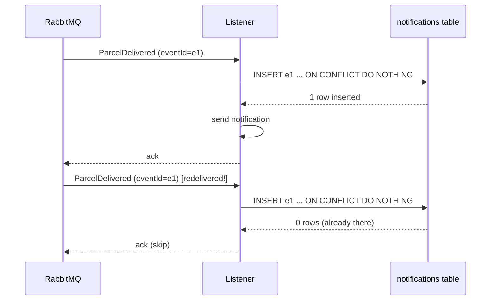

# Idempotency lab: surviving duplicate messages

Companion to [Step 12](README.md). Do it after the build works.

> [!PICTURE]
> The worker at the end of the belt keeps a **list of parcel labels he has already handled**. When a parcel with a label from his list comes along again, he puts it aside without a second delivery. The list is the `notifications` table. The label is the `eventId`.

## The problem

Your listener receives `ParcelDelivered`, sends the notification… and the app crashes **before** it acknowledges the message. For RabbitMQ the message was never handled, so it goes back on the queue. After the restart the listener receives the **same event again** and would send a **second** notification. Ava gets two "your parcel arrived!" texts. With a payment instead of a text, this bug costs money.

RabbitMQ is not broken. It promises **at-least-once** delivery, and "at least" means duplicates are your job.

## Key words

| Word | Beginner meaning |
|---|---|
| **Idempotent** | Doing it twice has the same result as doing it once. The general idea (also for HTTP methods) is in the [CS lesson on HTTP](../../../computer-science/index.html#http-requests-responses). |
| **At-most-once** | Ack before the work: no duplicates, but a crash can **lose** a message. |
| **At-least-once** | Ack after the work: nothing is lost, but **duplicates happen**. RabbitMQ's default, and what ParcelPilot uses. |
| **Exactly-once** | The dream. Across a broker, your database and an email provider you cannot really have it. You build at-least-once plus idempotency and get the same *effect*. |
| **Dedup(lication)** | Spotting "I handled this one already" and skipping it. |

Why can't the broker avoid duplicates? It cannot tell "the worker crashed before the work" from "the worker did the work and crashed before the ack". Only your consumer can tell, because only your consumer can keep a record.

## How your listener does it

You built it in [sub-step 8 of the README](README.md#8-the-consumer-a-listener-that-is-safe-to-call-twice). The three ideas:

1. **Every event carries a unique id.** `ParcelDelivered(eventId, parcelId, recipient, occurredAt)`. The producer creates a fresh `UUID` for each delivery.
2. **The id is a primary key.** `notifications.event_id UUID PRIMARY KEY`. The database refuses a second row with the same id, even if two copies arrive in the same millisecond.
3. **Insert-if-absent, then act.**

```java
int inserted = jdbc.update("""
        INSERT INTO notifications (event_id, parcel_id)
        VALUES (?, ?) ON CONFLICT (event_id) DO NOTHING
        """, event.eventId(), event.parcelId());
if (inserted == 0) {
    return;   // duplicate: skip it, and returning normally acks it
}
// send the notification
```

Two details to say out loud:

- **A duplicate is acknowledged, not rejected.** Skipping a duplicate *is* handling it correctly. Returning normally lets Spring ack it, and it leaves the queue.
- **Record before the side effect.** If you sent first and recorded second, a crash between the two would send again after the redelivery: the original bug. Record-first has the opposite risk: a crash after the insert but before sending means one notification is **never** sent, and a retry would skip it too. ParcelPilot's rule is "rather miss one text than spam". When both risks are unacceptable (payments), teams use the **transactional outbox** pattern, explained in [Messaging and queues](../../references/architecture/messaging-and-queues.md#the-dual-write-problem).



## Prove it

> [!TRY]
> 1. Start the app (`mvn spring-boot:run`) and open `http://localhost:15672` (`guest` / `guest`) → **Queues** → `parcel-delivered` → **Publish message**.
> 2. In **Properties**, add `content_type` = `application/json`. (Without it, the JSON converter does not know the bytes are JSON.)
> 3. Paste this payload and press **Publish message** two times:
>    ```json
>    {"eventId":"11111111-1111-1111-1111-111111111111","parcelId":"P-1","recipient":"Ava","occurredAt":"2026-01-01T10:00:00Z"}
>    ```
> 4. Look at the app log, then count the rows:
>    ```bash
>    docker exec -it parcelpilot-db psql -U parcelpilot -d parcelpilot \
>      -c "SELECT event_id, parcel_id FROM notifications WHERE parcel_id = 'P-1';"
>    ```
>
> You should see one `notification sent for P-1 to Ava`, one `Duplicate event 11111111-… for parcel P-1, skipping`, and exactly **one** row.

For a real redelivery (not a hand-made copy), do the crash scenario in the [event-driven lab](event-driven-lab.md). The automated version of this proof is the test `theSameEventTwice_isHandledOnlyOnce` in [ParcelDeliveredFlowTest](solution/src/test/java/com/parcelpilot/ParcelDeliveredFlowTest.java).

## Pros and cons

| Pros | Cons |
|---|---|
| Duplicates become harmless, so at-least-once is safe to build on | A table of handled ids to store and clean up one day |
| The database enforces it, even for duplicates that arrive at the same time | Every event **must** carry a stable unique id, forever |
| Skips are visible in the log | One more query per message |
| The same trick works for payments, emails, webhooks | It does not fix the producer side (dual write needs the outbox) |

## When you do not need it

Some operations are **naturally idempotent**: `UPDATE parcels SET status = 'DELIVERED' WHERE id = 'P-1'` ends in the same state however often it runs. Rule of thumb: *setting* a value is naturally idempotent; *adding, sending, counting* is not. "Send a text", "append a row", "charge €5" all need the dedup key. When unsure, assume you need it.

## Check yourself

> [!CHECK]
> 1. Why is `event_id` the **primary key** and not a normal column?
>    <details><summary>Answer</summary>A primary key makes a second row with the same id impossible. The database enforces it even when two copies of the event arrive at the same moment, so a check-then-insert race cannot slip through.</details>
> 2. The listener sees a duplicate. Does it ack the message or reject it?
>    <details><summary>Answer</summary>It acks it (returns normally). The duplicate was handled correctly by skipping it. Rejecting it would send it to retries and the dead-letter queue for nothing.</details>
> 3. What goes wrong if you send first and record second?
>    <details><summary>Answer</summary>A crash between "send" and "record" leaves no row. The redelivered message inserts its row and sends again: the customer gets two notifications.</details>

## Next

- When a message does not only repeat but keeps **failing**: [Retries and dead letters](retries-and-dead-letters.md).
- Back to [Step 12](README.md).
