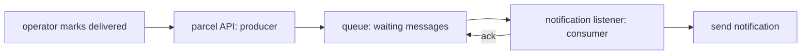

# What is a queue, really?

> [!PICTURE]
> At a post office, a customer puts a parcel on the sorting belt and leaves. Sorting goes on after the customer is gone. The belt holds the work until a worker is ready. That belt is a queue.

## The parts, in ParcelPilot words

- The **producer** is the code that publishes `ParcelDelivered` (`RabbitNotifier`).
- The **message** says which parcel was delivered, to whom, and when.
- **RabbitMQ** is the **broker**: it holds and routes the messages.
- The **consumer** is the notification listener (`ParcelDeliveredListener`).
- An **ack** tells the broker "this job is done, you can delete the message".



## What problem does it solve?

Without a queue, the API waits for the slowest part:

```text
operator → API → database → email provider → response
```

If the email provider takes ten seconds or fails, the operator waits or sees an error, even though the parcel update worked.

With a queue:

```text
operator → API → database + queue → response now
                               ↓
                         notification later
```

The caller gets an answer as soon as the important part (the parcel) is saved. The listener can retry the notification later.

## When should I use one?

Use a queue when all of these are true:

1. The work can happen later.
2. The caller does not need the result in the same HTTP response.
3. The work gains from retries, buffering, or scaling on its own.
4. It is fine that parts of the system disagree for a moment.

Good examples: email, SMS, thumbnails, billing exports, audit events, slow webhooks.

Bad examples: checking a password at login, checking stock before accepting an order, reading a parcel by id. The caller needs those answers **now**.

## RabbitMQ, Kafka, SQS

- **RabbitMQ**: task queues and routing. You can watch it work in its web page. We start here.
- **Kafka**: a durable event log with replay. Good for huge streams and many independent readers.
- **AWS SQS**: a queue run by Amazon. Good when you are on AWS and do not want to run a broker.

They are not the same product with different names. The problem decides. More in [Messaging and queues](../../references/architecture/messaging-and-queues.md) and the [architecture track](../../../architecture/index.html).

## The honest limits

A queue does not make code reliable by magic. A consumer may receive the same message **twice**, so it must be idempotent ([idempotency lab](idempotency-lab.md)). And "save to the database" plus "publish to the queue" are two actions that can be interrupted in between. That gap is called the **dual-write** problem; the transactional outbox pattern closes it (see [Messaging and queues](../../references/architecture/messaging-and-queues.md#the-dual-write-problem)).

## Check yourself

> [!CHECK]
> 1. Who is the producer and who is the consumer in ParcelPilot?
>    <details><summary>Answer</summary>The producer is the parcel side (<code>RabbitNotifier</code>), which publishes <code>ParcelDelivered</code>. The consumer is the notification listener, which takes the message off the queue and sends the notification.</details>
> 2. Should "is this password correct?" go through a queue?
>    <details><summary>Answer</summary>No. The caller needs the answer before it can continue. Queues are for work that can happen after the response.</details>
> 3. What does an ack tell the broker?
>    <details><summary>Answer</summary>"I finished this message, you can delete it." Without an ack, the broker keeps the message and gives it out again.</details>

## Next

Back to [step 12](README.md) and build it.
