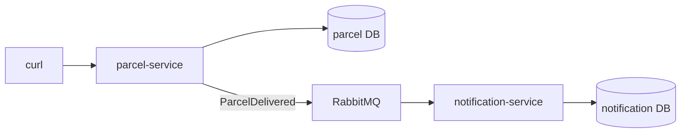

# Step 13: Extract the notification microservice

> [!PICTURE]
> So far the notification desk sat in a corner of the main depot. Now it moves into its **own little post-office branch** across town, with its own staff and its own filing cabinet. The depot does not phone the branch and wait. It drops a **note** into the shared mailbox (RabbitMQ), and the branch picks the note up when it can. If the branch closes for an hour, the notes wait in the mailbox.

## The problem right now

Step 12 proved that notification work runs on its own schedule. But it still lives **inside** the parcel app: one build, one deploy, one database. If notifications need a new release or more power, parcel tracking is dragged along. Now there is a **real boundary**, and it is worth a split.

## Key words

| Word | Beginner meaning |
|---|---|
| **Microservice** | A small app that is built, deployed and scaled on its own. |
| **Database per service** | Each service owns its data. Others never read it directly. |
| **Contract** | The agreed message shape two services use to talk. Deep dive: [service contracts](service-contracts.md). |
| **Eventual consistency** | Services agree a moment *later*, not instantly. |
| **Partial failure** | One part is down while the others keep working. |

## What makes it a microservice, not a folder?

Two rules: it is **deployed on its own**, and it **owns its data**. Two packages in one app that share a database are not microservices.

- **parcel-service** owns the parcel endpoints and the parcel database. It publishes `ParcelDelivered`.
- **notification-service** owns the listener and its own `notifications` database.
- They talk **only** through RabbitMQ. notification-service never connects to the parcel database.



Why this is cheap now: in step 11 you drew a boundary that the compiler and a grep checked. The split follows exactly that line. The general pros and cons are in [Monoliths and microservices](../../references/architecture/monolith-and-microservices.md); the senior view is in the [architecture track](../../../architecture/index.html).

## Build it in ParcelPilot (do this exactly)

The full files are in [solution/](solution/README.md).

### 1. Save the working monolith

Before you move anything, tag the step-12 monolith in Git, so you can always go back: [Git tag checkpoint](git-tag-checkpoint.md).

### 2. Make the new folders

```bash
cd applications
mkdir parcelpilot-services
cp -r parcelpilot parcelpilot-services/parcel-service
mkdir -p parcelpilot-services/notification-service
```

```text
applications/parcelpilot-services/
├── parcel-service/          # the copy: endpoints, parcel DB, publishes events
└── notification-service/    # new: listener, its own DB
```

### 3. Slim down parcel-service

In `parcelpilot-services/parcel-service`:

1. Delete the folder `src/main/java/com/parcelpilot/notification/` (the listener moves out).
2. Delete `src/test/java/com/parcelpilot/ParcelDeliveredFlowTest.java` (it tested both halves; each service gets its own tests below).
3. In `pom.xml`, rename `<artifactId>parcelpilot</artifactId>` to `<artifactId>parcel-service</artifactId>`.
4. In `application.properties`, set `spring.application.name=parcel-service`.
5. Hand the table over. Create `src/main/resources/db/migration/V3__drop_notifications.sql`:

```sql
-- Notifications now live in notification-service's own database.
DROP TABLE notifications;
```

Keep `MessagingConfig` and `RabbitNotifier`: parcel-service is still the producer.

### 4. Create notification-service

It needs only four classes. Copy the [notification-service pom.xml](solution/notification-service/pom.xml) (its key dependencies are `spring-boot-starter-amqp`, `spring-boot-starter-json`, `spring-boot-starter-jdbc`, `postgresql`, `flyway-core` and `flyway-database-postgresql`) and the [Dockerfile](solution/notification-service/Dockerfile) (the same as step 09, with port 8081).

All classes go into `src/main/java/com/parcelpilot/notification/`. The entry point:

```java
package com.parcelpilot.notification;

import org.springframework.boot.SpringApplication;
import org.springframework.boot.autoconfigure.SpringBootApplication;

@SpringBootApplication
public class NotificationServiceApplication {
    public static void main(String[] args) {
        SpringApplication.run(NotificationServiceApplication.class, args);
    }
}
```

Its **own copy** of the event. Same field names and types as parcel-service sends, but a different Java class in a different program. Only the JSON connects them: that JSON is the [contract](service-contracts.md).

```java
package com.parcelpilot.notification;

import java.time.Instant;
import java.util.UUID;

public record ParcelDelivered(UUID eventId, String parcelId, String recipient, Instant occurredAt) {}
```

Then two copies from the monolith, with the package changed to `com.parcelpilot.notification`:

- `MessagingConfig.java` from `messaging/`, unchanged otherwise.
- `ParcelDeliveredListener.java` from `notification/internal/`. Delete its two imports `com.parcelpilot.messaging.MessagingConfig` and `com.parcelpilot.parcel.ParcelDelivered`: both classes are now in the same package.

> [!WARN]
> Both services declare the queue `parcel-delivered`. RabbitMQ accepts the second declaration only if the arguments are **identical** (`x-dead-letter-exchange`, `x-dead-letter-routing-key`). One different argument and the app fails at start with `PRECONDITION_FAILED - inequivalent arg`. That is why both copies of `MessagingConfig` must match.

### 5. Give notification-service its own database

`src/main/resources/db/migration/V1__create_notifications.sql` gets the same `CREATE TABLE notifications (...)` as step 12's `V2` migration. Then `src/main/resources/application.properties`:

```properties
spring.application.name=notification-service

# its own database (port 5433 on your laptop, 5432 inside Docker)
spring.datasource.url=jdbc:postgresql://${DB_HOST:localhost}:${DB_PORT:5433}/notifications
spring.datasource.username=${DB_USER:notifications}
spring.datasource.password=${DB_PASSWORD:local-dev-only}
spring.flyway.enabled=true

logging.pattern.console=%d{HH:mm:ss.SSS} %-5level [%X{requestId}] %logger{36} : %msg%n

# the same broker as parcel-service
spring.rabbitmq.host=${RABBIT_HOST:localhost}
spring.rabbitmq.port=5672
spring.rabbitmq.username=guest
spring.rabbitmq.password=guest
```

Also copy the five `spring.rabbitmq.listener.simple.*` retry lines from step 12: the retries belong to the listener, so they move with it.

### 6. Test each service on its own

**Contract tests** check the JSON on both sides, without Docker. The consumer side, `src/test/java/com/parcelpilot/notification/ParcelDeliveredContractTest.java`:

```java
@JsonTest   // only Jackson, configured like the real app
class ParcelDeliveredContractTest {

    @Autowired
    JacksonTester<ParcelDelivered> json;

    @Test
    void readsTheAgreedJson_andIgnoresUnknownFields() throws Exception {
        String fromParcelService = """
                {"eventId":"11111111-1111-1111-1111-111111111111",
                 "parcelId":"P-7","recipient":"Ava",
                 "occurredAt":"2026-07-14T16:22:31Z",
                 "addedLater":"consumers must ignore this"}
                """;

        ParcelDelivered event = json.parseObject(fromParcelService);

        assertThat(event.parcelId()).isEqualTo("P-7");
        assertThat(event.occurredAt()).isEqualTo(Instant.parse("2026-07-14T16:22:31Z"));
    }
}
```

The producer side ([ParcelDeliveredContractTest](solution/parcel-service/src/test/java/com/parcelpilot/ParcelDeliveredContractTest.java) in parcel-service) writes an event and checks the field names. Rename `parcelId` in one service and one of the two tests turns red: the compiler can no longer catch that for you.

Then one test per service with real containers:

- parcel-service: [ParcelEventsTest](solution/parcel-service/src/test/java/com/parcelpilot/ParcelEventsTest.java) delivers a parcel and reads the event straight off the queue.
- notification-service: [ParcelDeliveredListenerTest](solution/notification-service/src/test/java/com/parcelpilot/notification/ParcelDeliveredListenerTest.java) sends the same event twice and expects one row. It needs its own [TestcontainersConfiguration](solution/notification-service/src/test/java/com/parcelpilot/notification/TestcontainersConfiguration.java) (the step-12 one, in the new package).

## Test it

> [!TRY]
> 1. Run both test suites:
>    ```bash
>    cd applications/parcelpilot-services
>    (cd parcel-service && mvn test)
>    (cd notification-service && mvn test)
>    ```
> 2. Start notification-service's own database next to the others on `parcelpilot-net`:
>    ```bash
>    docker run --name notification-db --network parcelpilot-net \
>      -e POSTGRES_DB=notifications -e POSTGRES_USER=notifications \
>      -e POSTGRES_PASSWORD=local-dev-only -p 5433:5432 \
>      -v notification-postgres:/var/lib/postgresql/data -d postgres:16-alpine
>    ```
> 3. Build two images and run them (stop the old `parcelpilot-api` container first: `docker rm -f parcelpilot-api`):
>    ```bash
>    docker build -t parcel-service ./parcel-service
>    docker build -t notification-service ./notification-service
>    docker run --name parcel-service --network parcelpilot-net -p 8080:8080 \
>      -e DB_HOST=parcelpilot-db -e RABBIT_HOST=rabbitmq -d parcel-service
>    docker run --name notification-service --network parcelpilot-net \
>      -e DB_HOST=notification-db -e DB_PORT=5432 -e RABBIT_HOST=rabbitmq -d notification-service
>    ```
> 4. Create a parcel `P-13`, pick it up and deliver it with the three `curl` commands from step 12.
> 5. Read the branch's log: `docker logs notification-service`
>
> You should see `notification sent for P-13 to Ava` exactly once, in **notification-service's** log, not in parcel-service's.

Prove the data really moved:

```bash
docker exec -it notification-db psql -U notifications -d notifications -c "SELECT parcel_id FROM notifications;"
docker exec -it parcelpilot-db psql -U parcelpilot -d parcelpilot -c "\dt"   # no notifications table any more
```

## Go deeper (labs)

- [Service contracts](service-contracts.md): the agreement no compiler checks, and how to change it safely.
- [Network failure lab](network-failure-lab.md): stop one service, then the broker, and watch what each failure does.
- [Git tag checkpoint](git-tag-checkpoint.md): the safety net from sub-step 1.

## Done when

- [ ] Both services build their own image: `parcel-service` and `notification-service`.
- [ ] Delivering a parcel in parcel-service makes notification-service log **exactly one** notification.
- [ ] notification-service has no parcel-database settings, and parcel-service no longer has a `notifications` table.
- [ ] `mvn test` is green in **both** services, including the two contract tests.
- [ ] You can name two costs the split added.

## Check yourself

> [!CHECK]
> 1. Why does notification-service have its **own** `ParcelDelivered` class instead of using parcel-service's?
>    <details><summary>Answer</summary>The services are separate programs, built and released on their own. Sharing a Java class would tie their builds together again. What they share is the <strong>JSON contract</strong>; each side has its own class that matches it.</details>
> 2. What happens if you change the dead-letter argument in only one `MessagingConfig`?
>    <details><summary>Answer</summary>RabbitMQ refuses the second declaration of <code>parcel-delivered</code> with <code>PRECONDITION_FAILED - inequivalent arg</code>, and that service fails to start. Queue declarations must be identical on both sides.</details>
> 3. notification-service is stopped and three parcels are delivered. What happens?
>    <details><summary>Answer</summary>parcel-service answers normally. The three events wait in the queue. When notification-service starts again, it handles them. Nothing is lost: the queue absorbs the outage.</details>
> 4. Name two costs of this split.
>    <details><summary>Answer</summary>Any two: a second database to run; changes to the event need care because no compiler checks the contract; logs are now in two places; more things to start; the services only agree eventually.</details>

## Reflect

You now start two services, two databases and a broker by hand, with long `docker run` lines. That is slow and easy to get wrong, and it is written down nowhere.

## Next

[Step 14](../14-compose-and-observe/README.md): start the whole system with one command and learn to watch it.
