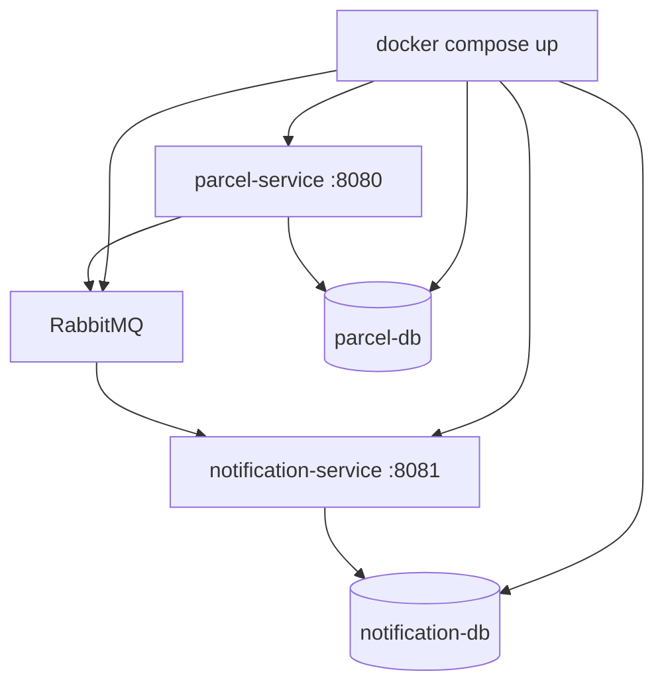

# Step 14: Docker Compose and observing the system

> [!PICTURE]
> Every morning you walk through the depot and switch things on one by one: the lights, the belt, the scanner, the branch office, in the right order. Now you get **one remote control**. One button starts the whole depot in the right order, and a row of **green lamps** shows what is running. The remote is `docker compose up`. The lamps are the health checks.

## The problem right now

Your system is two services, RabbitMQ and two databases. Step 13 started them with five long `docker run` lines, in the right order, with the right network and environment variables. Nobody can repeat that from memory, and when something breaks you read four separate logs.

You need one written-down definition of the whole system, and ways to see what it is doing.

## Key words

| Word | Beginner meaning |
|---|---|
| **Docker Compose** | A tool that starts many containers from one file. |
| **`compose.yaml`** | That file: services, networks, volumes, settings. |
| **Health check** | A small test Compose runs to see if a service is really ready. |
| **`depends_on`** | "Start this one only after those are healthy." |
| **Actuator** | Spring's built-in endpoints like `/actuator/health` and `/actuator/metrics`. |
| **Observability** | Seeing what a running system does: **health** (alive?), **logs** (what happened?), **metrics** (getting worse?). |
| **Correlation ID** | One id for one request, written on every log line in every service it touches. |

The Compose idea itself (services, networks, volumes) is taught in the CS lesson [Docker Compose](../../../computer-science/index.html#docker-compose). This step uses it for ParcelPilot.



## Build it in ParcelPilot (do this exactly)

Work in `applications/parcelpilot-services/`. The full files are in [solution/](solution/README.md).

### 1. Write `compose.yaml`

Create `applications/parcelpilot-services/compose.yaml`:

```yaml
services:
  parcel-db:
    image: postgres:16-alpine
    environment:
      POSTGRES_DB: parcelpilot
      POSTGRES_USER: parcelpilot
      POSTGRES_PASSWORD: local-dev-only      # local only, never a real secret
    volumes:
      - parcel-data:/var/lib/postgresql/data
    healthcheck:
      test: ["CMD-SHELL", "pg_isready -U parcelpilot -d parcelpilot"]
      interval: 5s
      timeout: 3s
      retries: 10

  notification-db:
    image: postgres:16-alpine
    environment:
      POSTGRES_DB: notifications
      POSTGRES_USER: notifications
      POSTGRES_PASSWORD: local-dev-only
    volumes:
      - notification-data:/var/lib/postgresql/data
    healthcheck:
      test: ["CMD-SHELL", "pg_isready -U notifications -d notifications"]
      interval: 5s
      timeout: 3s
      retries: 10

  rabbitmq:
    image: rabbitmq:3-management
    ports:
      - "15672:15672"                        # management page in your browser
    healthcheck:
      test: ["CMD", "rabbitmq-diagnostics", "-q", "ping"]
      interval: 5s
      timeout: 5s
      retries: 10

  parcel-service:
    build: ./parcel-service
    ports:
      - "8080:8080"
    environment:
      DB_HOST: parcel-db                     # a service NAME, not localhost
      DB_USER: parcelpilot
      DB_PASSWORD: local-dev-only
      RABBIT_HOST: rabbitmq
    depends_on:
      parcel-db:
        condition: service_healthy
      rabbitmq:
        condition: service_healthy

  notification-service:
    build: ./notification-service
    ports:
      - "8081:8081"                          # only for /actuator/health
    environment:
      DB_HOST: notification-db
      DB_PORT: 5432                          # inside the network it is the normal port
      DB_USER: notifications
      DB_PASSWORD: local-dev-only
      RABBIT_HOST: rabbitmq
    depends_on:
      notification-db:
        condition: service_healthy
      rabbitmq:
        condition: service_healthy

volumes:
  parcel-data:
  notification-data:
```

Three things to notice:

- Services find each other **by name** (`parcel-db`, `rabbitmq`). Compose puts them on one private network, so you no longer need `parcelpilot-net`.
- `condition: service_healthy` waits until the health check passes. A database that has *started* is not yet a database that *accepts connections*.
- The environment variables fill the `${DB_HOST:localhost}` placeholders you wrote in steps 10 and 13. No code change for a new environment.

### 2. Add Actuator to both services

In **both** `pom.xml` files:

```xml
<dependency>
    <groupId>org.springframework.boot</groupId>
    <artifactId>spring-boot-starter-actuator</artifactId>
</dependency>
```

notification-service has no web server yet, so `/actuator/health` would have nowhere to live. Add `spring-boot-starter-web` to **its** `pom.xml` too, and give it its own port in its `application.properties`:

```properties
server.port=8081
```

Then add to **both** `application.properties`:

```properties
management.endpoints.web.exposure.include=health,metrics
management.endpoint.health.show-details=always
```

`show-details=always` lists every part Spring checks: `db`, `rabbit`, `diskSpace`. Fine on your laptop; in production you would hide the details from strangers.

### 3. Give every request one id across both services

Your step-07 `RequestIdFilter` puts an id into the MDC (the per-request sticky note that every log line prints). But it stays inside parcel-service. The id must **ride along with the message**. Three small changes:

**a) Run the filter first.** In parcel-service, add one annotation to `RequestIdFilter`, so the id exists before any other filter (later: rate limiting and security) writes a log line or an error:

```java
@Component
@Order(Ordered.HIGHEST_PRECEDENCE)   // org.springframework.core.Ordered / ...annotation.Order
public class RequestIdFilter extends OncePerRequestFilter {
```

**b) The producer puts the id into a message header.** In parcel-service, replace `parcelDelivered` in `RabbitNotifier`:

```java
public static final String CORRELATION_HEADER = "correlationId";

@Override
public void parcelDelivered(ParcelDelivered event) {
    String correlationId = MDC.get("requestId");   // set by RequestIdFilter
    rabbit.convertAndSend(MessagingConfig.PARCEL_DELIVERED_QUEUE, event, message -> {
        if (correlationId != null) {
            // a header travels next to the JSON, so the event contract stays the same
            message.getMessageProperties().setHeader(CORRELATION_HEADER, correlationId);
        }
        return message;
    });
    log.info("Published ParcelDelivered for {} (eventId {})", event.parcelId(), event.eventId());
}
```

**c) The consumer puts the header back into its MDC.** In notification-service, change the listener method:

```java
@RabbitListener(queues = MessagingConfig.PARCEL_DELIVERED_QUEUE)
public void handle(ParcelDelivered event,
                   @Header(name = "correlationId", required = false) String correlationId) {
    MDC.put("requestId", correlationId != null ? correlationId : "no-correlation-id");
    try {
        log.info("Received ParcelDelivered for {} (eventId {})", event.parcelId(), event.eventId());
        // ... the insert-if-absent and "notification sent" code from step 12, unchanged ...
    } finally {
        MDC.remove("requestId");   // listener threads are reused: always clean up
    }
}
```

`@Header` comes from `org.springframework.messaging.handler.annotation`. Both services already print `[%X{requestId}]` in their log pattern, so the same id now shows up on both sides. The full listener is in the [solution](solution/notification-service/src/main/java/com/parcelpilot/notification/ParcelDeliveredListener.java). Why a header and not a new JSON field: see [correlation IDs](correlation-ids.md).

### 4. Tests

A plain unit test proves the header without Docker or Spring. In parcel-service, `src/test/java/com/parcelpilot/RabbitNotifierTest.java`:

```java
@Test
void publishedMessage_carriesTheRequestIdAsCorrelationHeader() {
    RabbitTemplate rabbit = mock(RabbitTemplate.class);
    RabbitNotifier notifier = new RabbitNotifier(rabbit);
    ParcelDelivered event = new ParcelDelivered(UUID.randomUUID(), "P-7", "Ava", Instant.now());
    MDC.put("requestId", "req-42");   // what RequestIdFilter does for a real request

    notifier.parcelDelivered(event);

    ArgumentCaptor<MessagePostProcessor> postProcessor = ArgumentCaptor.forClass(MessagePostProcessor.class);
    verify(rabbit).convertAndSend(eq(MessagingConfig.PARCEL_DELIVERED_QUEUE), eq(event), postProcessor.capture());
    Message message = postProcessor.getValue().postProcessMessage(new Message(new byte[0], new MessageProperties()));
    assertThat((String) message.getMessageProperties().getHeader("correlationId")).isEqualTo("req-42");
}
```

And a health test with real containers, [HealthEndpointTest](solution/parcel-service/src/test/java/com/parcelpilot/HealthEndpointTest.java): it starts the app on a random port and expects `/actuator/health` to say `UP` with `db` and `rabbit` inside. notification-service's `ParcelDeliveredListenerTest` sends its events through RabbitMQ without a header, so it keeps working unchanged (the log shows `[no-correlation-id]`).

## Test it

> [!TRY]
> 1. Stop the hand-started containers from step 13 (`docker rm -f parcel-service notification-service notification-db rabbitmq parcelpilot-db`). Your data lives in volumes; Compose makes new ones.
> 2. Start everything: `cd applications/parcelpilot-services && docker compose up --build -d`
> 3. Watch the lamps: `docker compose ps`. Wait until every service shows `running` or `healthy`.
> 4. Ask both services: `curl -s http://localhost:8080/actuator/health` and `curl -s http://localhost:8081/actuator/health`
> 5. Create a parcel `P-7`, pick it up, then deliver it **with your own id**:
>    ```bash
>    curl -s -X PATCH http://localhost:8080/parcels/P-7/status -H 'X-Request-Id: req-42' \
>      -H 'Content-Type: application/json' -d '{"status":"DELIVERED"}'
>    ```
> 6. Find the whole story: `docker compose logs | grep req-42`
>
> You should see `"status":"UP"` with `db` and `rabbit` in step 4, and in step 6 lines from **both** services with `[req-42]`:
> ```text
> parcel-service-1        | ... INFO  [req-42] c.p.parcel.internal.RabbitNotifier : Published ParcelDelivered for P-7 (eventId b5a7…)
> parcel-service-1        | ... INFO  [req-42] c.p.parcel.internal.ParcelController : Parcel P-7 status changed to DELIVERED
> notification-service-1  | ... INFO  [req-42] c.p.n.ParcelDeliveredListener : Received ParcelDelivered for P-7 (eventId b5a7…)
> notification-service-1  | ... INFO  [req-42] c.p.n.ParcelDeliveredListener : notification sent for P-7 to Ava
> ```

Then break it on purpose:

```bash
docker compose stop rabbitmq
curl -s http://localhost:8080/actuator/health    # "status":"DOWN", and "rabbit" is DOWN
docker compose start rabbitmq                     # wait a few seconds: UP again
```

## Go deeper (labs)

- [Reading logs across services](reading-logs-across-services.md): `docker compose logs` tricks and a worked trace.
- [Correlation IDs](correlation-ids.md): why the id travels as a header, and how real tracing grows from it.
- [Metrics intro](metrics-intro.md): from stories to numbers with `/actuator/metrics`.

## Done when

- [ ] `docker compose up --build` starts all five containers; `docker compose ps` shows the databases and RabbitMQ as `healthy`.
- [ ] `/actuator/health` says `UP` on port 8080 and on port 8081.
- [ ] One `grep` for an `X-Request-Id` finds lines from both services.
- [ ] With RabbitMQ stopped, parcel-service's health is `DOWN`; after a restart it is `UP` again.
- [ ] `mvn test` is green in both services, including `RabbitNotifierTest`.

## Check yourself

> [!CHECK]
> 1. Why does parcel-service use the host `parcel-db` and not `localhost`?
>    <details><summary>Answer</summary>Each service runs in its own container, and <code>localhost</code> means "this container". Compose puts all services on one network where each one is reachable by its service name.</details>
> 2. What does `condition: service_healthy` prevent?
>    <details><summary>Answer</summary>The app starting before its database or broker can accept connections. Compose waits until the health check passes, not only until the container started.</details>
> 3. Why does the correlation id travel in a message **header** and not in the event JSON?
>    <details><summary>Answer</summary>It is information about the request, not about the delivery. A header keeps the event contract unchanged, so notification-service's contract test and any other consumer stay valid.</details>
> 4. Why must the listener call `MDC.remove("requestId")` in `finally`?
>    <details><summary>Answer</summary>Listener threads are reused. Without the cleanup, the next message handled on that thread would print the old id, and your grep would find lines that do not belong to the request.</details>

## Reflect

The system is easy to start and you can see inside it. But it is not yet **fast** or **safe** under pressure: every read hits the database, two operators can overwrite each other, a broken client can flood the API, and anybody can change any parcel. The last two steps fix that.

## Next

[Step 15](../15-performance-and-safety/README.md): add a cache, version checks and a rate limit.
