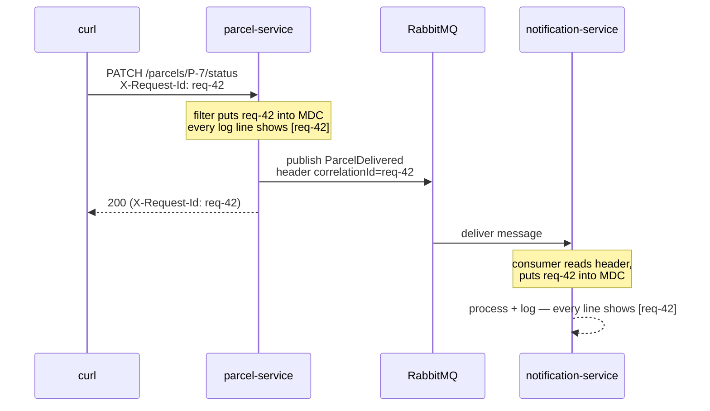

# Correlation IDs: one thread of identity across two services

Companion to [Step 14](README.md). You built the code in sub-step 3 of the README; this page explains why it looks that way. It grows out of the step-07 `RequestIdFilter` from the [logging lab](../07-logging-and-observability-basics/logging-lab.md).

> [!PICTURE]
> A customer hands in a parcel and gets a **ticket number**. The clerk writes the number on every form she fills in. When the parcel moves to the branch office, the number goes along on a sticker. Later, anyone can find every form about that parcel by searching for one number.

## The problem

One `PATCH /parcels/P-7/status` request now produces log lines in **two** services. Inside parcel-service, your step-07 filter stamps every line with a request ID from the `X-Request-Id` header (or a generated one) via MDC. But that ID lives in the MDC of *one JVM*. The moment the work crosses the broker, the ID stays behind — notification-service's lines carry no trace of which request caused them. Same logical operation, two services, **no shared thread of identity**. Grep-by-parcel-ID ([previous lab](reading-logs-across-services.md)) is a workaround; the real fix is making the ID travel *with the work*.

## Key words

| Word | Beginner meaning |
|---|---|
| **Correlation ID** | One ID for one logical operation, attached everywhere that operation goes. |
| **MDC** | The per-thread "sticky note" (step 07) that Logback prints on every log line. |
| **Message header** | Metadata attached to a message, separate from its payload. |
| **Propagation** | Passing the ID along at every boundary: HTTP → code → message → code. |

## The move: put the ID into the event

The correlation ID must ride inside the thing that crosses the boundary — the message. Two options: a **message header** (metadata, keeps the payload/contract clean — our choice) or a field in the event JSON (visible in the queue UI, but now it's part of the [contract](../13-split-services/service-contracts.md)).



## Where the three pieces live

| Piece | Where (from README sub-step 3) | What it does |
|---|---|---|
| Make the id | `RequestIdFilter` in parcel-service, `@Order(Ordered.HIGHEST_PRECEDENCE)` | Reads `X-Request-Id` or makes one up, puts it into the MDC as `requestId`, echoes it in the response |
| Carry the id | `RabbitNotifier` in parcel-service | Copies `MDC.get("requestId")` into the message header `correlationId` with a `MessagePostProcessor` |
| Restore the id | `ParcelDeliveredListener` in notification-service | Reads `@Header("correlationId")`, puts it into **its own** MDC, removes it in `finally` |

Both services print `[%X{requestId}]` in `logging.pattern.console`, so the restored id appears on every line.

The names are an informal contract between the two codebases: the header is called `correlationId`, the MDC key is `requestId`. Rename one side only and the thread of identity breaks without any error. The unit test `RabbitNotifierTest` guards the producer half.

## Proof: one curl, one grep, the whole story

Rebuild and restart (`docker compose up --build -d`), then send **one** request with a recognizable ID:

```bash
curl -s -X PATCH http://localhost:8080/parcels/P-7/status \
  -H 'X-Request-Id: req-42' \
  -H 'Content-Type: application/json' -d '{"status":"DELIVERED"}' > /dev/null

docker compose logs | grep req-42
```

Expected — every line of the operation, from both services, in order:

```text
parcel-service-1        | 18:52:03.114 INFO  [req-42] c.p.parcel.internal.RabbitNotifier : Published ParcelDelivered for P-7 (eventId 5f0c…)
parcel-service-1        | 18:52:03.131 INFO  [req-42] c.p.parcel.internal.ParcelController : Parcel P-7 status changed to DELIVERED
notification-service-1  | 18:52:03.209 INFO  [req-42] c.p.n.ParcelDeliveredListener : Received ParcelDelivered for P-7 (eventId 5f0c…)
notification-service-1  | 18:52:03.215 INFO  [req-42] c.p.n.ParcelDeliveredListener : notification sent for P-7 to Ava
```

That grep works even when ten other requests are interleaving, even for log lines that never mention a parcel ID. One ID, one operation, full story.

## Distributed tracing, in one paragraph

What you built by hand is the seed of **distributed tracing**. Grown-up systems use OpenTelemetry (and backends like Jaeger, Zipkin, or Tempo): every operation gets a **trace ID** (your correlation ID, standardized), each unit of work within it gets a **span** with timing, and libraries propagate the IDs automatically through HTTP headers and message headers — no hand-written filters. The result is a visual timeline per request across every service. Don't implement it here; only recognize that when you meet "traces" later, you already understand the core idea.

## Why do it? Pros and cons

| Pros | Cons |
|---|---|
| One grep reconstructs any operation across all services | Discipline required at **every** boundary — one publish or one consumer that forgets, and the thread of identity snaps |
| Works for lines with no business ID in them (errors, infrastructure) | Header names and MDC keys must match across codebases (an informal contract) |
| Clients can quote the `X-Request-Id` from a failed response in a bug report — instantly findable | MDC cleanup mistakes on reused threads stamp the *wrong* ID on later work |

## Check yourself

> [!CHECK]
> 1. Why can't the MDC of parcel-service be read by notification-service?
>    <details><summary>Answer</summary>The MDC lives in one thread of one JVM. notification-service is another program on another machine (container). Only what is inside the message crosses the broker, so the id must ride in the message.</details>
> 2. A request has no `X-Request-Id` header. What id do its log lines get?
>    <details><summary>Answer</summary>The filter makes one up (the first 8 characters of a random UUID) and sends it back in the <code>X-Request-Id</code> response header, so the caller can quote it in a bug report.</details>

## Next

- Logs answer "what happened" — for "how many, how fast" go to [metrics-intro.md](metrics-intro.md)
- Back to the step: [Step 14 README](README.md)
