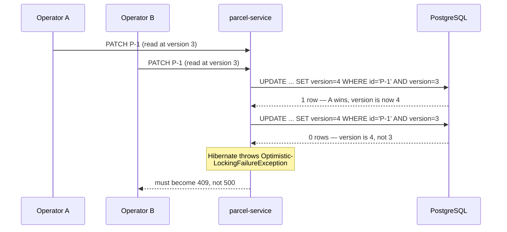

# Optimistic locking lab: when two operators race

Hands-on companion to [Step 15](README.md), sub-steps 4 and 5. Concepts (optimistic vs pessimistic, why we chose optimistic) are in [Locking explained](../10-persistence/locking-explained.md); this lab makes you *cause* a conflict and handle it like a client.

> [!PICTURE]
> Every parcel label carries a small **version number**. You fill in a change form and copy the number from the label. At the counter the clerk compares: if the label now shows a newer number, someone changed the parcel after you looked, and your form goes back to you.

## The problem

Two operators have parcel P-1 open; both screens say `CREATED`. Operator A marks it `PICKED_UP`. A minute later, operator B, still looking at the old screen, clicks `DELIVERED` because he thinks he is skipping a step. The state rule happily allows `PICKED_UP → DELIVERED`, so B's click **silently wins**: B decided based on a state that no longer existed. The database is consistent; B's *decision* was based on a lie. This is the **lost update**, and the whole point of this lab is turning "silent" into "loud": the loser must get a `409`, not a quiet victory.



## The `@Version` field: check it's still there

You added this in [step 10](../10-persistence/README.md) — verify it survived the step-13 move into parcel-service:

```java
@Entity
@Table(name = "parcels")
public class ParcelEntity {
    @Id
    private String id;
    // ...
    @Version
    private Long version;   // Hibernate checks + bumps this on every UPDATE
}
```

What Hibernate does with it: every `UPDATE` it generates gets `AND version = <the version you read>` in the `WHERE` clause, plus `SET version = version + 1`. If another transaction committed in between, the row's version no longer matches, the update touches **0 rows**, and Hibernate — knowing it should have touched exactly 1 — throws. No trigger, no manual check: the version column turns the race into an exception.

## The exception, and its 409

When the version does not match, Spring throws `ObjectOptimisticLockingFailureException`. In ParcelPilot that happens in two places:

1. **The explicit check** in `changeStatus` (README sub-step 5): the client sent `"version": 0`, but the label says `1`.
2. **`@Version` itself**: two requests both read version 0 at the same moment and both pass the check; the second `saveAndFlush` changes 0 rows and Hibernate throws.

You mapped this exception to `409 Conflict` with the code `VERSION_CONFLICT` back in [step 10](../10-persistence/README.md). `409` is right: the request was valid, but it clashes with the parcel's current state.

## Proof 1: a stale screen (always works)

```bash
curl -s -X POST http://localhost:8080/parcels \
  -H 'Content-Type: application/json' -d '{"id":"P-9","recipient":"Cleo"}'
# {"id":"P-9",...,"status":"CREATED","version":0}

# operator A, who saw version 0
curl -s -X PATCH http://localhost:8080/parcels/P-9/status \
  -H 'Content-Type: application/json' -d '{"status":"PICKED_UP","version":0}'
# {"id":"P-9",...,"status":"PICKED_UP","version":1}

# operator B, who ALSO saw version 0
curl -s -X PATCH http://localhost:8080/parcels/P-9/status \
  -H 'Content-Type: application/json' -d '{"status":"DELIVERED","version":0}'
```

Expected for B:

```json
{
  "code": "VERSION_CONFLICT",
  "message": "The parcel was changed by someone else. Reload and retry.",
  "details": {},
  "path": "/parcels/P-9/status"
}
```

The same check runs as the test `updateWithAnOldVersion_gets409` in [ParcelCacheAndLockTest](solution/parcel-service/src/test/java/com/parcelpilot/ParcelCacheAndLockTest.java).

## Proof 2: a real race (stretch)

Now leave out `version`, so only `@Version` can save you. Fire two requests at once with `&`:

```bash
curl -s -X POST http://localhost:8080/parcels \
  -H 'Content-Type: application/json' -d '{"id":"P-10","recipient":"Dan"}' > /dev/null

curl -s -o /dev/null -w "first:  %{http_code}\n" -X PATCH http://localhost:8080/parcels/P-10/status \
  -H 'Content-Type: application/json' -d '{"status":"PICKED_UP"}' &
curl -s -o /dev/null -w "second: %{http_code}\n" -X PATCH http://localhost:8080/parcels/P-10/status \
  -H 'Content-Type: application/json' -d '{"status":"PICKED_UP"}' &
wait
```

Expected: one `200`, one `409`. Races depend on timing. If the second request starts after the first finished, it reads `PICKED_UP` and fails the **state rule** instead (`"code": "INVALID_TRANSITION"`). To hit the `VERSION_CONFLICT` window on purpose, add a temporary `Thread.sleep(500)` between `load(id)` and `saveAndFlush` in `changeStatus`, rebuild, and run it again. Delete the sleep afterwards.

## The client's job on a 409

A `409` is not a dead end; it's an instruction. The client should: **re-read** the parcel (fresh state, fresh version), **reapply** its intended change if it still makes sense against the new state (maybe someone already did it, or the transition is no longer legal), and **retry** the request. Human-facing UIs usually surface it instead: "This parcel changed while you were editing — here's the latest state."

## Optimistic vs pessimistic under load

The full comparison lives in [Locking explained](../10-persistence/locking-explained.md); the one thing this lab adds is the *load* perspective. Optimistic locking costs nothing until a conflict actually happens — perfect while conflicts are rare, as parcel updates are. But if a single hot row were updated hundreds of times a second, most requests would lose the race, and the retry storm (read → 409 → re-read → 409 …) would burn more work than pessimistic waiting ever would. High contention is the one regime where "lock the row and make everyone queue" wins. ParcelPilot is nowhere near that; if it ever is, you'll see it in the metrics from [step 14](../14-compose-and-observe/metrics-intro.md) first.

## Check yourself

> [!CHECK]
> 1. Operator B's `DELIVERED` would pass the state rule. Why is it still refused?
>    <details><summary>Answer</summary>B sent <code>"version": 0</code>, but the parcel is at version 1 since A's change. B decided based on an old state, so the explicit check throws and the API answers <code>409 VERSION_CONFLICT</code>.</details>
> 2. What should a client do after a `409`?
>    <details><summary>Answer</summary>Read the parcel again (new state, new version), decide whether the change still makes sense, and if so retry with the new version. A UI shows the new state to the human.</details>
> 3. When would pessimistic locking win?
>    <details><summary>Answer</summary>Under high contention: when the same row is changed many times per second, most optimistic attempts would fail and retry. Making everyone wait in line is then cheaper.</details>

## Next

- The third tool of this step: [rate-limiting.md](rate-limiting.md)
- Back to the step: [Step 15 README](README.md)
- Concepts: [Locking explained](../10-persistence/locking-explained.md) · [Databases, caching, and locking](../../references/architecture/databases-caching-and-locking.md)
