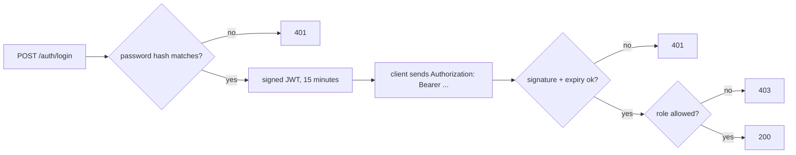

# Step 16: Password login and JWT protection

> [!PICTURE]
> At the depot gate, a guard checks your name and password **once**. Then he hands you a **stamped visitor badge**: your name, your role ("operator" or "customer"), and the time it stops working. The stamp proves the depot made the badge; nobody can draw one at home. Every door after that only looks at the badge. The badge is a **JWT**.

## The problem right now

Every endpoint is open. Anyone who can reach port 8080 can create parcels and mark them delivered. Changing parcels must be limited to a **logged-in operator**. Login comes last on purpose: it is security code, and it is easier to get right once you know the whole system.

## Key words

| Word | Beginner meaning |
|---|---|
| **Authentication** | Proving *who* you are (login). Fails with `401`. |
| **Authorization** | Deciding *what* you may do (your role). Fails with `403`. |
| **Password hash** | A slow, salted, one-way fingerprint of a password. The database stores only this. |
| **JWT** | JSON Web Token: a signed badge with **claims** like `sub` (who) and `role`. |
| **Bearer token** | The badge sent in the header `Authorization: Bearer <token>`. |
| **Signature** | The stamp: proof the token was made with our secret and not changed. |

The ideas are taught once, in the CS lessons [Passwords, MFA and passkeys](../../../computer-science/index.html#passwords-mfa-passkeys), [Tokens, JWT and OAuth](../../../computer-science/index.html#tokens-jwts-oauth) and [Roles and authorization](../../../computer-science/index.html#authorization-roles). The Spring checklist is [Password login and JWT](../../references/web-and-api/authentication.md).

**Hashing, encryption, encoding:** a **hash** is one-way (you cannot get the password back; you can only hash a typed password again and compare). **Encryption** can be reversed with a key. **Encoding** like Base64 is neither: anyone can decode it. That is why passwords are hashed, and why a JWT's content is readable by anyone who holds it: it is only encoded and signed, not encrypted.



## Build it in parcel-service (do this exactly)

The full files are in [solution/](solution/README.md). New classes go into the package `com.parcelpilot.auth`.

### 1. Dependencies

```xml
<dependency>
    <groupId>org.springframework.boot</groupId>
    <artifactId>spring-boot-starter-security</artifactId>
</dependency>
<dependency>   <!-- checks JWTs on every request -->
    <groupId>org.springframework.boot</groupId>
    <artifactId>spring-boot-starter-oauth2-resource-server</artifactId>
</dependency>
<dependency>   <!-- test helpers like jwt() -->
    <groupId>org.springframework.security</groupId>
    <artifactId>spring-security-test</artifactId>
    <scope>test</scope>
</dependency>
```

The moment Spring Security is on the classpath, **every** endpoint answers `401`. That is the safe default, not a bug. Sub-step 6 opens the doors you choose.

### 2. The signing secret

In `application.properties`:

```properties
# at least 32 characters for HS256; the default is for your laptop only
parcelpilot.jwt.secret=${JWT_SECRET:local-dev-only-secret-change-me-0123456789}
```

And in `compose.yaml`, under `parcel-service:` → `environment:`, add `JWT_SECRET: local-dev-only-secret-change-me-0123456789`. In a real deployment the secret comes from a secret store and never sits in Git.

### 3. Who may log in

Create `src/main/resources/db/migration/V4__create_operators.sql`:

```sql
CREATE TABLE operators (
    username      VARCHAR(64)  PRIMARY KEY,
    password_hash VARCHAR(100) NOT NULL,
    role          VARCHAR(32)  NOT NULL
);

-- Local practice users. Both passwords are "local-password". Never seed real accounts.
INSERT INTO operators (username, password_hash, role) VALUES
    ('operator', '$2a$10$ag/mhGSiF5yZwMFf/22vDemJ0wONGeoznPdASt4k7FhY2UXKe6sxu', 'OPERATOR'),
    ('ava',      '$2a$10$JIrG/WTcC2UbIjZGiCJqM.FsaDrThyt2.cdR2CgRvEHznlZ95SuiG', 'CUSTOMER');
```

Same password, two different hashes: each bcrypt hash has its own random **salt** inside (`$2a$10$` + salt + hash). To make a hash for another password, run `new BCryptPasswordEncoder().encode("…")` once in a throwaway test.

Read the table with `auth/OperatorRepository.java`:

```java
@Repository
public class OperatorRepository {

    public record Operator(String username, String passwordHash, String role) {}

    private final JdbcTemplate jdbc;

    public OperatorRepository(JdbcTemplate jdbc) {
        this.jdbc = jdbc;
    }

    public Optional<Operator> findByUsername(String username) {
        return jdbc.query("SELECT username, password_hash, role FROM operators WHERE username = ?",
                (row, n) -> new Operator(row.getString("username"), row.getString("password_hash"), row.getString("role")),
                username).stream().findFirst();
    }
}
```

### 4. Print the badge: `TokenService`

```java
@Service
public class TokenService {

    public static final Duration LIFETIME = Duration.ofMinutes(15);   // short-lived on purpose

    private final JwtEncoder encoder;

    public TokenService(JwtEncoder encoder) {
        this.encoder = encoder;
    }

    public String issue(String username, String role) {
        Instant now = Instant.now();
        JwtClaimsSet claims = JwtClaimsSet.builder()
                .issuer("parcelpilot")
                .subject(username)                 // who
                .claim("role", role)               // what they may do: from the DATABASE, never the request
                .issuedAt(now)
                .expiresAt(now.plus(LIFETIME))
                .build();
        JwsHeader header = JwsHeader.with(MacAlgorithm.HS256).build();
        return encoder.encode(JwtEncoderParameters.from(header, claims)).getTokenValue();
    }
}
```

All JWT types come from `org.springframework.security.oauth2.jwt` and `...oauth2.jose.jws.MacAlgorithm`. You never build or sign the token by hand.

### 5. The gate: `AuthController`

```java
@RestController
@RequestMapping("/auth")
public class AuthController {

    public record LoginRequest(@NotBlank String username, @NotBlank String password) {}
    public record LoginResponse(String accessToken, String tokenType, long expiresInSeconds) {}

    private final OperatorRepository operators;
    private final PasswordEncoder passwordEncoder;
    private final TokenService tokens;

    // constructor with the three fields (see the solution file)

    @PostMapping("/login")
    public ResponseEntity<?> login(@Valid @RequestBody LoginRequest request, HttpServletRequest http) {
        Optional<OperatorRepository.Operator> operator = operators.findByUsername(request.username());

        // matches() hashes the typed password with the stored salt and compares
        if (operator.isEmpty() || !passwordEncoder.matches(request.password(), operator.get().passwordHash())) {
            // the same answer for "unknown user" and "wrong password": do not help attackers guess names
            return ResponseEntity.status(HttpStatus.UNAUTHORIZED).body(new ErrorResponse(
                    "BAD_CREDENTIALS", "Wrong username or password", Map.of(), http.getRequestURI()));
        }
        String token = tokens.issue(operator.get().username(), operator.get().role());
        return ResponseEntity.ok(new LoginResponse(token, "Bearer", TokenService.LIFETIME.toSeconds()));
    }
}
```

Never log the password, and never put it in the token.

### 6. The door rules: `SecurityConfig`

```java
@Configuration
public class SecurityConfig {

    @Bean
    SecurityFilterChain api(HttpSecurity http) throws Exception {
        http
            .csrf(csrf -> csrf.disable())   // no cookies, only Bearer headers
            .sessionManagement(s -> s.sessionCreationPolicy(SessionCreationPolicy.STATELESS))
            .authorizeHttpRequests(auth -> auth           // first match wins
                .requestMatchers(HttpMethod.POST, "/auth/login").permitAll()
                .requestMatchers("/actuator/health/**").permitAll()
                .requestMatchers(HttpMethod.GET, "/parcels", "/parcels/**").permitAll()
                .requestMatchers(HttpMethod.POST, "/parcels").hasRole("OPERATOR")
                .requestMatchers(HttpMethod.PATCH, "/parcels/*/status").hasRole("OPERATOR")
                .anyRequest().authenticated())
            .oauth2ResourceServer(server -> server
                .jwt(jwt -> jwt.jwtAuthenticationConverter(rolesFromTheRoleClaim())));
        return http.build();
    }

    /** "role": "OPERATOR" in the token becomes the authority ROLE_OPERATOR, which hasRole("OPERATOR") checks. */
    private JwtAuthenticationConverter rolesFromTheRoleClaim() {
        JwtGrantedAuthoritiesConverter authorities = new JwtGrantedAuthoritiesConverter();
        authorities.setAuthoritiesClaimName("role");
        authorities.setAuthorityPrefix("ROLE_");
        JwtAuthenticationConverter converter = new JwtAuthenticationConverter();
        converter.setJwtGrantedAuthoritiesConverter(authorities);
        return converter;
    }

    @Bean
    SecretKey jwtSigningKey(@Value("${parcelpilot.jwt.secret}") String secret) {
        return new SecretKeySpec(secret.getBytes(StandardCharsets.UTF_8), "HmacSHA256");
    }

    @Bean
    JwtEncoder jwtEncoder(SecretKey jwtSigningKey) {   // stamps badges
        return new NimbusJwtEncoder(new ImmutableSecret<>(jwtSigningKey));
    }

    @Bean
    JwtDecoder jwtDecoder(SecretKey jwtSigningKey) {   // checks signature and expiry on every request
        return NimbusJwtDecoder.withSecretKey(jwtSigningKey).macAlgorithm(MacAlgorithm.HS256).build();
    }

    @Bean
    PasswordEncoder passwordEncoder() {                // bcrypt: slow on purpose, salted
        return new BCryptPasswordEncoder();
    }
}
```

Reading parcels stays public: a customer tracks a parcel without an account. Changing parcels needs the `OPERATOR` role. Why CSRF can be off for this API: [security troubleshooting](security-troubleshooting.md#csrf-surprise-on-post).

### 7. Tests

`src/test/java/com/parcelpilot/AuthFlowTest.java` climbs the whole ladder with MockMvc and real containers:

```java
@SpringBootTest(properties = "parcelpilot.rate-limit.per-minute=1000")
@AutoConfigureMockMvc
@Import(TestcontainersConfiguration.class)
class AuthFlowTest {

    @Autowired MockMvc mvc;
    @Autowired ObjectMapper json;
    @MockBean Notifier notifier;   // no RabbitMQ needed here

    @Test
    void readingStaysPublic_butChangingNeedsABadge() throws Exception {
        String operator = tokenFor("operator");
        createParcel("P-S1", operator);

        mvc.perform(get("/parcels/P-S1")).andExpect(status().isOk());              // no badge: fine for reading
        pickUp("P-S1", null).andExpect(status().isUnauthorized());                  // no badge: 401
        pickUp("P-S1", "not-a-real-token").andExpect(status().isUnauthorized());    // fake badge: 401
        pickUp("P-S1", tokenFor("ava")).andExpect(status().isForbidden());          // wrong role: 403
        pickUp("P-S1", operator).andExpect(status().isOk());                        // right badge: 200
    }
    // helpers tokenFor, createParcel, pickUp and a wrong-password test: see the solution file
}
```

Your step-15 `ParcelCacheAndLockTest` now gets `401` on every `POST` and `PATCH`. Give its requests a test badge with `spring-security-test`:

```java
import static org.springframework.security.test.web.servlet.request.SecurityMockMvcRequestPostProcessors.jwt;

mvc.perform(post("/parcels").with(jwt().authorities(new SimpleGrantedAuthority("ROLE_OPERATOR")))
        .contentType(MediaType.APPLICATION_JSON).content("{\"id\":\"P-C1\",\"recipient\":\"Ava\"}"));
```

Your step-08 `@WebMvcTest(ParcelController.class)` does not load `SecurityConfig` on its own; add `@Import(SecurityConfig.class)` to it and use the same `.with(jwt()...)` on its `POST` and `PATCH` requests.

## Test it

> [!TRY]
> 1. `mvn test`, then `docker compose up --build -d` in `applications/parcelpilot-services`.
> 2. Log in as the operator and keep the badge in a variable:
>    ```bash
>    TOKEN=$(curl -s -X POST http://localhost:8080/auth/login \
>      -H 'Content-Type: application/json' \
>      -d '{"username":"operator","password":"local-password"}' | jq -r .accessToken)
>    ```
> 3. Create a parcel **with** the badge: add `-H "Authorization: Bearer $TOKEN"` to the usual `POST /parcels` for `P-16`.
> 4. Try `PATCH /parcels/P-16/status` with `{"status":"PICKED_UP"}` three times: without a header, with a badge of `ava` (log in as `ava`), with `$TOKEN`.
> 5. Look at the database: `docker compose exec parcel-db psql -U parcelpilot -d parcelpilot -c "SELECT username, password_hash, role FROM operators;"`
>
> You should see `201` in step 3, then `401`, `403`, `200` in step 4, and in step 5 only `$2a$10$…` hashes, never `local-password`.

Decode your badge to see what anyone holding it can read: `echo "$TOKEN" | cut -d. -f2 | base64 -d 2>/dev/null; echo`. You see `sub`, `role`, `exp`, and no password.

## Go deeper (labs)

- [Authn vs authz lab](authz-vs-authn-lab.md): the `401`/`403` ladder, step by step, and the `ROLE_` trap.
- [Security troubleshooting](security-troubleshooting.md): symptom → cause → fix for every wall you can hit.

## Done when

- [ ] The `operators` table holds only bcrypt hashes.
- [ ] `POST /auth/login` returns a token for correct credentials and `401 BAD_CREDENTIALS` otherwise.
- [ ] `PATCH /parcels/{id}/status` returns `401` without a token, `403` with a `CUSTOMER` token, `200` with an `OPERATOR` token.
- [ ] `GET /parcels/{id}` still works without a token.
- [ ] `mvn test` is green, including `AuthFlowTest`.

## Check yourself

> [!CHECK]
> 1. When does the API answer `401`, and when `403`?
>    <details><summary>Answer</summary><code>401</code>: it cannot tell who you are (no token, a fake one, an expired one). <code>403</code>: it knows who you are, and your role may not do this.</details>
> 2. Why are passwords hashed and not encrypted?
>    <details><summary>Answer</summary>A hash cannot be turned back into the password, not even by us. If the database leaks, attackers get fingerprints, not passwords. Encryption can be reversed by whoever has the key.</details>
> 3. The role comes from the token. Why can't a customer change `"role":"CUSTOMER"` to `"OPERATOR"` in their token?
>    <details><summary>Answer</summary>The token is signed with our secret. Changing one character breaks the signature, so the decoder rejects the token with <code>401</code>.</details>
> 4. Why do tokens live only 15 minutes?
>    <details><summary>Answer</summary>A JWT cannot be taken back once issued. If one is stolen, or an operator loses the role, a short lifetime keeps the damage window small.</details>

## You finished the path

ParcelPilot grew from one Java class into an observable, secured system of two services, one problem at a time. Real systems add HTTPS, refresh tokens, brute-force protection and secret rotation; you now know enough to read about them safely in [Production thinking](../../references/operations/production-thinking.md) and the [architecture track](../../../architecture/index.html).
