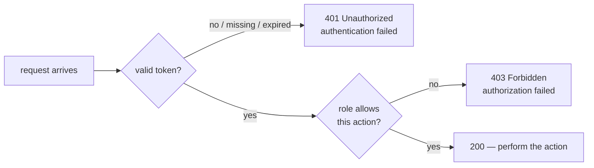
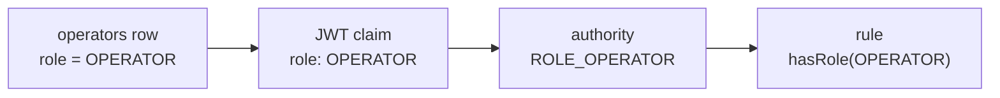

# Authn vs authz lab: who you are vs what you may do

Hands-on companion to [Step 16](README.md). Do it once the build works. The README already wired roles in; this lab makes you *see* the two halves of security separately, and break them on purpose.

> [!PICTURE]
> At the depot, the gate guard checks **who** you are and gives you a badge. Inside, each door has its own sign: "staff only". The badge says who you are; the sign decides whether that person may enter. A visitor with a perfect badge still cannot open a "staff only" door.

## The problem

Imagine the step-16 rules said `.anyRequest().authenticated()` and nothing more: no token, no `PATCH`. That answers **who** you are. But then *any* logged-in user could perform *any* protected action: `ava`, a customer who should only *read* her parcels, could mark parcels delivered all day. Knowing who someone is says nothing about what they may do. Those are two different questions.

## The two questions (hammer this in)

**Authentication (authn)** — *who are you?* Answered at login by verifying credentials. When the answer is "I can't tell": **`401 Unauthorized`**.

**Authorization (authz)** — *what may you do?* Answered on every request by checking the authenticated identity's roles against the endpoint's rule. When the answer is "you specifically may not": **`403 Forbidden`**.

This pair confuses everyone (not helped by `401`'s misleading official name "Unauthorized", which really means *unauthenticated*). Burn it in with the decision table:

| The server thinks… | Status | Example |
|---|---|---|
| "No idea who this is" (no token) | `401` | curl without an `Authorization` header |
| "Someone claims to be operator, but I can't verify it" (bad/expired token) | `401` | token signed with a different secret, or expired |
| "This is definitely user *ava* — and ava may not do this" | `403` | valid token, missing the required role |
| "This is operator, and operators may do this" | `200` | valid token with the right role |



Rule of thumb: **401 = fix your token. 403 = fix your permissions.**

## Key words

| Word | Beginner meaning |
|---|---|
| **Role** | A named bundle of permissions (`OPERATOR`, `CUSTOMER`) assigned to a user. |
| **Authority** | Spring Security's word for a single granted permission string. A role is an authority with a `ROLE_` prefix. |
| **Claim** | A fact inside the JWT — here, the role travels as a claim. |
| **`hasRole` / `hasAuthority`** | Spring's checks: `hasRole("OPERATOR")` matches authority `ROLE_OPERATOR`; `hasAuthority("ROLE_OPERATOR")` matches it literally. |

## Where the role lives in your code

Three places, all from the step-16 README. Follow the word `OPERATOR` through them:

1. **The database** (`V4__create_operators.sql`): the row for `operator` has `role = 'OPERATOR'`, the row for `ava` has `role = 'CUSTOMER'`.
2. **The token** (`TokenService.issue`): `.claim("role", role)`, with the role read from that row by `AuthController`. Never from the login request: anything the client sends outside the signature is the client grading their own homework.
3. **The check** (`SecurityConfig`): `rolesFromTheRoleClaim()` turns the claim `"role": "OPERATOR"` into the authority `ROLE_OPERATOR` (`setAuthoritiesClaimName("role")` + `setAuthorityPrefix("ROLE_")`), and `.hasRole("OPERATOR")` on the `PATCH` rule checks exactly that authority.



## Break it on purpose

> [!TRY]
> 1. In `SecurityConfig`, change `authorities.setAuthorityPrefix("ROLE_")` to `setAuthorityPrefix("")`. Restart and repeat proof step 3 below with the operator token.
> 2. You get `403`, although the token says `OPERATOR`. The authority is now `OPERATOR`, and `hasRole("OPERATOR")` looks for `ROLE_OPERATOR`.
> 3. Put the prefix back. `200` again.
>
> You should now be able to explain every `403` with a valid token by following the four boxes above.

## Proof: the three-status ladder

```bash
# 1. No token -> 401 (authentication fails: who are you?)
curl -s -o /dev/null -w "%{http_code}\n" -X PATCH http://localhost:8080/parcels/P-1/status \
  -H 'Content-Type: application/json' -d '{"status":"PICKED_UP"}'
# 401

# 2. Valid token, wrong role -> 403 (authenticated as ava; customers may not do this)
CUSTOMER_TOKEN=$(curl -s -X POST http://localhost:8080/auth/login \
  -H 'Content-Type: application/json' \
  -d '{"username":"ava","password":"local-password"}' | jq -r .accessToken)

curl -s -o /dev/null -w "%{http_code}\n" -X PATCH http://localhost:8080/parcels/P-1/status \
  -H "Authorization: Bearer $CUSTOMER_TOKEN" \
  -H 'Content-Type: application/json' -d '{"status":"PICKED_UP"}'
# 403

# 3. Valid token WITH the role -> 200
OPERATOR_TOKEN=$(curl -s -X POST http://localhost:8080/auth/login \
  -H 'Content-Type: application/json' \
  -d '{"username":"operator","password":"local-password"}' | jq -r .accessToken)

curl -s -o /dev/null -w "%{http_code}\n" -X PATCH http://localhost:8080/parcels/P-1/status \
  -H "Authorization: Bearer $OPERATOR_TOKEN" \
  -H 'Content-Type: application/json' -d '{"status":"PICKED_UP"}'
# 200
```

Same endpoint, same request body — three outcomes, decided entirely by *who* is asking and *what they may do*. `AuthFlowTest` in the [solution](solution/parcel-service/src/test/java/com/parcelpilot/AuthFlowTest.java) checks the same ladder on every `mvn test`.

**One honest note on the response bodies:** these `401`/`403`s are produced by Spring Security's filters, which run *before* your controllers — so the step-06 `GlobalErrorHandler` never sees them, and the bodies are empty: the reason is in the `WWW-Authenticate` response header (`curl -i` shows it), **not** in your `ErrorResponse` shape. Only the `401` from a wrong password has your shape (`BAD_CREDENTIALS`), because `AuthController` writes it. Wiring security failures into the shared error contract is possible (custom `AuthenticationEntryPoint` and `AccessDeniedHandler`) but is beyond this step; for now, know that the *status code* is the reliable part of the contract here.

## Common mistakes

- **The `ROLE_` prefix, both directions.** `hasRole("OPERATOR")` secretly means authority `ROLE_OPERATOR`. Two classic bugs: granting the authority without the prefix (`SimpleGrantedAuthority("OPERATOR")` — never matches `hasRole`), and writing `hasRole("ROLE_OPERATOR")` (Spring prepends the prefix again → `ROLE_ROLE_OPERATOR`). Pick a rule: claims store the bare name, the converter adds `ROLE_`, config uses `hasRole("OPERATOR")`.
- **Checking the role in controller code** (`if (!user.role().equals("OPERATOR")) return 403;`). It works — once. But the rule is now invisible to anyone reading the security config, duplicated in every method that needs it, and one forgotten `if` away from a hole. Authorization rules belong in one place: the filter chain (or method-level annotations like `@PreAuthorize`, same idea).
- **Reading the role from the request instead of the token.** The role must come from the *verified* JWT claim. Anything the client sends outside the signature (a header, a body field) is the client grading their own homework.

## Pros and cons: roles inside the JWT

| Pros | Cons |
|---|---|
| Self-contained: every request carries its permissions; no DB lookup to authorize | **Stale until expiry**: revoke someone's operator role and their existing token keeps working until `exp` — the flip side of statelessness |
| Works across services: any service holding the secret can authorize locally | Role changes require re-login (or short expiry + refresh tokens) |
| Simple to reason about: decode the token, see exactly what it grants | Fat permission lists bloat a token that rides on *every* request |

The staleness trade-off is the JWT revocation problem from the README's cons, wearing authorization clothes. Short expiry keeps the window small — exactly why ParcelPilot's tokens are short-lived.

## Check yourself

> [!CHECK]
> 1. `ava` logs in successfully and gets `403` on `PATCH`. Which question failed: authentication or authorization?
>    <details><summary>Answer</summary>Authorization. Authentication worked (her token is valid, the server knows it is ava); her role <code>CUSTOMER</code> may not change parcels.</details>
> 2. Why does `hasRole("ROLE_OPERATOR")` never match?
>    <details><summary>Answer</summary><code>hasRole</code> adds the prefix itself and looks for <code>ROLE_ROLE_OPERATOR</code>. Use <code>hasRole("OPERATOR")</code>, or <code>hasAuthority("ROLE_OPERATOR")</code>.</details>
> 3. You remove `operator`'s role in the database. Does their current token stop working?
>    <details><summary>Answer</summary>No, not until it expires (15 minutes). The role is inside the signed token. That is the price of stateless tokens, and why they are short-lived.</details>

## Next

- When any of this returns a status you didn't expect: [security-troubleshooting.md](security-troubleshooting.md)
- Concepts: [Password authentication and JWT](../../references/web-and-api/authentication.md)
- Back to the step: [Step 16 README](README.md)
