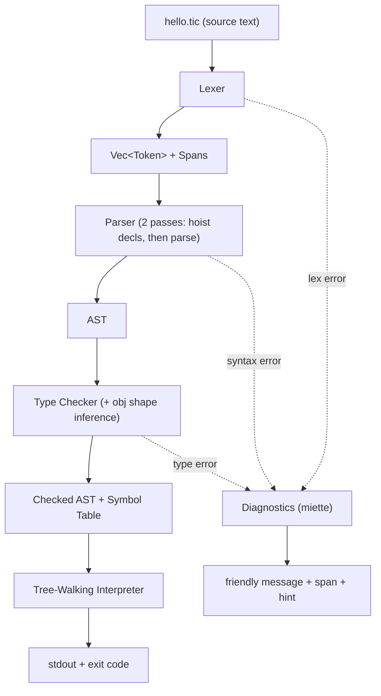
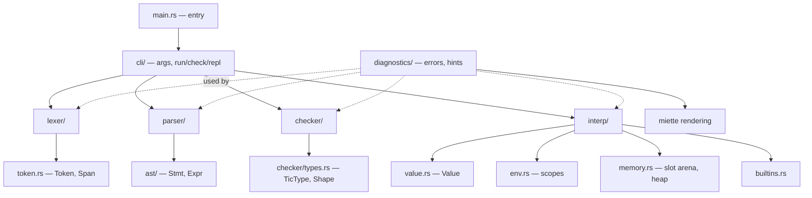
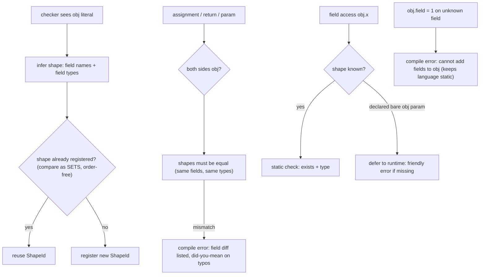
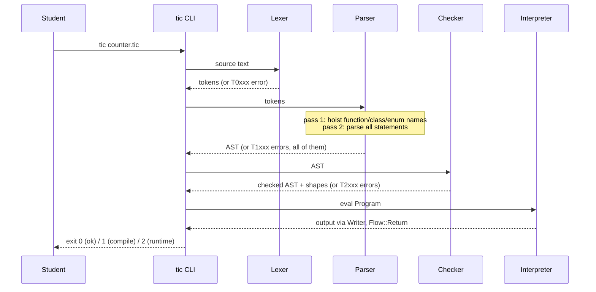
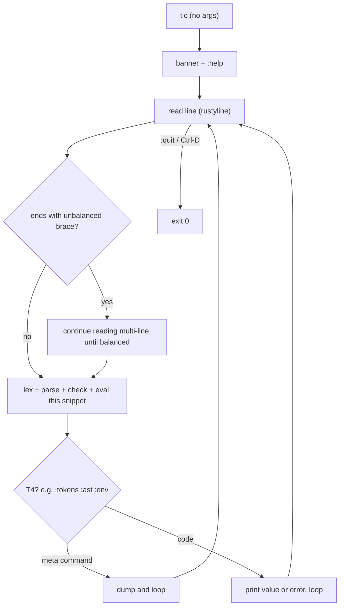
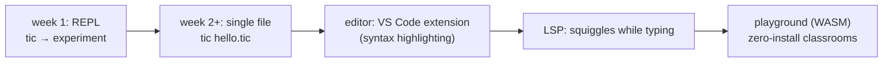
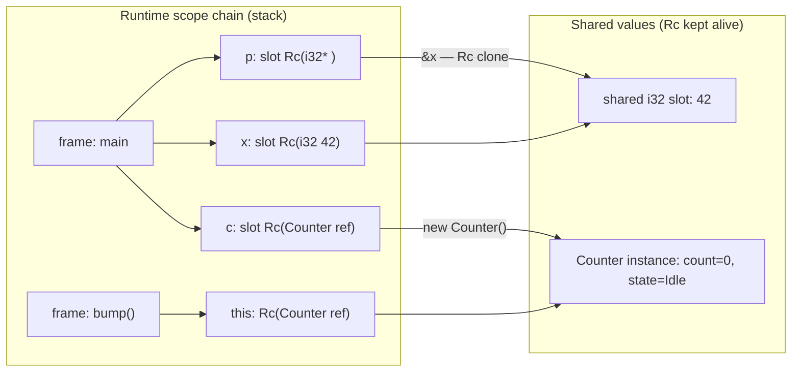

# Tic — Complete Build Plan

> **Tic** — a tiny, statically-typed, C-like teaching language.
> *"Teeny-C": everything students need to learn real CS fundamentals — types, memory, pointers, control flow, functions, classes — with zero undefined behavior and errors that actually teach.*
>
> Interpreter written in Rust. Script-style execution. Spec fits on one page.
>
> **Status: PLAN — nothing implemented yet.**

---

## Table of Contents

1. [Vision & Design Principles](#1-vision--design-principles)
2. [Language Specification (the one-pager)](#2-language-specification)
3. [Grammar (EBNF)](#3-grammar-ebnf)
4. [Architecture & Folder Structure](#4-architecture--folder-structure)
5. [Core Technical Designs](#5-core-technical-designs)
6. [Flows & Diagrams](#6-flows--diagrams)
7. [CLI Specification](#7-cli-specification)
8. [Example Programs](#8-example-programs)
9. [Testing Strategy](#9-testing-strategy)
10. [Implementation Roadmap (in order)](#10-implementation-roadmap)
11. [Future Roadmap (post-v1)](#11-future-roadmap-post-v1)
12. [Risks & Mitigations](#12-risks--mitigations)
13. [Dependencies](#13-dependencies)

---

## 1. Vision & Design Principles

| # | Principle | Consequence |
|---|-----------|-------------|
| P1 | **Never undefined behavior** | Overflow, out-of-bounds, null deref, div-by-zero → friendly runtime panic with line number. Students learn *why*, not memorize segfaults. |
| P2 | **Script feel, static spine** | No `main()` required; top-level code runs top-to-bottom (JS/Python feel). But fully statically type-checked *before* anything runs (C/Java spine). |
| P3 | **One page spec** | If a feature doesn't teach a CS concept, it's out. No classes-of-classes, no generics, no closures, no operator overloading. |
| P4 | **Errors are the teacher** | Every error: line/col, a label, a plain-language explanation, and a hint ("did you mean…?"). |
| P5 | **X-ray transparency** | `--tokens`, `--ast`, `--trace` let students *see* what a compiler is. The toolchain itself is a lesson. |
| P6 | **One binary, one command** | `tic hello.tic` runs. No build system, no SDK, no flags needed for day 1. |
| P7 | **Rust, no unsafe** | Tree-walking interpreter. Clarity of implementation over performance; optimization is a later chapter, not a goal. |

**Explicitly NOT in v1** (documented in README so students know what "real" languages add):
generics, closures/lambdas, operator overloading, exceptions, inheritance, interfaces, imports/modules, `match`, garbage-collector tuning, pointer arithmetic, concurrency.

---

## 2. Language Specification

### 2.1 Type system

| Type | Literal example | Zero value | Notes |
|------|----------------|------------|-------|
| `i8 i16 i32 i64` | `42` (int literals default to `i32`) | `0` | Arithmetic is width-checked; overflow panics with message. |
| `u8 u16 u32 u64` | via cast: `u8(200)` | `0` | Same rules, unsigned range. |
| `f32 f64` | `3.14` (float literals default `f64`) | `0.0` | Division `f / f` → float; `i / i` → integer division (teaching moment). |
| `bool` | `true`, `false` | `false` | Only type allowed in `if` / `while` conditions. |
| `char` | `'A'`, `'\n'` | `'\0'` | Single Unicode code point. Cast to `i32` shows the code. |
| `str` | `"hello"` | `""` | Immutable. `"a" + x` auto-converts `x` to str. |
| `T[N]` fixed array | `[1, 2, 3]` | all zeros | Size locked at creation. Bounds-checked. |
| `T[]` dynamic array | `[1, 2, 3]` | `[]` | Growable via `push`/`pop`/`insert`/`remove`. Passed by reference. |
| `obj` | `{ enabled: true, retries: 3 }` | — | JS-style bag with **inferred anonymous shape** (see 5.4). |
| `ClassName` | `new Counter(10)` | — | Heap instance, reference semantics, auto-managed (P1). |
| `EnumName` | `State.Idle` | first variant | Dotted access, `==` comparable. |
| `T*` pointer | `&x` | `null` | Explicit address-of, explicit deref. Null/dangling → runtime error. |

**No implicit numeric conversions.** `i32 + f64` is a compile error with a hint to cast. Exception: `str + anything` auto-converts (Java-style, starts from the string side only).

### 2.2 Keywords (complete list, 24)

```
function  class  enum  final  if  else  while  for  return
new  this  true  false  null
i8 i16 i32 i64 u8 u16 u32 u64 f32 f64 bool char str obj
```

Reserved for future: `match  import  delete  map  private  static`.

### 2.3 Operators & precedence (highest → lowest)

| Prec | Operators | Notes |
|------|-----------|-------|
| 1 (postfix) | `()` call · `[]` index · `.` field/method | |
| 2 (unary) | `!` `-` `&` address-of `*` deref | `*`/`&` valid only on pointer-compatible exprs |
| 3 | `*` `/` `%` | `i/i` integer division; `i%0` and `f/0.0` → runtime error |
| 4 | `+` `-` | `str` on the **left** side concatenates |
| 5 | `< > <= >=` | numerics + `char` only |
| 6 | `== !=` | primitives, str (content), enums, pointers (identity), references (identity) |
| 7 | `&&` | short-circuit |
| 8 (lowest) | `\|\|` | short-circuit |

Assignment (`= += -= *= /=`) is a **statement**, not an expression (`x = y = 5` is a compile error — removes a classic C confusion).

### 2.4 Statements

```
i32 x = 5;              // declaration + init
i32 y;                  // declaration, zero-init
final i32 MAX = 3;      // constant; reassignment = compile error
x = 10;  x += 1;        // assignment statements
if (cond) { } else if (cond) { } else { }   // parens & braces MANDATORY
while (cond) { }
for (i32 i = 0; i < n; i += 1) { }          // init; cond; update
return expr;  return;   // return type mandatory on functions
{ }                     // block scope
```

### 2.5 Built-in functions

| Builtin | Signature | Teaches |
|---------|-----------|---------|
| `print(a, b, …)` | any → prints space-separated + newline | output, `str()` conversion |
| `input(prompt) -> str` | | interactive I/O |
| `len(x)` | str, arrays → i32 | length vs. size |
| `push(arr, v)` / `pop(arr)` | dynamic arrays | amortized growth concept |
| `insert(arr, i, v)` / `remove(arr, i)` | dynamic arrays | O(n) shifting |
| `range(n)` / `range(a, b)` / `range(a, b, step)` | → `i32[]` | sequences |
| `size_of(T)` | any type → i32 (bytes) | memory layout! |
| `sqrt abs floor ceil pow min max` | numeric | math toolbox |
| `random(a, b) -> i32` | inclusive | nondeterminism |
| `copy(arr)` | shallow copy | reference vs. value semantics |

Casts are *syntax*, not builtins: `i32(2.7)`, `f64(3)`, `char(65)`, `i32('A')`, `str(42)`, `i32("123")` (parse; failure = runtime error with message).

### 2.6 Core semantic rules (the "checked" contract)

1. Integer arithmetic uses width-checked ops (`checked_add` + range clamp per declared width). Overflow → `runtime error: i8 overflow (127 + 1) at line N`.
2. Every array/object access bounds/shape-checked.
3. Deref of `null` → `runtime error: null pointer dereference at line N`.
4. `new` objects and dynamic arrays are reference-counted and never freed manually in v1; no use-after-free is possible. Chapter 2 (post-v1) adds explicit `delete` that turns use-after-free into a *teaching panic*.
5. Functions may recurse up to `--max-depth` (default 1000) → friendly "too much recursion" error instead of a native stack overflow.
6. Top-level code runs top-to-bottom after all declarations are collected (two-pass — see 5.2).
7. `final` violations, duplicate declarations, type mismatches, unknown fields — all **compile-time**.

---

## 3. Grammar (EBNF)

```ebnf
program        = { declaration | statement } ;

declaration    = function_decl | class_decl | enum_decl ;
function_decl  = "function" IDENT "(" [ params ] ")" "->" type block ;
params         = param { "," param } ;
param          = type IDENT ;
class_decl     = "class" IDENT "{" { field_decl | function_decl } "}" ;
field_decl     = type IDENT ";" ;
enum_decl      = "enum" IDENT "{" IDENT { "," IDENT } "}" ;

statement      = var_decl | final_decl | if_stmt | while_stmt | for_stmt
               | return_stmt | block | expr_or_assign_stmt | ";" ;

var_decl       = type IDENT [ "=" expr ] ";" ;
final_decl     = "final" type IDENT "=" expr ";" ;
if_stmt        = "if" "(" expr ")" block { "else" (if_stmt | block) } ;
while_stmt     = "while" "(" expr ")" block ;
for_stmt       = "for" "(" ( var_decl_no_semi | assign_no_semi | ";" )
                     ";" [ expr ] ";" [ assign_no_semi ] ")" block ;
return_stmt    = "return" [ expr ] ";" ;
expr_or_assign_stmt = expr ";" | lvalue assign_op expr ";" ;

block          = "{" { statement } "}" ;

(* Types — type-first everywhere: *)
type           = base_type { "[]" } | base_type "[" [ INT ] "]" | base_type "*" ;
base_type      = "i8"|"i16"|"i32"|"i64"|"u8"|"u16"|"u32"|"u64"
               | "f32"|"f64"|"bool"|"char"|"str"|"obj" | IDENT ;   (* class/enum name *)

(* Expressions — precedence encoded in the grammar: *)
expr           = or_expr ;
or_expr        = and_expr { "||" and_expr } ;
and_expr       = equality { "&&" equality } ;
equality       = comparison { ("=="|"!=") comparison } ;
comparison     = additive { ("<"|">"|"<="|">=") additive } ;
additive       = multiplicative { ("+"|"-") multiplicative } ;
multiplicative = unary { ("*"|"/"|"%") unary } ;
unary          = ("!"|"-"|"&"|"*") unary | postfix ;
postfix        = primary { "(" [ args ] ")" | "[" expr "]" | "." IDENT } ;
primary        = INT | FLOAT | CHAR | STRING | "true" | "false" | "null"
               | IDENT | "(" expr ")" | array_literal | obj_literal
               | cast | new_expr ;
array_literal  = "[" [ expr { "," expr } [ "," ] ] "]" ;
obj_literal    = "{" IDENT ":" expr { "," IDENT ":" expr } [ "," ] "}" ;
cast           = base_type "(" expr ")" ;          (* i32(x) — base types are keywords, so unambiguous *)
new_expr       = "new" IDENT "(" [ args ] ")" ;
lvalue         = IDENT | postfix "." IDENT | postfix "[" expr "]" | "*" unary ;
assign_op      = "=" | "+=" | "-=" | "*=" | "/=" ;
```

**Ambiguity resolutions (design decisions):**

| Ambiguity | Resolution |
|-----------|------------|
| `Counter c = …` (decl) vs `Counter;` (expr stmt) | Statement starting with `IDENT IDENT` → declaration. Parser consults the hoisted class/enum name set (available because declarations are collected first — the two-pass design pays off). |
| `i32(x)` cast vs `i32` type keyword | Base-type keywords followed by `(` → cast. |
| `*p = 5` deref-assign vs multiplication | Assignment statements are parsed structurally: try lvalue-first. |
| Dangling `else` | Braces mandatory → impossible. |

---

## 4. Architecture & Folder Structure

### 4.1 Pipeline



### 4.2 Module graph



### 4.3 Folder & file structure

```
tic/
├── Cargo.toml                  # single crate, edition 2021
├── README.md                   # the one-page spec + quickstart (student handout)
├── PLAN.md                     # this document (moves into the repo)
├── examples/                   # teaching pack, one concept per file
│   ├── 01_hello.tic
│   ├── 02_types_and_memory.tic
│   ├── 03_control_flow.tic
│   ├── 04_functions_recursion.tic
│   ├── 05_pointers.tic
│   ├── 06_arrays_sorting.tic
│   ├── 07_classes.tic
│   ├── 08_enums_and_obj.tic
│   └── 99_capstone.tic
├── src/
│   ├── main.rs                 # clap setup → dispatch to cli::
│   ├── lib.rs                  # re-exports; makes the crate testable as a library
│   ├── cli/
│   │   ├── mod.rs              # run / check / dispatch, exit codes
│   │   └── repl.rs             # interactive session
│   ├── lexer/
│   │   ├── mod.rs              # hand-rolled scanner
│   │   ├── token.rs            # TokenKind, Token, Span
│   │   └── keywords.rs         # keyword table
│   ├── ast/
│   │   ├── mod.rs              # Stmt/Expr enums, all nodes carry Span
│   │   └── display.rs          # pretty-printer for --ast
│   ├── parser/
│   │   ├── mod.rs              # recursive descent, two-pass
│   │   └── errors.rs           # parse-error helpers with hints
│   ├── checker/
│   │   ├── mod.rs              # static pass: types, final, decls, returns
│   │   ├── types.rs            # TicType, Shape (anonymous obj types)
│   │   └── scope.rs            # compile-time symbol table (scopes)
│   ├── interp/
│   │   ├── mod.rs              # eval(stmt)/eval(expr) — the interpreter
│   │   ├── value.rs            # Value enum
│   │   ├── env.rs              # runtime scope chain
│   │   ├── memory.rs           # slot arena (pointers), heap values
│   │   └── builtins.rs         # print, len, range, …
│   ├── diagnostics/
│   │   ├── mod.rs              # TicError enum → miette Diagnostic impls
│   │   └── hints.rs            # Levenshtein "did you mean"
│   └── util/
│       └── span.rs             # Span { start, end } byte offsets
└── tests/
    ├── integration/            # runs examples/*.tic, asserts stdout
    ├── errors/                 # programs that must fail + expected message
    └── repl.rs                 # scripted REPL sessions
```

### 4.4 Core data structures (signatures)

```rust
// token.rs
pub struct Span { pub start: usize, pub end: usize }          // byte offsets into source
pub enum TokenKind { Ident(String), Int(i64), Float(f64), Str(String), Char(char),
    // keywords: Function, Class, Enum, Final, If, Else, While, For, Return, New, This,
    // True, False, Null, and one variant per base type (TI32, F64, …)
    Plus, Minus, Star, Slash, Percent, Assign, PlusAssign, …,
    LParen, RParen, LBrace, RBrace, LBracket, RBracket, Comma, Semi, Dot, Arrow,
    Eof }
pub struct Token { pub kind: TokenKind, pub span: Span }

// ast/mod.rs (illustrative)
pub struct Program { pub decls: Vec<Decl>, pub stmts: Vec<Stmt> }
pub enum Stmt { VarDecl { ty: TicType, name: Ident, init: Option<Expr>, is_final: bool, span },
    Assign { target: Expr, op: AssignOp, value: Expr, span },
    If { cond: Expr, then: Block, els: Option<Block-or-If>, span },
    While { cond: Expr, body: Block, span },
    For { init: Option<Box<Stmt>>, cond: Option<Expr>, update: Vec<Stmt>, body: Block, span },
    Return { value: Option<Expr>, span }, Block(Block), ExprStmt(Expr, Span) }
pub enum Expr { IntLit, FloatLit, StrLit, CharLit, BoolLit, Null, Ident,
    Binary { op, lhs, rhs }, Unary { op, operand },
    Call { callee, args }, Index { obj, idx }, Field { obj, name },
    ArrayLit, ObjLit { fields: Vec<(Ident, Expr)> },
    Cast { ty: TicType, expr }, New { class: Ident, args },
    /* every variant carries Span */ }

// checker/types.rs
pub enum TicType { I8, I16, I32, I64, U8, U16, U32, U64, F32, F64, Bool, Char, Str,
    FixedArray(Box<TicType>, usize), DynArray(Box<TicType>),
    Obj(ShapeId),                       // inferred anonymous shape
    Class(Ident), Enum(Ident), Pointer(Box<TicType>), Null, Unit }
pub struct Shape { pub fields: BTreeMap<String, TicType> }    // order-insensitive equality

// interp/value.rs
pub enum Value { Int(i64, Width), Float(f64, Width), Bool(bool), Char(char), Str(Rc<String>),
    Array(Rc<RefCell<Vec<Value>>>, TicType),        // arrays & objects = reference semantics
    Object(Rc<RefCell<ObjData>>, ShapeId),
    Instance(Rc<RefCell<ClassInstance>>),
    EnumValue { enum_name: Ident, variant: Ident },
    Pointer(Rc<RefCell<Value>>),                    // points at a *slot*
    Null, Unit }

// interp/env.rs
pub struct Env { scopes: Vec<Scope> }   // push/pop blocks; vars are Rc<RefCell<Value>> slots
```

**The pointer trick:** `&x` clones the `Rc<RefCell<Value>>` slot that `x` lives in → `*p` reads/writes through it. A pointer outliving its scope stays valid (the slot is kept alive by the `Rc`) — no dangling, ever (P1). Chapter 2 `delete` will add refcount checks to *demonstrate* use-after-free safely.

---

## 5. Core Technical Designs

### 5.1 Lexer
- Hand-rolled scanner over `Vec<char>` (simpler offset math than bytes for a teaching codebase).
- Produces `Vec<Token>`; comments (`//`, `/* */`) skipped; max token length guards.
- Errors: unterminated string, unknown character `~`, invalid number `1.2.3` — each with span + hint.
- Number literals: `123` int, `1.5` float; `1_000` allowed for readability.

### 5.2 Parser — two passes, recursive descent
- **Pass 1 (scan-ahead):** tokenize once, then walk tokens collecting `function` / `class` / `enum` declarations into a name table (name → kind, arity for classes). This table is what lets (a) the parser disambiguate `Counter c = …` from expressions, and (b) students call functions defined later in the file.
- **Pass 2:** standard recursive descent per the EBNF, one function per grammar rule, Pratt-style precedence via grammar layering.
- Error recovery: on a statement-level error, record it, skip to the next `;` or `}`, continue parsing → students see **all** their errors in one run, not one at a time.
- Cap: max errors shown = 10, then "…and N more — fix these first".

### 5.3 Type checker
Single AST walk with a compile-time `Scope` stack. Responsibilities:

| Check | Rule |
|-------|------|
| Declarations | no duplicate names in a scope; `final` must be initialized; types match initializer |
| Binary ops | same-type operands (numeric pairs, `str + T`, `==` per 2.3); error shows both types + cast hint |
| Conditions | `if`/`while` condition must be `bool` |
| Calls | arity + param types; return type of every `return` matches the signature |
| Indexing | `[i32]` index on arrays; result type = element type |
| Field/method access | class → field table; `obj` → inferred shape |
| Enums | variant must exist; only same-enum `==` |
| Pointers | `&` only on lvalues; `*` only on pointers; no `T**` in v1 |
| Casts | only per the cast table; `i32("abc")` is *allowed* (runtime parse) |

### 5.4 `obj` shape inference (the TypeScript trick)



- A `function … -> obj` must return literals of **one consistent shape** (checker verifies all returns unify).
- Objects with identical field sets/types are mutually assignable — no nominal typing.
- Adding/removing fields after creation = compile error. This single rule is what keeps Tic static (documented in README).
- `obj` as a *declared parameter type* is the one dynamic escape hatch: fields checked at runtime with friendly errors. (v2 may add `map<str, any>` for fully-dynamic bags.)

### 5.5 Interpreter
- `fn eval_stmt(&mut self, stmt) -> Flow` where `Flow = Normal | Break?* | Return(Value)` (no break/continue in v1 — loops are simple; v2 candidate).
- `fn eval_expr(&mut self, expr) -> Result<Value, TicError>`.
- Arithmetic via `checked_*` + width range check → runtime errors carry spans (P1).
- Every `RefCell::borrow` failure (only possible via interpreter bug) is converted into a friendly internal error, never a Rust panic visible to students.
- `new` → allocate `Rc<RefCell<ClassInstance>>`; run `init` with `this` bound; reference semantics on assignment/argument passing.
- Output goes through a `Writer` trait (default: stdout) — this is the seam that later lets the WASM playground capture output.

### 5.6 Diagnostics (the teacher's voice)

Every error = `{ code, message, span, label, hint }`, rendered by `miette`:

```text
Error [T2003]: type mismatch
  ┌─ counter.tic:5:19 ─┐
  │
5 │     i32 x = "hello";
  │             ^^^^^^  this is a str, but you promised an i32
  │
  = hint: convert with i32("hello") — careful: it fails unless the text is a number
```

| Code family | Meaning |
|-------------|---------|
| `T0xxx` | lex errors |
| `T1xxx` | parse errors |
| `T2xxx` | type errors (checker) |
| `T3xxx` | runtime errors (overflow, bounds, null, div-by-zero, recursion depth) |
| `T4xxx` | REPL/CLI usage |

`hints.rs` implements Levenshtein-based "did you mean" for identifiers, fields, enum variants, and builtin names.

---

## 6. Flows & Diagrams

### 6.1 `tic run` flow (also: bare `tic file.tic`)



### 6.2 REPL flow



REPL state: declarations persist across lines (same `Env` + declaration table). A lone expression prints its value automatically (`> 1 + 2` → `3`).

### 6.3 Student journey



### 6.4 Memory model



---

## 7. CLI Specification

```text
tic <file>              check + run (the only command students need)
tic run <file>          same, explicit
tic check <file>        type-check only; prints nothing on success
tic --tokens <file>     dump token stream (x-ray)
tic --ast <file>        dump pretty-printed AST (x-ray)
tic --trace <file>      run + print variables after every statement (x-ray)
tic --max-depth <n>     recursion limit (default 1000)
tic                     REPL
tic --help / --version
```

Exit codes: `0` success · `1` compile errors (lex/parse/type) · `2` runtime error · `130` Ctrl-C.

Implementation: `clap` derive API in `cli/mod.rs`; single `dispatch()` returns `ExitCode`.

---

## 8. Example Programs (ship in `examples/`, used as tests)

### 8.1 `01_hello.tic`
```minic
// my first Tic program — no main() needed!
str name = "World";
print("Hello,", name + "!");
```
```text
$ tic examples/01_hello.tic
Hello, World!
```

### 8.2 `02_types_and_memory.tic`
```minic
print(size_of(i32), size_of(f64));   // 4 8

print(i32('A'));                     // 65  — chars are numbers
print(i32(2.7));                     // 2   — truncation, not rounding

i8 big = 127;
print(big + 1);                      // runtime error: i8 overflow (127 + 1)

i32 x = 42;
i32* p = &x;
print(*p);                           // 42
*p = 99;
print(x);                            // 99
```

### 8.3 `99_capstone.tic` (uses nearly everything)
```minic
final i32 MAX = 3;

enum State { Idle, Running, Done }

class Counter {
    i32 count;
    State state;

    function init() {
        this.count = 0;
        this.state = State.Idle;
    }

    function bump() -> bool {
        if (this.count >= MAX) {
            this.state = State.Done;
            return false;
        }
        this.count += 1;
        this.state = State.Running;
        return true;
    }
}

function double(i32 x) -> i32 {
    return x * 2;
}

// ---- top-level code: runs top to bottom ----
print("start");
print(double(21));                    // 42

Counter c = new Counter();
while (c.bump()) {
    print(c.count);                   // 1 2 3
}
print(c.state == State.Done);         // true

obj config = { retries: 3, enabled: true };
print(config.retries);                // 3
```

---

## 9. Testing Strategy

| Layer | Tool | What |
|-------|------|------|
| Unit | `#[cfg(test)]` per module | lexer tokens, parser AST shapes, checker accept/reject, shape unification |
| Integration | `tests/integration/` | run each `examples/*.tic`, assert exact stdout |
| Error tests | `tests/errors/` | each error-code example program must fail with the expected code + message snippet + exit code |
| Snapshot | plain text fixtures | `--tokens`/`--ast` dumps for one representative program |
| REPL | `tests/repl.rs` | scripted multi-line session incl. persistent declarations |
| CLI | exit codes | 0 / 1 / 2 mapping |

No external snapshot crate needed (plain file fixtures keep the dep tree tiny and the project readable for students). `cargo test` must be green before each phase is called done.

---

## 10. Implementation Roadmap

Each phase ends in a working, testable state. Ordered by dependency, sized for solo part-time work.

| Phase | Deliverable | Key files | Acceptance criteria | Est. size |
|-------|-------------|-----------|---------------------|-----------|
| **0. Scaffold** | crate + CLI skeleton + diagnostics plumbing | `Cargo.toml`, `main.rs`, `cli/`, `diagnostics/` | `tic --help` works; error rendering shows a fake error correctly | ~200 LOC |
| **1. Lexer** | full token stream | `lexer/*` | `--tokens` on all examples; unit tests for every token kind + 5 error cases | ~400 |
| **2. Parser** | AST + two-pass hoisting | `parser/*`, `ast/*` | `--ast` dump of capstone; error recovery shows ≥2 errors in one run; ambiguity unit tests (decl-vs-expr, cast) | ~900 |
| **3. Checker** | full static pass + obj shapes | `checker/*` | all T2xxx tests; capstone type-checks; 30+ reject-cases pass | ~700 |
| **4. Interpreter core** | scalars, control flow, functions, recursion, top-level execution | `interp/mod.rs`, `env.rs`, `value.rs` | 01/03/04 examples run exactly right; overflow + depth-limit tests pass | ~700 |
| **5. Memory** | arrays (fixed+dynamic), pointers, checked ops, builtins | `memory.rs`, `builtins.rs` | 02/06 examples; null/bounds/overflow runtime tests; pointer-to-outlived-local stays safe | ~600 |
| **6. Classes & enums** | `class`, `new`, `this`, `init`, enum values | `interp/` + checker extensions | 07/08 examples; reference-semantics tests (aliasing visible) | ~400 |
| **7. Diagnostics polish** | did-you-mean, multi-error output, error docs | `diagnostics/*` | every error has code+hint; snapshot tests of rendered output | ~300 |
| **8. REPL** | interactive mode | `cli/repl.rs` | multi-line input, persistent state, `:tokens :ast :env :quit`; scripted test green | ~300 |
| **9. Teaching pack** | examples + README spec + PLAN in repo | `examples/`, `README.md` | all examples double as integration tests; README spec fits one page | ~200 |
| **MVP done** | | | **≈ 4,700 LOC + tests** | **~2–4 weeks part-time** |

**Build order is strict:** lexer → parser → checker → interpreter → memory → classes. Each later phase consumes only stable interfaces from earlier ones.

---

## 11. Future Roadmap (post-v1)

| When | Feature | Technical note |
|------|---------|----------------|
| Chapter 2 | `delete` + use-after-free *teaching* panics | refcount the slots; freeing sets a poisoned flag; access → `T3xxx` error explaining the bug |
| Chapter 3 | `break`/`continue`, `match` on enums | new Stmt variants; `match` = exhaustive enum switch |
| Editor | VS Code extension (TextMate grammar) | one afternoon; ships in the repo `editors/vscode/` |
| Editor | LSP (`tower-lsp`) | diagnostics on open/change, hover shows inferred types & shapes |
| Classroom | WASM playground (`wasm-bindgen` + `wasm-pack`) | `Writer` trait output already routes to the browser; CodeMirror editor; shareable permalinks |
| v2 ideas | `map<str, any>`, string methods, struct methods on `obj` shapes, simple bytecode VM | VM replaces tree-walk for a 10–100× speedup — itself a great advanced lesson |

---

## 12. Risks & Mitigations

| Risk | Mitigation |
|------|------------|
| Deep recursion overflows the Rust stack | Tic-level depth cap (default 1000, `--max-depth`); friendly error |
| `RefCell` double-borrow panic surfacing to students | central `borrow_slot()` helper → maps to friendly internal-error with issue pointer |
| Parser ambiguity (decl vs expr) | solved structurally: keyword types + two-pass hoisted name table (see §3) |
| Scope creep ("just one more feature") | P3 one-page rule; v1 feature list is **frozen** (this doc) |
| Error messages drift from tests | error snapshot tests are part of the definition of done per phase |
| Students hitting float precision confusion | planned lesson in README ("why 0.1 + 0.2 ≠ 0.3") — a feature, not a bug |

---

## 13. Dependencies

```toml
[dependencies]
clap    = { version = "4", features = ["derive"] }  # CLI
miette  = { version = "7", features = ["fancy"] }   # diagnostics rendering
rustyline = "14"                                    # REPL (phase 8)

[profile.release]
lto = true                                          # small fast binary for students
```

Everything else is hand-rolled **on purpose** — the codebase itself should be readable by a curious student.

---

*End of plan. Next step on approval: Phase 0 + Phase 1 (scaffold + lexer).*
